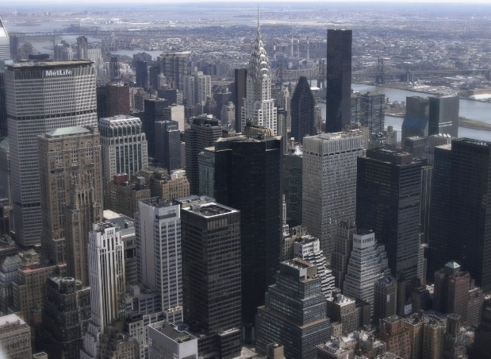

New York City has undertaken a number of [significant rezoning efforts](/final-review-blog/historic-zoning-changes-new-york-city-zoning-for-quality-and-affordability/) in recent years. The latest change received City Council [approval](http://legistar.council.nyc.gov/LegislationDetail.aspx?ID=3112385&GUID=561EC80B-6FBD-4B53-9129-A518CEDBBFCE&Options=ID%7CText%7C&Search=midtown+east) on August 9, 2017, the rezoning of a section of Midtown Manhattan known as East Midtown.The amendment of the Zoning Resolution of the City of New York is intended to encourage development in a major business center. The inability to construct larger-scale office towers has slowed growth in East Midtown. Rezoning the area to encourage development while accounting for the needs of different stakeholders has been a number of years in the making.

History of the Zoning Text Amendment

Daniel Garodnick, the New York City Council member who represents the area covered by the rezoning, and other City representatives stated in a recent Daily News [opinion piece](http://www.nydailynews.com/opinion/sun-rises-east-midtown-article-1.3394842) that East Midtown, once a major force in the City’s economy due to the Fortune 500 companies that called the area home, is seeing these businesses leave the area responsible for 10 percent of New York City’s tax base. “East Midtown’s office buildings are 75 years old on average, and have become increasingly out of date and inefficient for today’s companies.” Similarly, East Midtown’s subways and streets, critical to providing access to the area, need updating.

Work on East Midtown’s rezoning began during Mayor Bloomberg’s administration, and the Department of City Planning (DCP) put forth a [proposal](https://www1.nyc.gov/assets/planning/download/pdf/plans/east-midtown/east_midtown.pdf) in 2013. However, these zoning amendments did not move forward due to insufficient support, in part, due to the view that the draft amendments were too focused on the needs of real estate developers. A [zoning amendment](https://www1.nyc.gov/assets/planning/download/pdf/about/cpc/150127.pdf) for a subsection of the East Midtown district, known as the Vanderbilt Corridor, was approved in 2015.

To ensure a zoning amendment for the larger East Midtown area that represented diverse interests, including those of the local community and historic landmarks, an [East Midtown Steering Committee](http://manhattanbp.nyc.gov/html/land_use/east-midtown-report.shtml) was established in 2014 and worked on the rezoning effort which culminated in a [report](https://www1.nyc.gov/assets/planning/download/pdf/plans-studies/greater-east-midtown/greater-east-midtown-steering-report.pdf). The East Midtown Steering Committee recommended balancing higher density development and modern office high-rises with a commitment to upgrade “transportation networks and public open spaces.” Additionally, the committee advocated for steps to protect area historic structures.

The review process for the rezoning began in January 2017 which provided opportunities for the public to review draft proposals. The City Planning Commission approved the text amendment with some changes on June 7, 2017, and the [East Midtown Text Amendment](https://www1.nyc.gov/assets/planning/download/pdf/plans-studies/greater-east-midtown/approved-text-amendment-cc-mods.pdf) (Text Amendment) with modifications received the full City Council’s approval on August 9, 2017.

## Key Provisions of the East Midtown Zoning Text Amendment

The Text Amendment creates an East Midtown Subdistrict located from Madison and Third Avenues and 39th to 57th Streets. The East Midtown Subdistrict also contains six Subareas that have some special regulations: (1) Grand Central Transit Improvement Zone Subarea; (2) Northern Subarea; (3) Other Transit Improvement Zone Subarea; (4) Park Avenue Subarea; (5) Southern Subarea; and (6) Vanderbilt Corridor Subarea. There is also a Grand Central Core Area comprised of the Vanderbilt Corridor, the Grand Central Transit Improvement Zone, and part of the Other Transit Improvement Zone.

The Text Amendment allows increased floor to area ratios (FAR) for East Midtown to incentivize development. In order for new buildings in parts of the Subdistrict to receive FAR bonuses, they must undertake a transit improvement that is found on the Priority Improvement List provided in the Text Amendment. Bonuses are also available for certain sites that develop a public concourse, public plaza, or subway station improvement.

Landmarks in the East Midtown Subdistrict designated by the Landmarks Preservation Commission may transfer development rights - air rights - to purchasers to create more opportunities for new construction. However, for these transfers of development rights to be approved, certain contingencies must be met to assure landmark preservation and area improvements such as the development of public amenities.

For Subdistrict commercial buildings built before 1961 with non-complying FAR, specific provisions apply to the reconstruction of such spaces when the FAR is retained. However, such reconstructed pre-1961 buildings no longer need to keep 25 percent of the current building as required before the Text Amendment.

The Text Amendment creates a Public Realm Improvement Fund to be used for upgrades in the East Midtown Subdistrict. Contributions must be made to the fund when there is a transfer of landmark development rights or the retention of the existing FAR during reconstruction of a pre-1961 non-complying commercial building.

There are specific height and setback requirements for buildings in the Grand Central Core Area as well as other area specific requirements. Depending on a site’s location in the East Midtown Subdistrict, there are new requirements to develop street walls, sidewalk widenings, and mass transit access. The Text Amendment also contains special provisions to control the development of hotels in the Subdistrict and assure that hotels support the Subdistrict’s needs as an office area and preserve the area’s character.

The part of East Midtown located east of Third Avenue between 46th and 51st Streets is exempt from the new provisions in order to preserve the residential character of these blocks. 

Looking to the Future

We hope the East Midtown rezoning will result in the area’s much-needed revitalization. According to Mayor de Blasio’s [press release](http://www1.nyc.gov/office-of-the-mayor/news/544-17/mayor-de-blasio-council-member-garodnick-adoption-greater-east-midtown-rezoning) announcing the East Midtown zoning amendment,“\[t\]he zoning framework will generate 6.8 million square feet in new commercial office space over the next 20 years, along with an additional 6.6 million square feet of older office space that will be upgraded.”
