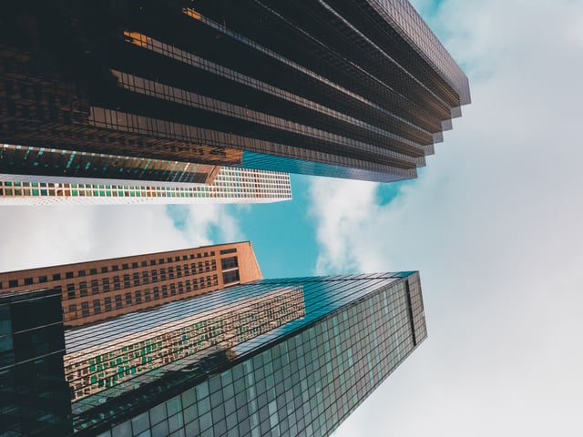

Rooftop solar, now ubiquitous in many areas throughout the world, plays an increasing role in both commercial and residential energy generation and storage. While it has a history of implementation in countries such as Germany and Australia, there has been an influx in smaller rooftop installations throughout the world. As of 2015, 20 percent of all photovoltaic (PV) capacity worldwide is smaller-scale, rooftop panel installations.

Part of the Electricity Generation sector, rooftop solar ranks #10 in [Project Drawdown](https://www.drawdown.org/solutions/electricity-generation/rooftop-solar)’s list of solutions for fighting global warming. If implemented according to their scenario results, growth from .4 percent to 7 percent of worldwide rooftop solar energy generation will net a 24.6 gigatons reduction in carbon dioxide emissions and save $3.4 trillion dollars in home energy costs by 2050. 

<em>image by [Simon Shim](https://unsplash.com/photos/dHb_53Oefbg)</em>

Rooftop solar continues to grow as the cost of solar panels falls but installation costs still remain high. Despite these costs, small-scale panels have advantages beyond price. They provide communities without access to existing power grids to generate and store electricity as well as harness an unlimited energy source, and have significant implications for urban resilience.

In this post, we’ll explore the history of rooftop solar, how New York City implements solar installation, and next week how solar installations are spreading across the world through the lens of Project Drawdown’s analysis. 

## History of Solar Cells, Photovoltaic Systems

Solar energy is “the most abundant energy source on earth,” [according to the National Oceanic and Atmospheric Administration](https://sos.noaa.gov/datasets/energy-on-a-sphere/) (NOAA), as “173,000 terawatts of solar energy strikes the earth continually.” It outranks all other renewable energy sources in potential energy production.

The [United States Department of Energ](https://www1.eere.energy.gov/solar/pdfs/solar_timeline.pdf)y states that use of solar energy has been ongoing since the 7th century B.C. Civilizations have used mirrors, magnifying glasses, and sun rooms to heat buildings or for combustion reactions. In 1767, Swiss scientist Horace de Saussure created the first solar collector for cooking use which spurred interest in energy-generating technology. Willoughby Smith discovered that selenium was photoconductive in 1873, leading to the development of the first solar cell in 1883.

In 1884, Charles Fritts installed the first solar array on a New York City rooftop, beginning the history of solar installations in New York City and ushering in an alternative to coal energy. The first major implementation effort for solar energy took place in 1947 as a response to energy scarcity during WWII, and Bell Telephone Laboratories developed the first silicon photovoltaic cell in 1954. Present systems still use silicon cells for power generation in both large and small-scale systems, including New York City’s own solar programs.

## New York Provides Incentives for Solar Installations

New York City, the site of the first rooftop installation, has a robust rooftop solar program. Including both residential and commercial buildings, rooftop PV systems provide buildings with a renewable energy source and, increasingly, the opportunity to store solar energy.

The [New York Solar Map](https://nysolarmap.com/) details the statistics of solar installations throughout New York state (NYS), including the amount of solar radiation for a particular address, the installed capacity of PV systems, and statistics for systems in towns and cities across the state. As of 2018, NYS has 81,709 existing installations and over 9,000 in progress systems. The majority of these are residential, rooftop installations, with a record high of over 20,000 installations in 2015. The cost of residential solar systems fell from $6.67 per watt in 2010 to $3.91 in 2018, and residential solar panels will only continue to become more accessible.

Increasingly, policy has focused on the potential for solar storage. In a previous post, we [discussed](/final-review-blog/new-york-state-changes-to-increase-energy-efficiency-and-energy-storage/) New York’s Clean Energy Jobs and Climate Agenda that included a variety of initiatives to fight climate change. One of these initiative includes the aggressive expansion of energy storage capabilities to 1,500 megawatts by 2025. Though this does not limited to solar storage, storing solar power expands the potential savings of rooftop solar by providing access to energy on-demand at the site of generation.

[Energy storage technologies](https://nysolarmap.com/solarplusstorage/storage-101/), including but not limited to batteries, can provide backup power and contribute to the resiliency of urban power systems when combined with distribution systems. The [New York Solar Smart DG Hub-Resilient Solar Project](/final-review-blog/the-economic-and-resiliency-value-of-pairing-solar-and-storage-new-york-city/), an initiative of the City University of New York, advocates for the a more resilient New York City energy system. Current backup generation capacity for New York’s critical infrastructure is insufficient, and generating and storing solar energy successfully can help create a system more adaptable in times of crisis. The Resilient Storage Project, backed by the U.S. Department of Energy and CUNY, supports these efforts through retrofitting of existing systems with battery storage technology and the creation of the NYS Solar Map.

New York City offers a variety of incentives for both commercial and residential installations. Residential installations may be eligible for federal tax credits, and NYS offers the [NY-Sun Initiative](https://nysolarmap.com/financing-solar/incentives/residential/) and tax credits, New York City residents who install a grid-connected system are eligible for a four-year property tax abatement. Similar commercial incentives are available, addressing some of the installation cost issues raised by Project Drawdown’s examination of rooftop solar.

Both the city and state programs illustrate how an interconnected network of solar installations, including both small-scale and large-scale networks, can both reduce reliance on fossil fuels and other non-renewable energy sources and contribute to resiliency planning.

## New York City Legislation Could Prioritize Green and Solar Roofs

A bill before the New York City Council could mandate many environmentally-focused features including solar rooftops, [green roofs](/final-review-blog/project-drawdown-green-roofs-mandates-denver/), and or wind turbines on new construction in New York.

According to the text provided by the New York City Council, the [bill](http://legistar.council.nyc.gov/LegislationDetail.aspx?ID=3557657&GUID=B4C3A822-2FBB-45FD-8A74-C59DD95246C1&Options=ID%7CText%7C&Search=1032) would require the following:

"The rooftops of buildings or structures in occupancy groups B, I-4, M, or S-2, as defined in section BC 302 of the New York city building code, be covered in plants (known as “green roofs”), solar panels, small wind turbines or a combination of all three. This legislation promotes energy efficient building practices, as green roofs filter pollutants and add agricultural space, solar roofs encourage renewable energy generation and reduce air pollution and small wind turbines generate heat and electric power in an environmentally conscious manner.”

While currently in committee, the [amendment](https://www.nytimes.com/2018/07/18/nyregion/new-york-today-will-green-roofs-get-the-green-light.html?smprod=nytcore-ipad&smid=nytcore-ipad-share) would apply to commercial buildings including offices and industrial spaces, and a separate bill would apply to residential and institutional uses. If passed, the law would echo similar mandates in [Denver](/final-review-blog/project-drawdown-green-roofs-mandates-denver/) and San Francisco, and make NYC’s policies in line with some of the most stringent green roof requirements.

Next week, we’ll take a look at the global impacts of rooftop solar and explore more of Drawdown’s analysis of the ever-growing solar energy sector.

<em>This blog post is part of Burnham Nationwide’s [Drawdown Series](/final-review-blog/burnham-nationwides-climate-change-drawdown-series/).</em>

Did the NYC green/solar roof mandate described in this post ever pass? Yes — what this post describes as pending in committee became Local Law 92 and Local Law 94 of 2019, requiring most new buildings and major rooftop renovations to include either a green roof or solar panels (or both) on qualifying roof areas. This made NYC one of the largest cities in the U.S. to mandate sustainable roofing for new construction. How much has rooftop solar installation grown in New York State since this post? Dramatically — NYS had roughly 81,000 installations in 2018 as this post notes; by 2025 that figure exceeded 400,000 residential solar installations statewide, reflecting both continued cost declines and the NY-Sun Initiative's ongoing incentive structure. Is NYC's property tax abatement for solar installations still available? Yes — the NYC Solar Property Tax Abatement was extended through January 1, 2035, offering 30% of installed system costs back over four years (7.5% annually), capped at $62,500 per year or actual tax liability, whichever is lower. Did New York reach its 1,500 megawatt energy storage target by 2025? New York significantly expanded its ambition before the deadline — the state increased its storage target to 6,000 megawatts by 2030, having met and exceeded the original 1,500 MW goal ahead of schedule, reflecting the rapid drop in battery storage costs since this post was written. How much has the cost of residential solar fallen since the 2018 figures in this post? The $3.91 per watt figure cited in this post has continued declining — U.S. residential solar averaged approximately $2.50–2.80 per watt installed in 2025, though New York City's specific soft costs (permitting complexity, high labor costs) keep NYC's per-watt costs somewhat above the national average.
