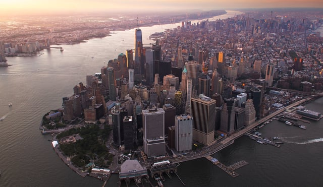

New York has been at the forefront of state-level work to combat climate change. Recently undertaken initiatives and regulatory changes are part of the state’s aggressive push to increase sustainability and transform the electrical grid. Programs to deploy more energy storage and improve buildings’ energy efficiency are among the 2018 developments in New York State.

<em>Photo by [Brandon Jacoby](https://unsplash.com/@jacobybrandon)</em>

Governor Sets New Goals

During his [2018 State of the State: New York’s Clean Energy Jobs and Climate Agenda](https://www.governor.ny.gov/news/governor-cuomo-unveils-20th-proposal-2018-state-state-new-yorks-clean-energy-jobs-and-climate), New York Governor Cuomo announced a variety of initiatives to fight climate change. These included a goal to aggressively expand energy storage in the state to 1,500 megawatts by 2025. State agencies are to develop a broad spectrum of energy storage projects, such as changes in both the regulatory and procurement processes, to foster the adoption of energy storage.

To support this goal, the Governor proposed that the NY Green Bank, the New York State Energy Research and Development Authority (NYSERDA) division that works on private investment in the state’s clean energy market, commit a minimum of $200 million in energy storage investments to decrease costs and assure that storage is strategically implemented.

The Governor also called for NYSERDA to spend $60 million on energy storage pilots and other programs to remove barriers to energy storage adoption.

In the 2018 State of the State address, the Governor also directed the New York Department of Public Service and NYSERDA to develop by Earth Day, April 22, 2018, an ambitious initiative to achieve a new energy efficiency target by 2025.

The new energy efficiency initiative was [announced on April 20, 2018](https://www.governor.ny.gov/news/governor-cuomo-announces-new-energy-efficiency-target-cut-greenhouse-gas-emissions-and-combat). The plan is to provide building improvement incentives to reduce energy consumption by 185 trillion British Thermal Units across building sectors by 2025. According to the press release, the new target will help the state, “deliver nearly one third of the greenhouse gas emissions reductions needed to meet New York’s climate goal of 40 percent reduction by 2030.”

 Public Service Commission Decisions

New York State’s Public Service Commission (PSC) embarked on the Reforming the Energy Vision (REV) initiative in 2014 to redesign the state’s electricity distribution system and create more competitive electricity markets. The major goals of the REV initiative are to reduce greenhouse gas emissions and increase the electrical grid’s resiliency and sustainability. As part of REV, the PSC is continuing to adopt a broad spectrum of regulatory changes.

On April 19, 2018, the PSC updated the state’s [Standardized Interconnection Requirements](http://documents.dps.ny.gov/public/MatterManagement/CaseMaster.aspx?MatterCaseNo=18-E-0018&submit=Search) (SIR) for distributed generation providers, including those using renewable energy and energy storage systems (DSS), to connect to the electrical distribution system. The updated rules allow for the interconnection of a DSS of up to 5 MW (stand-alone or hybrid projects). This is in keeping with the state’s goal to increase energy storage.

The PSC also revised the distributed generation application and contract requirements to create a more efficient interconnection process. This encourages more renewable energy to come online.

The same day, the PSC approved the utility NYSEG’s plan to pilot an Energy Smart Community project that uses a real-time electrical rate option for about 12,000 customers and employs an advanced metering infrastructure. By allowing the use of different rates for on-peak and off-peak (2.5 times less than on-peak) electrical usage, the program will hopefully encourage customers to shift their energy usage which makes more efficient use of the grid.

The PSC also [approved](http://documents.dps.ny.gov/public/MatterManagement/CaseMaster.aspx?Mattercaseno=17-M-0315) NYSERDA’s creation of the Utility Energy Registry. The registry, an online platform, would provide public access to utility’s aggregated customer-load data for electricity and natural gas. The availability of this information is critical for research and will support energy-related planning to increase efficiency and the use of cleaner energy.  

Other Important Changes

The state is also undertaking other programs to stimulate the growth of renewable energy. For example, the Governor stated in the 2018 State of the State that New York is beginning to seek proposals to develop at least 800 megawatts of offshore wind. The Governor announced in late April the second solicitation for the development of large-scale renewable energy projects under New York’s Clean Energy Standard.
