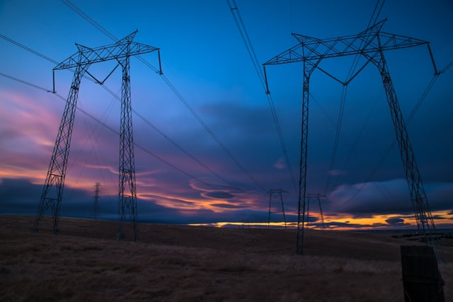

Illinois embarked a collaborative planning process for the state’s electrical grid in in March of 2017, called Utility of the Future, “NextGrid” Grid Modernization Study (NextGrid). In order to properly modernize Illinois’ electrical grid. NextGrid is examining a variety of topics over an 18 month period and engaging a broad variety of stakeholders. Interested members of the building industry may actively participate in NextGrid by joining one of the [NextGrid working groups](https://nextgrid.illinois.gov/WorkingGroups.html) or submitting comments during different stages of the NextGrid process.

<em>Photo by [Casey Horner](https://unsplash.com/@mischievous_penguins)</em>

Background to NextGrid

Illinois has been at the forefront of electrical utility regulatory developments and grid modernization over the last several decades. In 1997, Illinois adopted the Electric Service Customer Choice and Rate Relief Law, a statute granting consumers the right to choose their electricity provider. Previously, the public utility served as the sole electricity provider in most parts of the state.

The Illinois Energy Infrastructure Modernization Act of 2011 granted significant funding for grid upgrades, including the installation of smart meters and other new technology.

More recently, Illinois passed the Future Energy Jobs Act at the end of 2016. Amongst its many changes, the law expands the state’s energy efficiency programs, bolsters the Illinois Renewable Portfolio Standard that requires utilities to provide a percentage of energy from renewable sources, and increases investments in renewable energy sources.

The Future Energy Jobs Act and other Illinois energy related initiatives serve as the foundation for NextGrid.

## NextGrid Process

NextGrid is funded by the state’s electric utilities and uses a a collaborative approach to study how a future state utility might be designed to increase reliability, foster the use of clean energy, assure affordable electricity, and use the latest technological advances. The study will consider the latest developments in such areas as energy efficiency, distributed generation, demand response, competitive markets, and smart-devices. These topics will be discussed by participating stakeholders representing different perspectives.

The Illinois Commerce Commission (ICC), the quasi-judicial body that oversees Illinois’ public utilities, is responsible for managing NextGrid. NextGrid was launched on March 22, 2017, with the ICC’s issuance of a [resolution](https://nextgrid.illinois.gov/resolution.pdf). In response to the March 22, 2017, resolution, the ICC received over 40 comments regarding the topics to be considered as part of the NextGrid study and who should be selected as the third-party facilitator of NextGrid.

To enable shareholder participation, working groups will be formed representing seven different areas: New Technology Deployment and Grid Integration; Metering Communications, and Data; Reliability, Resiliency, and Cyber Security; Customer and Community Participation; Electricity Markets; Regulatory, Environmental and Policy Issues; and Ratemaking. There is opportunity for the public to participate in the working groups as well as provide comments on the working groups’ recommendations.

According to the ICC’s resolution, the working groups’ efforts will result in a final report that describes both the ”opportunities and challenges,” acknowledges where there is disagreement, and provides a “range of recommendations aimed at empowering customers and communities, driving economic development, optimizing the electric utility industry and creating a 21st Century regulatory model that supports innovation.”

The ICC, in conjunction with the Illinois public utilities, selected Power and Energy Stem Area of Electrical and Computer Engineering Department at the University of Illinois at Urbana-Champaign to act as the NextGrid third-party facilitator to coordinate the working groups and study.

## Moving Forward with NextGrid

A NextGrid [launch event](https://nextgrid.illinois.gov/NextGrid_Launch_Release.pdf) was held on on September 28, 2017, at the University of Illinois Forum. The team of University of Illinois of NextGrid facilitators presented their plans for the NextGrid process. Various energy industry experts participated in panels and gave presentations at the event.

The formation of the working groups and their meetings are still at an early stage. The first NextGrid working group, New Technology Deployment and Grid Integration, began meeting on December 5, 2017. Due to the overwhelming response to the request for nominations for the working group, the meeting had to [be delayed](https://nextgrid.illinois.gov/rescheduled.pdf) from the originally scheduled date in order to allow for a proper review of all the submissions.

We look forward to following the process of the NextGrid study and reading the final report. Illinois is one of several states working on transforming the electrical grid. New York States’ [Reforming the Energy Vision](/final-review-blog/the-solar-ombudsmen-part-ii-expanding-their-successful-approach-to-solar-in-new-york-state/) initiative, a series of proceedings before the New York State Public Service Commission, is working on a redesign of the New York electricity distribution system and creation of more competitive electricity markets.

In Minnesota, the [e21 Initiative](/final-review-blog/the-energy-system-of-the-future-a-look-at-minnesotas-e21-initiative/) led by the Great Plains Institute is also looking at new business and regulatory models for that state’s energy system. Hopefully, all of these initiatives will result in a better electrical grid and utility regulatory processes across the nation.
