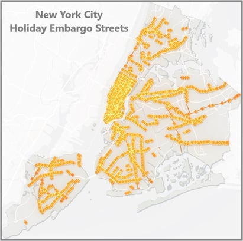

What is the 'Holiday Construction Embargo'?

Across the country, municipalities limit construction activity<em>,</em> building permit issuances, or street closures during certain dates and times through November and December. This is done to promote full access to retail stores, restaurants and other businesses by the public.

Whenever possible, additional hours will be granted during the embargo period. The New York City Department of Transportation (NYCDOT) has reduced the parameters due to the reduction in holiday activities. This provides contractors an opportunity to complete work in areas that would have otherwise been heavily trafficked.

[2025 NYC Holiday Construction Embargo Dates & Times](https://www.nyc.gov/html/dot/html/infrastructure/construction-embargoes.shtml#holiday)

In effect: Saturday, November 15, 2025 – Friday, January 2, 2026 (6:00AM-11:59PM)

On all holiday season gridlock alert days during the Holiday Construction Embargo period lane closures are prohibited from 6:00 AM to midnight on highways (and their service roads) and East and Harlem River Bridge Crossings listed below.

<strong>Brooklyn:</strong>

-   Belt Parkway
-   Brooklyn Queens Expressway
-   Gowanus Expressway
-   Jackie Robinson Parkway
-   Prospect Expressway

<strong>Bronx:</strong>

-   Bronx River Parkway
-   Bruckner Expressway
-   Cross Bronx Expressway
-   Henry Hudson Parkway
-   Hutchinson River Parkway
-   Major Deegan Expressway
-   New England Thruway
-   Throgs Neck Expressway

<strong>Manhattan:</strong>

-   Joe DiMaggio Highway/West Street (9A)/11th Avenue/12th Avenue
-   Miller Highway/Henry Hudson Parkway
-   FDR Drive/Harlem River Drive
-   Trans-Manhattan Expressway

<strong>Queens:</strong>

-   Belt Parkway
-   Brooklyn Queens Expressway
-   Cross Island Parkway
-   Grand Central Parkway
-   Jackie Robinson Parkway
-   Long Island Expressway
-   Van Wyck Expressway

<strong>Staten Island:</strong>

-   Staten Island Expressway
-   West Shore Expressway

<strong>East River Bridge Crossings:</strong>

-   Brooklyn Bridge
-   Ed Koch/Queensboro Bridge
-   Manhattan Bridge
-   Williamsburg Bridge

<strong>Harlem River Bridge Crossings:</strong>

-   145th Street Bridge
-   Alexander Hamilton Bridge
-   Broadway Bridge
-   Macombs Dam Bridge
-   Madison Avenue Bridge
-   Third Avenue Bridge
-   University Heights Bridge
-   Willis Avenue Bridge

For additional details such as streets subject to conditions [click here](https://www.nyc.gov/html/dot/html/infrastructure/construction-embargoes.shtml#holiday). As always, the Burnham Nationwide team is available to answer any questions on moratorium procedures or to assist with the application process for waivers in our offices throughout the country.

What are the dates for this year's NYC Holiday Construction Embargo? NYC DOT typically doesn't publish each year's exact dates until October, so the specific 2026 - 27 window isn't out yet. Based on the consistent annual pattern, expect it to run from mid-November through shortly after New Year's Day, with the 2025–26 embargo (Nov. 15, 2025–Jan. 2, 2026) as the most recent example of the typical timeframe and structure. Does the embargo stop all construction permits citywide? No - it applies to specific embargoed locations across the five boroughs, not every street. DOT publishes the affected location list, plus a separate list of "gridlock alert days" during which lane closures are additionally prohibited from 6am to midnight on major highways and East/Harlem River bridge crossings. Can I keep working on an emergency repair during the embargo? Yes - the embargo doesn't apply to emergency work, as long as the permit holder obtains an emergency work number under Section 2-11 of the Rules of the City of New York. Are active permits in embargoed areas automatically suspended, or do I need to do anything? They're automatically suspended for the embargo period - no action needed to pause them. But you can't resume work once the embargo lifts without confirming your permit's status, since some permits may also have expired or need renewal in the interim. How do I apply for a waiver to work during the embargo if my project can't wait? Waiver requests go through NYC DOT's Office of Special Events, submitted by email with a detailed description of your project's scope and timeline, along with relevant drawings-approval isn't guaranteed, so it's worth applying as early as possible.
