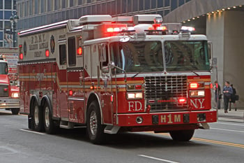

New York City has taken important steps to streamline solar permitting and bring down the cost of installing solar. However, further improvements should be made to the Fire Department, City of New York’s (FDNY) portion of the permit process. At Burnham, we assist clients with their solar permits and have found that that some of the New York City Fire Code requirements cause serious delays and raise costs. In this post, we will examine some of the issues the New York City Fire Code creates for solar installers and recommend ways to resolve these problems.

## Role of NYC Fire Code and Variance Procedure

Four different entities impose requirements on New York City solar installations: the NYC Department of Buildings (DOB); the FDNY; the local utility, Con Edison; and if one is seeking a financial incentive, the New York State Energy and Research Development Authority. All solar installations must be compliant with the [2014 New York City Fire Code (NYC Fire Code)](http://www.nyc.gov/html/fdny/html/firecode/table_of_contents_2014.shtml).   

NYC Fire Code Section 512 governs solar panel installation and has four major sections:

-   Section 512.1 - compliance with the city electrical and construction codes;
-   Section 512.2 - requirements for flat-top roof solar panel installations;   
-   Section 512.3 - requirements for pitched roof solar installations; and
-   Section 512.4 - requirements for location and markings of the conduit and equipment.

Pursuant to Section 512.2, all solar panels on a flat-top roof must comply with NYC Fire Code Section 504.4 governing rooftop access and obstructions unless the solar installation meets one of the exceptions specified in Section 512.2. The subsections of NYC Fire Code Section 504.4 that are particularly problematic when installing solar are Section 504.4.1 controlling fire department unobstructed access to building rooftops and Section 504.4.4 stating rooftop clear path requirements.

A DOB plan examiner will review a solar permit application to see if the application meets both the DOB and FDNY requirements. If a solar installer is unsure about a project’s compliance with the NYC Fire Code, the FDNY recommends applying to FDNY for a variance pursuant to Fire Code Section 104.8, using form [FDNY TM-5: Application for Rooftop Access Variance/Plan Review (TM-5)](http://www.nyc.gov/html/fdny/pdf/fire_prevention/TM5.pdf) before submitting an application to DOB. Form TM-5 are submitted in person to FDNY Headquarters along with a $420 fee. The application must include plans of the existing conditions and proposed changes, photographs of current conditions on all sections of the roof, and a description of the proposed modification. There are also detailed requirements for identifying and labeling elements of the plans and photos. The FDNY variance review takes several weeks.   

## NYC Fire Code Issues Confronted by Solar Installers

A major problem solar installers encounter is obtaining correct interpretations of the NYC Fire Code’s language. For example, NYC Fire Code Section 504.4.4(2) requires a clear path to have “reasonable” access to “bulkhead doors, fire escapes, access ladders, cockloft vents, skylights, scuttles, and shafts.” It is not always evident what the FDNY will view as “reasonable.” In order for a solar installer to find out whether the FDNY will agree a particular clear path is “reasonable,” the installer must file a TM-5 variance form with the FDNY Headquarters costing the installer the high-priced fee and causing weeks of delay.

Some of the NYC Fire Code requirements are also too restrictive and eliminate many New York City roofs as potential sites for installing solar. For example, NYC Fire Code Section 504.4.1 requires rooftop access with a minimum clearance of 6 feet width and 6 feet depth. Similarly, NYC Fire Code Section 504.4.4 has a 6-foot clear path requirement. It is very difficult to design solar installations that meet these requirements.   

Recently, the FDNY decided to impose a stricter interpretation of the Section 504 clear path requirements without any warning to New York City solar installers. This adversely impacted many solar installations that were already in process. The plans must be redesigned which adds to the installation cost and causes delays.

## Potential Solutions to NYC Fire Code Issues

A dialogue between New York City solar industry representatives and the FDNY would go a long way in helping improve the solar permit process. The goal of direct discussions would be to improve the review process itself and update the NYC Fire Code to support the adoption of solar in New York City. Also, more direct communication between the FDNY and solar installers would result in fewer surprises for the solar installers when the FDNY needs to make a change. There should also be a process for submitting questions to the FDNY rather than forcing installers to go through the expensive and time-consuming variance process to get answers. Finally, the FDNY should also develop guidance documents for sections of the NYC Fire Code that are vague or frequent sources of confusion for solar installers.  

## The Solar Permit Process in New York City will Continue to Evolve

New York City is a leading municipality in the adoption of solar and streamlining of solar permits. The [New York City Solar PV Standardized Checklist of Filing Materials](http://www.cuny.edu/about/resources/sustainability/solar-america/installer-resources/NYSolar_Smart_NYC_Checklist_Gantt_Chart_FINAL.pdf) and the [NYC Solar Permitting Process Guide](https://www.cuny.edu/about/resources/sustainability/reports/NYC_DOB_Solar_Permitting_Process_Final.pdf) are helping expedite the process of installing solar in New York City. More recently, DOB expanded the types of solar permits eligible for Professional Certification. See our [recent post](/final-review-blog/guide-to-expediting-solar-permits-with-nyc-professional-certification/) discussing how using Professional Certification will help eliminate solar permit wait times. We hope by focusing attention on NYC Fire Code issues the solar permit process in New York City will continue to improve.
