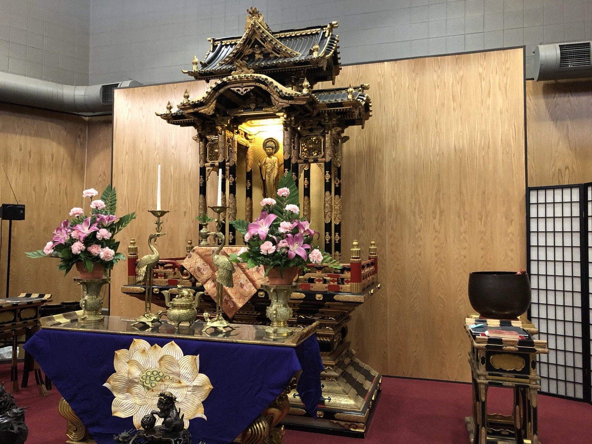

On October 13th and 14th, the Chicago Architecture Center (formerly the Chicago Architecture Foundation) hosted its eighth annual Open House Chicago and hundreds of notable buildings opened their doors to attendees. Part of network of [worldwide events](http://www.openhouseworldwide.org/), Open House Chicago (OHC) continues to expands its offerings to include new buildings, businesses, sacred spaces, and more throughout the city of Chicago and near suburbs.

Burnham’s team members toured many of the buildings in this year’s event and we’d like to showcase some of the places we explored below, as well as some of the significant sites from Open House Chicago’s largest year yet. 

*Buddhist Temple of Chicago by Caitlin Haycock*

This year, OHC showcased new locations in new neighborhoods - including the Beverly, Morgan Park, and Austin neighborhoods - as well as unique returning spaces. Chicago’s event is the largest of its type in North America and let attendees behind the scenes of more than 250 buildings over 48 hours.

## About Open House Chicago

The Chicago Architecture Center (CAC)’s [mission](http://www.architecture.org/about/about-us/our-impact/) is to “reveal the stories behind the buildings -- and the people behind the stories,” and spread awareness of Chicago’s hidden architectural gems and overlooked neighborhoods through events such as OHC.

Established in 2010, the event continues to draw an international crowd and promotes conversations around design, Chicago’s historic buildings, and between the organization’s partners such as the Frank Lloyd Wright Trust (host of the [Frank Lloyd Wright Home and Studio](https://openhousechicago.org/sites/site/frank-lloyd-wright-home-and-studio/) this year) and the Chicago Loop Alliance.

This year, Open House Chicago sought to shed light on buildings outside of Chicago’s business district and instill pride in community and place throughout the city, bringing attendees to neighborhoods they otherwise would not be likely to visit.

## New Locations, Unique Spaces Bring Visitors to Neighborhoods Across the City

The list of buildings, spaces, and businesses changes each year, and this year multiple neighborhoods hosted open houses for the first time. We covered these locations in a previous post, including Peace Corner Youth Center - one of the far west side Austin neighborhood’s contributions to this year’s event.

Founded in 2002 as “a safe haven for youth looking to escape gang violence”, Peace Corner is a community center that offers employment services, GED class referrals, legal counseling, programming, and tutoring to local residents. Previously operating out of a storefront, the organization moved to its current home at 5022 W. Madison Avenue in 2011 -- a LEED-certified building designed by Lothan Van Hook DeStefano Architecture -- which is home to green roof with a regulation basketball court. Visitors had the chance to explore the building’s amenity spaces and hear about the future of the Austin neighborhood after decades of disinvestment.

## OHC Focuses on the Arts, Community Connections

The [Chicago Printmakers Collaborative](https://www.chicagoprintmakers.com/) (CPC) in the Lincoln Square neighborhood opened its doors again this year for visitors. As the longest running independent print shop in the city, the CPC hosts printmaking classes and provides equipment access to working artists in the former Penn Dutchmann Antiques building on the city's North Side. 

Printmakers demonstrated etching and screen-printing processes for OHC visitors and the shop's ongoing galleries showcased work from artists focusing on the City of Chicago's energy and architecture.

In the historic South Side Bronzeville neighborhood, visitors had a chance to explore the [South Side Community Art Cente](https://openhousechicago.org/sites/site/south-side-community-art-center/)r's (SSCAC) museum and top-floor ballroom. Built in 1893, the former mansion was converted into a venue for exhibiting works by African American artists in 1941 and remains "the only WPA-era African America Art Center of its kind to remain continuously open." The center has been home to works by many prominent Bronzeville artists and is currently undergoing significant restoration to bring additional programming space to the SSCAC and make the building accessible.

The [DANK Haus German American Cultural Center](https://openhousechicago.org/sites/site/dank-haus-german-american-cultural-center/), built in 1927 and formerly the home of the Three Links fraternal order, returned this year - the five floor space holds galleries, exhibits, event space, a rooftop deck with an uninterrupted skyline view, and the Schlaraffia Club.

## Loop Sites Included an Inside Look at the Historic Old Main Chicago Post Office Renovation, CAC Home

The Chicago Loop included new sites this year such as the brand new 35-story office tower at 151 N. Franklin, which features column-less corners and tall ceilings, LEED certification, and a rooftop sky garden, and the Chicago Post Office.

Undergoing redevelopment, the former [Old Main Chicago Post Office](https://openhousechicago.org/sites/site/chicago-post-office/#controls) building at 433 W. Van Buren Street - above one of Chicago’s major expressways - is being redesigned by Gensler this year. Visitors to Open House Chicago were treated to an inside look into the largest adaptive reuse project in the United States.

Designed by Graham, Anderson, Probst and White in the 1920s, all 2.8 million square feet of the former post office is slated to become office space in a $600 million renovation project, with a portion of the space serving as the new home of Walgreens stores’ digital e-commerce operations. Once completed, the space will feature a full restored lobby, a new food hall, a three-acre rooftop terrace, and a new public river walk.

New this year, visitors were able to explore the CAC’s new home at [111 E. Wacker Drive](http://www.architecture.org/learn/resources/buildings-of-chicago/building/111-east-wacker-one-illinois-center/). The Mies van der Rohe-designed skyscraper unites the tours, exhibits, and services provided to architectural enthusiasts in a central location overlooking the Chicago River.

Attendees could explore the CAC’s exhibits, including the Chicago City Model Experience with over 4,000 building models, and a collection of pieces from local architects in “From Me to We: Imagining the City of 2050.”

We’re thrilled to again have had the chance to participate in this year’s event - take a look below at some of the sites we explored, including the Buddhist Temple of Chicago, the DANK Haus German American Cultural Center, the Chicago Printmakers Collaborative, [Héctor Duarte Studio](https://openhousechicago.org/sites/site/hector-duarte-studio/), and more.
