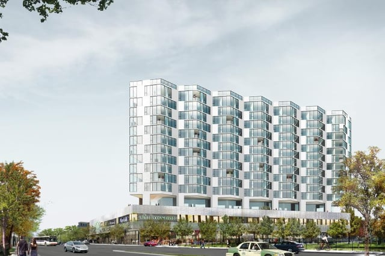

Chicago is experiencing a growth construction projects near public transportation. A variety of organizations and government agencies are working on initiatives to support transit-oriented development in the Chicago Region. In Fall 2015, the Chicago City Council adopted changes to its transit-oriented development ordinance to encourage more building close to transit. We at Burnham thought we would take a look at steps being taken to foster Chicago’s transit-oriented development and some resulting projects.

<em>[Rendering via Curbed Chicago](http://chicago.curbed.com/2015/9/28/9916530/city-hyde-park-preleasing)</em> 

## Chicago is Part of a National Trend in Transit-Oriented Development

Throughout the country, there is growing interest in transit-oriented development (TOD), the creation of mixed-use communities that are walkable and close to public transportation. A TOD zone is usually viewed as an area that is a half-mile radius from a train station. Frequently, TOD designs are also intended to facilitate the use of bicycles and encourage diverse types of businesses to serve the community. TODs are viewed as offering a healthier lifestyle and decreasing transportation costs. They also reduce air pollution, greenhouse gas emissions, and traffic congestion. Ideally, TODs should result in better access to jobs and more affordable housing.

Cities are adopting zoning changes and policies to encourage TOD. For example, this year New York City adopted amendments to its zoning regulations, [Zoning for Quality and Affordability](/final-review-blog/historic-zoning-changes-new-york-city-zoning-for-quality-and-affordability/) (ZQA), to increase the number of affordable apartments and improve the quality of housing. To encourage the development of TODs with affordable units, ZQA included in its many changes a reduction in the affordable housing parking requirements for developments in areas with good public transportation.

## Chicago’s Recent History of Transit-Oriented Development

Chicago saw a decrease in transportation zone development between 2000 and 2010. However, the Chicago Metropolitan Agency for Planning (CMAP) published a comprehensive plan for the metropolitan Chicago area in 2010 that was updated in 2014, [Go to 2040](http://www.cmap.illinois.gov/about/2040). One of CMAP’s key proposals in Go to 2040 was the recommendation that land use planning encourage reliance on public transportation.

Building upon Go to 2040, the Center for Neighborhood Technology (CNT) undertook a 2013 study, [Transit-Oriented Development in the Chicago Region, Efficient and Resilient Communities for the 21st Century](http://www.cnt.org/sites/default/files/publications/CNT_TODInChicagoRegion.pdf) (Report), that compared Chicago to other major cities with well-developed transit systems. The Report also looked at development and demographics in the areas around the Chicago Region’s 367 Chicago Transit Authority (CTA) and Metra train stations to assess how they were doing. Based on their analysis, CNT made specific policy recommendations in the Report to support TOD. It called for the creation of TOD zones and reducing barriers to TOD by changing local land use policies. Another important recommendation proposed that the Chicago Region undertake measures to preserve mixed-income housing.

This month, Cook County, the county that encompasses Chicago, released [Connecting Cook County: 2040 Long Range Transportation Plan](http://www.connectingcookcounty.org/pdf/CookCounty_LRTP_Full_V16.pdf) which provides additional support for TOD in the Chicago Region. Cook County’s plan calls for making public transit and TOD a priority.

## Chicago’s Transit-Oriented Development Ordinances

In September 2013, Chicago City Council passed the city’s [first ordinance to stimulate development in transit zones](https://pic.datamade.us/chicago/document/?filename=SO%202013-5995&document_url=http://ord.legistar.com/Chicago/attachments/2e12405f-10c8-4835-a8d4-460a9c1eec4c.pdf) (2013 TOD Ordinance). The ordinance, for example, reduced parking space requirements and allowed increased building heights for new construction in designated areas near public transportation. The Chicago City Council passed [changes to the transit-oriented development ordinance](http://www.metroplanning.org/uploads/cms/documents/so2015-5334.pdf) (2015 TOD Ordinance) in the fall of 2015 to encourage more development in transit zones, especially projects that incorporate affordable housing.

The Metropolitan Planning Council and others called for amendments to the 2013 TOD ordinance. In their July 2015 report, [Grow Chicago](http://growchicago.metroplanning.org/documents/grow-chicago.pdf), the Metropolitan Planning Council and the Institute for Transportation & Development Policy stated that the 2013 TOD ordinance did not apply to enough land, still required a cumbersome review process, and didn’t improve affordability. The report put forth specific recommendations that resulted in the 2015 TOD Ordinance. Amongst its changes, the 2015 TOD Ordinance:

-   Expands the TOD area around a CTA or Metra station to a quarter mile radius or, if on a pedestrian street, a half mile radius. New construction in these areas is eligible for reductions in parking requirements, height area increases, floor area ratio (FAR) increases, and minimum lot area reductions.
-   Projects using the FAR increase, height area increase, and minimum lot area reductions must meet criteria for special use and be approved by the City Council as a Type 1 zoning map amendment or planned development.
-   Allows for a 100% reduction in residential parking requirements if required parking spaces are replaced with bicycle spaces and the special use approval process is followed.
-   Projects that fall under the Affordable Requirements Ordinance are eligible for additional FAR increases that are scaled depending on the percentage of the required affordable housing units.

To support TOD in Chicago, the Metropolitan Planning Council has a [website](http://growchicago.metroplanning.org/?utm_source=%2fgrowchicago&utm_medium=web&utm_campaign=redirect) explaining some of Grow Chicago’s recommendations and findings. The website also contains a calculator that can be used to determine how a particular transit-oriented development may benefit a community.

## Recent Transit-Oriented Developments in Chicago

There have been many Chicago TOD projects in the last few years in various parts of the city. However, different groups have voiced concern that the TOD developments are frequently high-end projects and push lower-income residents out of a neighborhood. Some of Chicago’s more recent projects do incorporate affordable housing units. The following are few examples of Chicago TOD projects, including a couple with affordable housing:

-   One of many new buildings along Milwaukee avenue, Kenect, 504 & 505 North Green Street, is in the Fulton Market area near the CTA’s Blue Line and many restaurants and retail shops.
-   Work began this year on 710 West Grand Street, a mixed-use development located near the CTA’s Blue Line and just east of Kenect. The building will have 105 apartments as well as retail space. In lieu of including affordable units in the building, the project will pay into the Chicago housing fund to develop affordable housing.

-   City Hyde Park, located at 5105 S. Harper Street in Hyde Park, is near a Metra station and buses to the Loop. Recently completed, 20 percent of the 15-story building’s apartments are affordable units, and the building will house the first Whole Foods in the area.
-   John Pennycuff Homes, 2031 N. Milwaukee Avenue, were announced a few months ago. The project is comprised of 100 percent affordable units and is being promoted as a LGBTQ-friendly housing complex. Located near CTA’s Blue Line, the mixed-use development will be in the Logan Square neighborhood.  
    

We at Burnham will continue to watch Chicago’s transit-oriented development as well the growth of transit zones in other cities.
