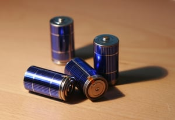

The next frontier for residential rooftop solar will be the ability to combine solar generation with energy storage. Con Edison, the investor-owned utility serving New York City and Westchester County, has started an exciting demonstration project, the Clean Virtual Power Plant, which pairs residential rooftop solar with energy storage. As part of the project, Con Edison will aggregate the combined units and operate them as a virtual power plant (VPP) dispatching the generated electricity to benefit the grid and create revenue. At Burnham, we believe more utilities are likely to follow Con Edison’s example and experiment with their own rooftop solar programs. See our [recent post](/final-review-blog/utility-led-distributed-solar-in-2016-the-evolving-utility/) on the future of utility-led solar. Here we will highlight the most important parts of Con Edison’s plans for the Clean Virtual Power Plant.

## Demonstration Project Designed to Meet REV Goals

Con Edison’s Clean Virtual Power Plant was developed to comply with the requirements of New York State’s Reforming the Energy Vision (REV) regulatory initiative. REV, begun in 2014, seeks to replace the state’s aging distribution system and encourage more competitive electricity markets. REV is designed to move the state from the present centralized electricity distribution system to a more diverse and decentralized model. This includes finding ways to integrate distributed energy resources (DER), small sources of power on customer property, into the grid and create revenue generating competitive markets for DERs. REV envisions the formation of Distributed System Platforms (DSP) responsible for facilitating the new role and opportunities for DERs. New York’s existing utilities will act as DSP providers.

As part of the REV initiative’s proceedings, the New York Public Service Commission’s [Order dated February 26, 2015](http://www.askpsc.com/askpsc/file/rev_order_feb_26_2015), requires New York utilities to develop demonstration projects to test how a utility may function as a DSP provider. The demonstration project guidelines call for the utilities to invite third party participation, such as companies working with DERs, in the demonstration projects. Con Edison filed its [project outline for the Clean Virtual Power Plant](http://www.capitalnewyork.com/sites/default/files/CONEDDEMO3.pdf) on July 1, 2015, and the project’s [implementation plan](https://www.burnhamnationwide.com/hubfs/blog_articles_-_PDFs/Clean_VPP_-_Project_Implementation_Plan_-_12-11-15.pdf) on December 11, 2015.

The Con Edison demonstration project will aggregate a few hundred single-family homes using rooftop solar and battery storage that will be connected to the grid and create a VPP. Participation in the demonstration project is open to homeowners located anywhere in Con Edison’s New York State service territory. The utility is partnering with SunPower, a solar company, on the Clean Virtual Power Plant. SunPower will obtain customers for the system and oversee the design and installation of the combined solar and battery systems. Additionally, SunPower is responsible for the Network Operations Center (NOC), the platform for aggregating and controlling all the battery storage units. Sunverge, an energy storage company, will also assist with the project.

## Three-Phased Demonstration Project

Con Edison is using the demonstration project to evaluate the best methods for controlling and coordinating DERs as a single energy source to benefit customers and the grid. The project will also give Con Edison the ability to explore new revenue streams and opportunities for competitive markets. The demonstration project’s data can help Con Edison determine how to avoid infrastructure costs by aggregating distributed solar and battery storage to provide dependable load relief. Utilities must maintain and invest in infrastructure to supply electricity during times that residential solar without storage creates an insufficient amount of power. If the VPP model proves to be a reliable source of electricity, the utility may avoid some future infrastructure costs. The Clean Virtual Power Plant will be developed in three phases.

#### Phase I Places a Value on Resiliency Services Provided by Storage

The combined rooftop solar and energy storage will be offered to customers and installed in Phase I. Much of the first phase will take place in 2016. To fund the solar units and their installation, customers will make monthly payments on a 20-year lease made available by a third party. Con Edison will fund, own, and control the battery storage units for the duration of the demonstration project. Under REV, utilities are not allowed to own DERs except in limited circumstances. They may, for example, own DERs for the purpose of a demonstration project. 

An important component of Phase I is testing customers’ willingness to pay for resiliency services the energy storage units provide. With extreme weather events, customers need backup power when the grid becomes unavailable. Traditional backup generators are expensive, noisy, require refueling, and contribute to carbon emissions. An energy storage system is a better option. Customers participating in the demonstration project will be charged a monthly fee for the resiliency service and different models for pricing these services will be tested. The customer’s combined utility bill, solar lease payment, and resiliency services charge will be less than or equal to the customer’s current utility bill.

#### Phase II Tests Control of the VPP and Examines New Rate Design

Con Edison’s ability to act as a DSP will be evaluated in Phase II. Communications will begin between Con Edison’s system and the NOC during the second phase. Once this communication is established, Con Edison will test controlling and dispatching the VPP to respond to the grid’s changing needs.

Also, Con Edison will assess various residential distributed resource rate designs using shadow modeling during Phase II. This will include testing rate designs to influence the combined unit customer’s behavior during different times of use.

#### Phase III Explores Options for Selling Value of VPP Assets

In Phase III, Con Edison will look at how the VPP can be used as a monetized asset in markets at the distribution and wholesale levels. Data from the demonstration project will give insight into how the competitive markets for DER services should be designed and revenue could be derived. Con Edison will also examine the regulatory changes necessary to support monetizing the VPP’s services.

## Goal to Expand the Clean Virtual Power Plant Program

It is unlikely the demonstration project will break-even. However, with the projected decline in the cost of energy storage, Con Edison expects the Clean Virtual Power Plant’s business model will be profitable in the next 10 years. By undertaking the demonstration project now, Con Edison will be well-positioned to successfully utilize the benefits of combined solar and energy storage when battery storage becomes a more financially viable option for customers. 

Con Edison’s goal is to scale the model created by the demonstration project. If successful, the Clean Virtual Power Plant will be open to additional vendors and more NOCs will be included in the system to aggregate new pools of homeowners. We at Burnham will share with you the results of Con Edison’s demonstration project as they become available.
