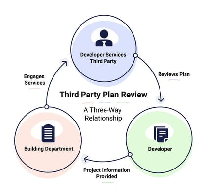

Peer reviews and third-party reviews are two terms that are often used interchangeably but are, in fact, different services.

**Peer Review**

A peer review is a review of plans and specifications that takes place when documents are 95% or 100% complete. It is done by one or more design professionals who are not on the design team and have no conflict of interest in that they had nothing to do with the design. However, it can be done in-house by the same firm doing the design, or by outside consultants. It is a two-way relationship. There is no contractual relationship between those performing the peer review and the building department or other municipal authorities.

An example would be Chicago’s Structural Peer Review Program whereby a “Registered Structural Peer Reviewer” (RSPR) is listed with the Department of Buildings after being vetted but has no contractual relationship with the City of Chicago.

**Third Party Review**

A third-party review, as the name implies, is a three-way relationship between a qualified professional architectural and/or engineering firm who is contracted by a building department or other governmental agency to perform plan reviews for a permit applicant through an approved vendor listing, where an additional contractual relationship is established by the permit applicant to purchase the services of the third-party directly. Once reviewed and approved, the third party then typically issues a “Reviewed for Code Compliance” letter and the drawings are returned to the jurisdiction where a permit for the project can be issued.

Rather than a peer reviewer that performs some or all reviews independently from jurisdictions, third-parties essentially augment municipal staff and take on their extra load to ensure that permit applicants get their reviews and permits in a timely manner. The staff of third-party reviewers are mostly ICC certified plan examiners who are licensed in the State they do business in and are expected to perform reviews in an equivalent manner as the jurisdictional authority.

See diagram below.

The move toward third-party augmentation of municipal staff by building departments is the direct result of an increasingly shrinking labor pool of plan examiners and inspectors due to retirements and decreases in municipal budgets. Third parties are paid by the applicants, carry their own liability and other insurance, and otherwise lessen overhead and the other costs of maintaining a larger employee workforce by government. Developers are willing to pay additional costs if they have a better degree of certainty regarding the timeliness of obtaining a permit.

Since third-party reviews are offered both as optional or mandatory services, depending on the municipal authority, where do peer reviews come in? They are sometimes mandated by the municipality (as in the case of Chicago for structural work on some projects), or when a performance-based design is used. However, peer reviews can also be utilized for a measurable advantage with regard to Quality Assurance. 

By improving compliance with applicable codes and standards or simply as a tool by which to gain more knowledge of specific best practices in communicating information to plan examiners, a permit can be obtained more quickly by reducing the number of plan review corrections and other changes to the drawings with the use of a peer review.

Burnham Nationwide’s code consulting division has provided life safety and accessibility ‘peer’ reviews for hundreds of projects over the last 25+ years and though its Illinois licensed subsidiary, The Code Group, Inc., has contractually performed third-party plan reviews for the City of Chicago since 2003.

[Contact us](/contact/) today for more information or looking for a third party plan review partner.

What's the main difference between a peer review and a third-party review? It comes down to the contractual relationship. A peer review is a two-way arrangement — the reviewer has no contract with the building department, just with the design firm or owner. A third-party review is a three-way relationship: the reviewing firm is contracted by the building department itself, and the applicant separately pays for that firm's services. Is a peer review the same as having your own firm double-check its own work? Not quite - a peer review specifically requires reviewers who weren't part of the original design team and have no conflict of interest, even if they work at the same firm. The key requirement is independence from the design, not necessarily independence from the company. Why are building departments increasingly using third-party reviewers instead of in-house staff? Largely due to a shrinking pool of plan examiners and inspectors from retirements and municipal budget cuts. Third-party reviewers - typically ICC-certified plan examiners licensed in their state - let departments outsource review capacity without growing payroll, while applicants pay extra for more predictable turnaround. When is a peer review actually required versus optional? Some jurisdictions mandate it - Chicago requires it for structural work on certain projects and for performance-based designs - but it's also used voluntarily as a quality-assurance tool, since catching issues before submittal tends to reduce plan review corrections and speed up permit issuance. What happens after a third-party review is completed? The reviewing firm issues a "Reviewed for Code Compliance" letter, and the drawings go back to the jurisdiction, which then issues the permit - distinct from a peer review, which doesn't produce a document the building department relies on directly.
