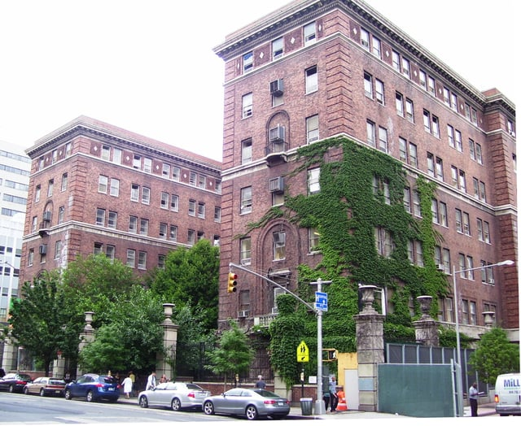
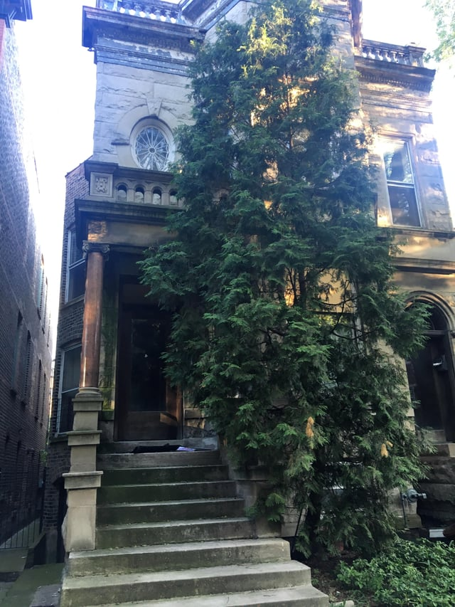
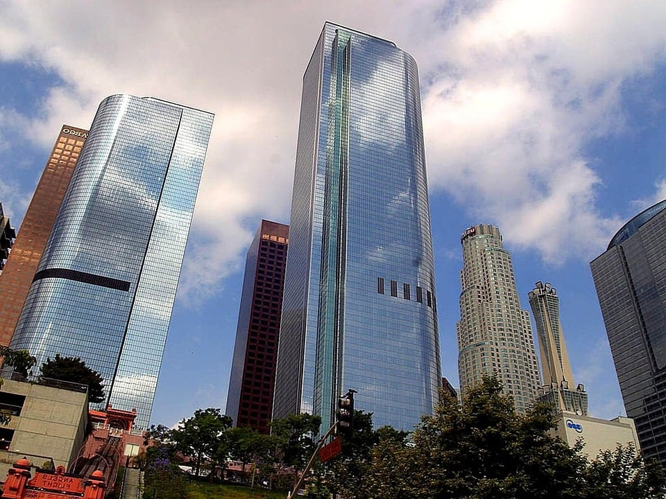

Organizations across the country are calling attention to endangered historic buildings in need of preservation. Fortunately, with the rise of [adaptive reuse](/final-review-blog/high-to-low-adaptive-reuse-in-pursuit-of-urban-parkland/) and other inventive repurposing of older sites, cities have begun listening - using existing and historic buildings and infrastructure to accommodate demands for increased walkability, more green space, and additional transportation alternatives. However, landmark and preservation organizations play a critical education and advocacy role in preventing the destruction of important historic buildings.

Previously, we profiled Landmarks Illinois and some of the [endangered sites in Illinois](/final-review-blog/exploring-2017s-most-endangered-historic-places-in-illinois/) highlighted in the organization’s annual statewide survey of threatened buildings and historic sites. In this post, we’ll take a look at endangered buildings across the U.S. and the ways in which organizations advocate to save them - and the benefits of doing so.

## New York Metro Area/Eastern U.S.

Preservation of structures on the East Coast poses challenges due to the age and historic significance of many buildings; the majority of organizations concentrate on saving the most threatened buildings and advocating for [Historic Protection Easements](https://www.nps.gov/tps/tax-incentives/taxdocs/easements-historic-properties.pdf). The easements are voluntary agreement between property owners and an outside agency and are the only way to protect structures in perpetuity by limiting future development that can occur on a site even with changes in ownership. Many preservation organizations hold these agreements in addition to their preservation advocacy efforts. 

### New York City

Founded in 1973, the [New York City Landmarks Conservancy](http://www.nylandmarks.org/about_us/what_we_do/) (the Conservancy) keeps a [running list](http://www.nylandmarks.org/programs_services/endangered_buildings_initiative/) of threatened buildings that has been active since 2000.

The Endangered Buildings Initiative (the Initiative) seeks to monitor existing buildings before they are threatened with demolition or deterioration. Currently, listed sites include structures such as the partially vacant [Bellevue Psychiatric Hospital](http://www.nylandmarks.org/programs_services/endangered_buildings_initiative/bellevue_psychopathic_hospital/) in Midtown East, abandoned Federal era buildings at [94-96 Greenwich Street](http://www.nylandmarks.org/programs_services/endangered_buildings_initiative/94_greenwich_st/) dating from 1798, and the historic [Officer’s Row](http://www.nylandmarks.org/programs_services/endangered_buildings_initiative/officers_row/) in the Brooklyn Navy Yard.

 [Beyond My Ken](https://commons.wikimedia.org/wiki/User:Beyond_My_Ken), [Bellevue Psychiatric Hospital old building](https://commons.wikimedia.org/wiki/File:Bellevue_Psychiatric_Hospital_old_building.jpg), [CC BY-SA 4.0](https://creativecommons.org/licenses/by-sa/4.0/legalcode)

The Initiative is unique in that it monitors buildings that have not been designated as historic landmarks or are in varying conditions, from well-preserved to [ruinous](http://www.nylandmarks.org/programs_services/endangered_buildings_initiative/westchester_avenue_cass_gilbert_station/), and advocates for the restoration of buildings regardless of their current state.

The Conservancy advocates for preservation of these buildings before the eleventh hour and focuses in particular on assisting with the restoration of buildings occupied by non-profit organizations and sacred sites, championing conversion when a property no longer serves its historic purpose.

The Conservancy also offers a restoration loan program for eligible residential and commercial buildings undergoing exterior or structural restoration through the [Historic Properties Fund](http://www.nylandmarks.org/programs_services/loans/historic_properties_fund/). Established in 1982, the fund is one of the largest private preservation loan funds and has assisted with the restoration of more than 240 buildings. In 1987, the Conservancy also established the Queens Historic Properties Fund alongside the Queens Historical Society to concentrate on the maintenance of historic properties in the borough of Queens.

The organization also manages additional funds and administers protective easements.

### State of New Jersey

Preservation New Jersey (PNJ) releases a [yearly list of threatened structures](https://drive.google.com/file/d/0B0vpUPGTKmPlNG5ya1RaNFdnNTg/view), and 2017’s list includes buildings already slated for demolition, including the King George Inn in Warren, N.J. which was constructed around 1785 with later additions. The structure was heavily damaged by Hurricane Irene in 2011 and determined to be unsalvageable by the current owner, however community members and Preservation New Jersey are advocating for the stabilization and restoration of the currently vacant building rather than redevelopment.

Structures on this list also include the unusual Caldwell Motor Bank, a mid-century bank in Caldwell, N.J. currently for sale, and the vacant Exempt Fire House in West New York, N.J. Though no longer viable for as a drive-up teller, the organization recommends repurposing the modernist kiosks as a drive-in coffee shop, dry cleaner, or restaurant.

PNJ makes a case for repurposing obsolete structures such as the Caldwell Motor Bank and protecting structures that can still be rehabilitated such as the King George Inn, and for the preservation of as much as possible for existing structures in ruinous condition such as the Brick’s Mincemeat Factory in the Township of Chesterfield, N.J. Portions of the interior of the structure have deteriorated and the building needs immediate intervention in order to preserve as much of the remaining building as possible.

## Midwestern U.S.

### City of Chicago

The Chicago non-profit, [Preservation Chicago](http://www.preservationchicago.org), releases its own list of threatened buildings called the Chicago 7 which has been published yearly since 2003. Broadly encompassing the built environment, the 2017 list includes public art throughout the City of Chicago as well as unusual structures such as the water intake cribs in Lake Michigan.

Unique to the city, the water cribs pose quite a challenge for reuse. Of the original eight water cribs constructed between 1865-1935 to provide the City with clean water, only six remain. Two are essential components of the City of Chicago’s water supply, but the two oldest remaining structures are scheduled to be demolished. Despite their location out in the lake, the [organization](https://preservationchicago.org/chicago07/chicago-water-cribs/) proposes that they be repurposed as “a restaurant, museum, excursion site, educational facility related to environmental issues, bird sanctuary, or other similar use that can be accessed via boat” or preserved in situ (as they are) with any necessary structural maintenance due to their historic value.

Preservation Chicago advocates for landmarking structures that cannot be reused if the significance is great and continuing to allow for public appreciation.

*631 W. Wellington Ave*

The nonprofit also tracks actively endangered places that may not have recognition outside of the city as part of its community-focused and community-driven preservation efforts, such as the [greystone](https://www.curbed.com/2016/6/2/11833698/brownstone-greystone-chicago-new-york-city) two-flat residence at [631 W. Wellington Ave.](https://preservationchicago.org/threatened_buildings/631-w-wellington-ave/) The building is listed in the National Register of Historic Places as a contributing building to the Lakeview neighborhood Historic District and currently has a pending demolition permit, making demolition of the home highly likely without community intervention.

Preservation Chicago is uniquely positioned to reach both residents of the city and others interested in Chicago’s architectural legacy.

### City of St. Louis

The Missouri Alliance for Historic Preservation (the Alliance) publishes an annual list titled “[Places in Peril](http://www.preservemo.org/)” which functions to raise awareness of threatened properties as is the goal of the previous lists discussed. The 2017 list will be released in August, however unique to the Alliance’s list is that the organization seeks to connect owners of properties directly with interested preservation-minded buyers.

By facilitating these connections, the Missouri Alliance for Historic Preservation is positioned to move beyond raising awareness around preservation issues and connect community members who can provide urgent solutions.

## City of Los Angeles

The Los Angeles Conservancy (the Conservancy) provides resources for owners of historic properties and advocacy on behalf of threatened properties. With [lists](https://www.laconservancy.org/issues/urgent) of immediately threatened buildings, ongoing endangerment, and watched properties, the Conservancy is focused on raising awareness of threatened buildings and undertakes litigation efforts.

The [Jones Dog & Cat Hospital](https://www.laconservancy.org/issues/jones-dog-cat-hospitalmelrose-triangle-project) at 9080 Santa Monica Boulevard is an intact example of the Streamline Moderne style dating from 1938. According to the organization, it is possibly the only remaining commercial example of the style within the area and is subject to demolition as part of a plan for a mixed use development at the site.

The Conservancy does not oppose development at the site but has indicated that the current plan does not adequately examine the benefits of retaining the structure and that by not pursuing preservation, the developer is not utilizing the most environmentally-sound plan. Many of the arguments for historic preservation center on the inherent environmentally-friendliness of the approach, especially in eliminating the waste produced during the wrecking process, increasingly of concern as cities face calls for greener building practices.

The Los Angeles Conservancy advocates strongly for preservation of mid-century and modernist architecture which is often overlooked in other locales, and is also monitoring sites such as the mid-century Chase Bank/Lytton Savings Building at 8150 Sunset Boulevard and the ongoing threat against [historic multi-family residences](https://www.laconservancy.org/issues/historic-multi-family-residences).

## Organizations Promote Economic, Environmental Benefits of Reuse

The Environmental Protection Agency recommends restoring historic properties as preserving existing buildings preserves “[embodied energy](https://www.epa.gov/smartgrowth/smart-growth-and-preservation-existing-and-historic-buildings)” and limits the energy expenditure needed for construction and waste generated. Preservation is another tool in creating building practices that are resilient and sustainable.

All the organizations profiled believe that economic development and historic preservation can co-exist and illustrate how adaptive reuse, preservation, and landmarking can benefit communities and provide solutions to the needs of residents. 

By reusing and rehabilitating a building that may be in disrepair, cities can promote growth in developed areas, address blight, renew pride on city blocks and in communities, provide more environmentally sound practices, and retain their intrinsic architectural character.
