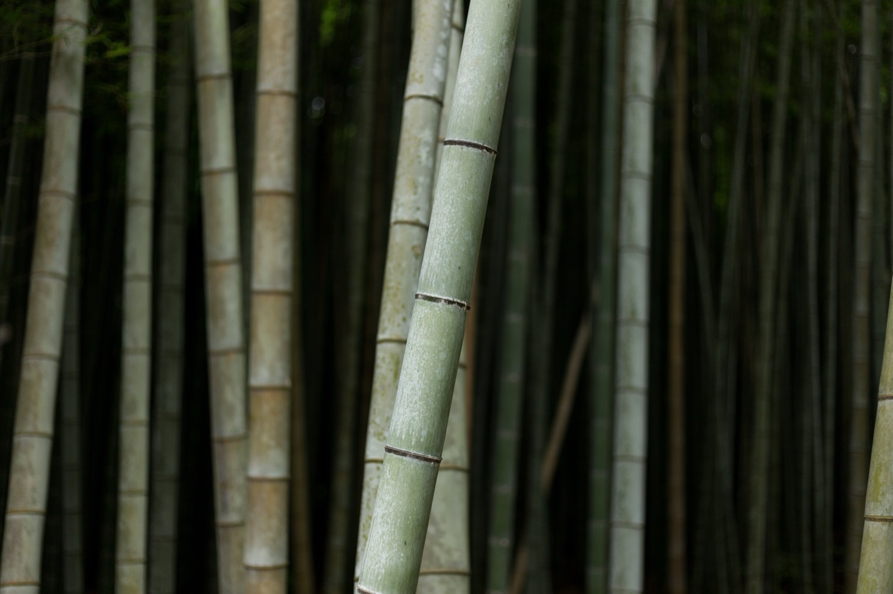

[Bamboo](https://www.drawdown.org/solutions/land-use/bamboo) is one of the world’s fastest growing and most adaptable grasses, sequestering significant amounts of carbon and thriving even on degraded land. According to [Project Drawdown](https://www.drawdown.org/), the plant is ideal for [afforestation](https://matteroftrust.org/13997/afforestation-meaning-importance-and-current-efforts) - replanting of trees in barren land to reduce the overuse of natural resources and create a new forest - because of its adaptability and uniquely fast growing times. Bamboo reaches full height in a single growing season, making it a very sustainable, renewable material source. With a host of practical uses, bamboo has “the compressive strength of concrete and tensile strength of steel.” 

<em>image by [Erol Ahmed](https://unsplash.com/photos/jIZmcB5UIrQ)</em>

Ranked #34 in [Project Drawdown](http://www.drawdown.org)’s solution list, planting bamboo on an additional 37 million acres of barren land will sequester 7.22 gigatons of carbon and save a total of $264.8 billion dollars. Project Drawdown specifically focuses on the land use potential of cultivating bamboo, but we’d like to shed light on some of the ways bamboo can be implemented in the built environment as a more sustainable material.

## Bamboo is a Prime Candidate for Afforestation

Bamboo, a woody member of the grass family, has a long history of cultivation for a variety of uses. Known as the “friend of the people,” the plant grows in a range of environmental conditions and is a resource for textiles, paper, building materials, food, and more. Bamboo also “sequesters carbon at a rate greater than or equal to that of many tree species,” according to Project Drawdown’s solution summary. Categorized under Drawdown’s “Land Use” sector, bamboo provides significant benefits when used for both regrowing overharvested or otherwise barren land, as well as numerous uses as a material resource.

[Afforestation](http://www.grida.no/climate/ipcc/land_use/004.htm) differs from reforestation in that it consists of planting entirely new forests where one does not currently exist, while reforestation involves planting trees and plants where a forest partially exists. Bamboo varieties are particularly well-suited to this task due to their quick growth rate and hardiness. Bamboo does not need to be replanted when harvested and since cutting of mature stalks promotes new growth, it is feasible for both afforestation and commercial cultivation.

## Bamboo Scaffolding, Building Provides Low-Cost Benefits

In Hong Kong, bamboo is used as scaffolding for uses as diverse as high rise construction and signage. Originating in the Chinese provinces of Guangdong and Guanxi, bamboo scaffolding has a centuries-old history and persists throughout Hong Kong. The [majority of skyscrapers](https://www.nytimes.com/2002/03/27/world/hong-kong-journal-for-raising-skyscrapers-bamboo-does-nicely.html) in Hong Kong have been built using traditional scaffolding methods, citing its strength and ability to withstand typhoon winds due to its flexibility. Though once used in mainland China, it is now banned on structures taller than six stories “because of fears that the quality of bamboo has deteriorated in recent years.” In contrast, scaffolding in Hong Kong frequently reaches 50-60 stories.

In addition to scaffolding, bamboo has a [rich history](http://discovermagazine.com/1996/jun/thebamboosolutio784) of global building use. According to Project Drawdown, there are species of bamboo native to North America, Asia, Latin America, and Africa, and [modern bamboo buildings](https://www.dezeen.com/2014/07/19/dezeen-top-10-bamboo-architecture-projects/) feature innovative designs as well as a humanitarian focus. In 2013, Architectural Association graduate John Naylor received the Foster + Partners prize for his proposal to bring bamboo construction to Haiti as a cost-effective, sustainable, and safe rebuilding material.

[Bamboo pavilions](https://www.architecturaldigest.com/gallery/most-beautiful-bamboo-structures-in-the-world) in Sydney and Berlin demonstrate its viability as a modern building material with practical uses, as well as its adaptability to different environments and practical application as disaster-resistant housing.

## Potential Issues with Widespread Bamboo Cultivation

Despite its significant benefits, there are drawbacks to planting and utilizing bamboo. Depending on the species and location, it can be an invasive plant, and requires careful cultivation if native varietals are not used. Bamboo is also [prone to fungus](http://discovermagazine.com/1996/jun/thebamboosolutio784) when used in tropical climates and burns quickly, making it impractical for use in multistory buildings without fire-resistant treatments. Despite these concerns, bamboo does not easily spread through its unique rhizome-based root system, and innovations in its building use continue to grow.

Engineering new methods of joining bamboo for building - traditionally its weakness - may improve future construction practices, and it remains a very strong, flexible, and adaptable building material, resistant to earthquake damage.

## Innovative Uses Continue to Develop

Beyond building alone, innovative uses include producing [bamboo bike frames](https://ourworld.unu.edu/en/riding-towards-sustainable-development-on-bamboo) - more flexible, shock absorbent, and more durable than metal frames - and environmentally-friendly textiles and fabrics from its fibers. [Bike infrastructure](/final-review-blog/bike-infrastructure-key-to-healthier-cities-reduced-emissions/) may someday benefit from these bike frames, demonstrating the unique interconnectedness of all Drawdown’s solutions.

*This blog post is part of Burnham Nationwide’s* [Drawdown Series](/final-review-blog/burnham-nationwides-climate-change-drawdown-series/)<em>.</em>

How does bamboo compare to trees in terms of carbon sequestration? Bamboo sequesters carbon at a rate comparable to or greater than many tree species, while also reaching full height in a single growing season rather than over decades, making it particularly well-suited to rapid afforestation efforts on degraded or barren land. Is bamboo actually strong enough to be used in construction? Yes, bamboo has compressive strength comparable to concrete and tensile strength comparable to steel by weight, which is why it has a centuries-long history as a scaffolding and building material in Asia, and continues to be used for multi-story scaffolding in Hong Kong today. What limits bamboo's use in multi-story buildings in the US? Two main factors: bamboo burns quickly without fire-resistant treatment, making multi-story building code compliance challenging; and traditional bamboo joinery methods are an engineering weakness that standard building codes aren't well set up to evaluate or approve, though research into engineered bamboo connectors is advancing. Is bamboo an invasive plant concern if used in landscaping or afforestation? It can be, depending on species , running bamboo varieties spread aggressively through rhizome root systems, while clumping varieties are far more contained. Careful selection of native or appropriate species is important, and invasive risks vary significantly by region. Has Project Drawdown's ranking of bamboo as a climate solution changed since this post? Yes, Project Drawdown regularly revises its solution rankings and carbon drawdown estimates as new research emerges. The original #The 34 ranking and 7.22-gigaton figures cited here are from the 2017 edition; current estimates and rankings are available on the updated Drawdown website and differ from these early figures.
