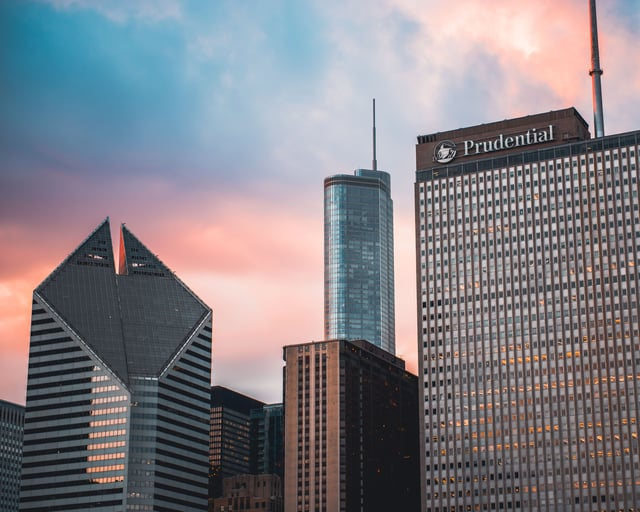

Wolf Point South, the third and final phase of Chicago’s [riverfront mega-development](https://chicago.curbed.com/2018/1/24/16923174/wolf-point-skyscraper-development-renderings) designed by Pelli Clarke Pelli Architects, is beginning its search for anchor tenants. Unlike the completed Wolf Point West and rising Wolf Point South, the south tower is the only mixed use building and is slated to include office space, hotel rooms, and residential units. The tower’s [proposed height](https://www.skyscrapercenter.com/building/wolf-point-south-tower/14276) is 950 ft with 70 above-ground floors, though height and other design adjustments may be made before approval. The City of Chicago is seeking tenants for the final tower and is in talks with Salesforce over space in Wolf Point South - and as a result, has proposed a new ordinance modifying Chicago’s current high-rise signage rules.

On October 31st, 2018, the Chicago City Council passed the ordinance as [substitute](https://chicago.legistar.com/LegislationDetail.aspx?ID=3680978&GUID=AB26986D-C8B7-48B8-AD3A-E7C8CAE785BC), with signage size governed by zoning district and height of sign from ground. The ordinance prohibits certain types of signs within the Chicago River Corridor Special Signage District, including banners, neon signs flashing signs, dynamic image display signs, roof signs, painted wall signs, off-premises signs, and projecting signs.

<em>image by [Mario Cuadros](https://unsplash.com/photos/E35baXi_oDE)</em>

Rumors that Salesforce is eyeing a major presence in the tower has brought an [ordinance](https://chicago.councilmatic.org/legislation/o2018-7004/) before the Chicago City Council, sponsored by Mayor Rahm Emanuel. The proposed ordinance would amend the existing provisions of the Zoning Code related to high rise signs adopted after Trump Tower installed oversized signage in 2014.

This isn’t the first time that Salesforce has brought skyline signage to one of the buildings the company occupies, and we’ll be taking a look at how Chicago’s new rules compare to signage ordinances across the country, and what might be the impact of Chicago’s new ordinance if passed.

## Current Chicago High-Rise Sign Regulations

The City of Chicago’s current zoning code governing signage heights and size was amended via an ordinance passed in 2014 in response to the [controversial Trump Tower sign](https://www.washingtonpost.com/news/wonk/wp/2014/09/25/donald-trump-just-inspired-chicago-to-rewrite-the-rules-on-absurdly-large-building-signs/?noredirect=on&utm_term=.fb1ce44611d0). The “TRUMP” sign installed at 401 N. Wabash Avenue, controversial for its visual clutter on Chicago’s skyline and “absurd” size, is 20 feet high and rests much lower height than now permitted - directly in pedestrian view and visible from as far away as the South Loop.

To prevent any future outsized sign installations, the Chicago City Council’s current [zoning ordinance](http://library.amlegal.com/nxt/gateway.dll/Illinois/chicagozoning/chicagozoningordinanceandlanduseordinanc?f=templates$fn=default.htm$3.0$vid=amlegal:chicagozoning_il) restricts signage on any high rise buildings to a percentage of the building’s width based on installation height. High rises cannot install projecting signs, and signage is limited to either the principal tenant of the building (who occupies greater than 51% of the floor share) or the alternate principal tenant, if the principal does not wish to display a sign.

The current rules locate all major signage near the top of high rise buildings, out of the line of sight of pedestrians, to prevent clutter and preserve the architectural integrity of the city’s many skyscrapers from street view.

## Proposed Ordinance Would Relax High-Rise Signage Rules

Though active since its approval, the Chicago Department of Planning and Development (CDPD) developed a new plan in September 2018 that would adjust the current rules, allowing for larger signs on office towers.

The move to introduce the changes follows after Salesforce’s interests in renting a major portion of unbuilt Wolf Point South’s floor area, and is part of a package of possible incentives and requests. In addition to installing a larger sign, [Salesforce has asked](https://www.chicagobusiness.com/commercial-real-estate/salesforce-eyes-big-chicago-office-expansion) for rights to “extensive signage” including a reported external video wall as well as exclusive access to the park and surrounding public areas at certain points in time, as per the information released.

If approved, the [new ordinance](http://www.chicagotribune.com/business/columnists/ori/ct-biz-chicago-sign-ordinance-ryan-ori-20180919-story.html) would permit “signs of up to 200 square feet of surface area if between 150 and 199 feet off the ground”, and 1,100-square-foot signs placed at 800 feet or above. The rules on tenant signage would also be relaxed, with any company occupying 350,000 square feet of floor space or with 1,000 or more employees present at the location allowed to install a sign.

The ordinance does not change the current requirements for “exterior video walls”, which have reportedly appeared in design talks however, and any exterior video screens used for commercial purposes remain subject to current signage regulations.

## Chicago’s New Signage Rules Would Mirror Similar Across the Country

Most cities with downtown cores or other areas with a number of high-rises have designated high-rise specific signage rules. In exploring these limits in other cities, we’ve determined that even with the relaxed regulations proposed by the new ordinance, Chicago’s signage would be in line with other major city centers.

### New York

New York City allows significant signage, both illuminated and non-illuminated, as long as all existing [zoning provisions](https://www.decodernyc.com/new-york-zoning-sign-rules) are met.

In New York, signage laws vary by zone, non-illuminated signs are subject to size restrictions based on zoning district. There are multiple subsets of commercial districts, but most high-rise office buildings would be included in the following code section in the Restricted Central Commercial (C5) or General Central Commercial (C6) zones:

C4, C5-4, C6-1, C6-2, C6-3, C6-4, C6-6, C6-8, C6-9: “Five times the street frontage of the zoning lot (in feet), but in no event more than 500 sq. ft. for interior or through lots or 500 sq. ft. on each frontage for corner.” There are no height above curb restrictions for buildings zoned C6.

The above is for non-illuminated commercial signs and does not include any special provisions.

### San Francisco

San Francisco has location, size, projection, and illumination [rules](http://sf-planning.org/signs) for all types of signs in all districts.

In commercial and industrial districts, signs attached to buildings must comply with the following [rules](http://library.amlegal.com/nxt/gateway.dll/California/planning/zoningmaps?f=templates$fn=default.htm$3.0$vid=amlegal:sanfrancisco_ca):

“No Sign Attached to a Building shall extend or be located above the Roofline of the building to which it is attached. In addition, no Sign Attached to a Building shall under any circumstances exceed a maximum height of:

In C-3: 100 feet;

In all other C, M, and PDR Districts: 60 feet

Such Signs may contain letters, numbers, a logo, service mark and/or trademark and may be Nonilluminated or Indirectly Illuminated.”

The City of San Francisco does not specify any tenant restricts, nor does it have separate high-rise designations, though vintage signs, historic movie theaters, or other uses may be exempt.

## Los Angeles

The City of Los Angeles [specifies](http://library.amlegal.com/nxt/gateway.dll/California/lapz/municipalcodechapteriplanningandzoningco?f=templates$fn=default.htm$3.0$vid=amlegal:lapz_ca) that all high-rise signs must be used for identification only, and “shall comprise no more than 80 percent of the width of that portion of the building where the signs are attached ... the area of these signs may constitute up to five percent of the area of the wall where the signs are attached.” The LA Municipal Code does not limit signage based on tenant.

With its tenant rules, the Chicago zoning code remains more stringent than most other cities on the type of sign and content allowed.

## Digital Art Not Currently Subject to Signage Rules, Requires Special Approvals

As digital public art increases in popularity, municipalities are developing regulations to govern these installations. The tallest building west of the Mississippi River, Salesforce Tower features an art installation at its top that premiered in May 2018. Designed by local San Francisco artist Jim Campbell, the screen is non-commercial and not considered a form of signage, but makes a lasting impact on [San Francisco’s skyline](https://sf.curbed.com/2018/5/23/17384262/salesforce-tower-led-jim-campbell-premiere) as the first major installation of its kind in the city.

The area surrounding the tower was rezoned to allow for the [increased height](http://default.sfplanning.org/zoning/zoning_bigmap_HeightBulk.pdf) as prior to construction, San Francisco’s Downtown Commercial (C-3) and other commercial zones had more restrictive height limits.

San Francisco’s Salesforce illumination project - along with the recent [Merchandise Mart](/final-review-blog/merchandise-mart-illumination-to-be-the-largest-art-projection/) illumination project in Chicago, and Los Angeles’s permanent digital art screen known as [ConvergenceLA](/final-review-blog/convergencela-installation-celebrates-past-future-of-los-angeles/) - further the growing trend in digital art displays in metropolises across the United States, but these remain entirely non-commercial. It was previously reported that Salesforce would request approval for a river-facing video wall that would not be strictly non-commercial, however this is currently [unconfirmed](http://www.chicagotribune.com/news/columnists/kamin/ct-biz-salesforce-video-board-kamin-0824-story.html).

## Potential Impact of New Rules

Though it’s not yet confirmed that Chicago will pass the new signage ordinance, Chicago Tribune architecture critic [Blair Kamin](http://www.chicagotribune.com/news/columnists/kamin/ct-met-salesforce-kamin-0923-story.html) remains unconcerned that the measure would mar Chicago’s architecture, given that height and size restrictions would still remain in place. Existing signs such as the one atop Chase Tower at 10 S. Dearborn Street are largely unobtrusive due to their placement.

Major cities across the country allow for a host of different signs, and it appears that even with this possible revision, Chicago’s new requirements will remain in line with limits in similar cities across the country.  
<em>This article was last updated on January 15th, 2019.</em>

Was Wolf Point South ever actually built, and is Salesforce really there? Yes - Salesforce Tower Chicago was completed in 2023 and serves as Salesforce's regional headquarters in Chicago. The 57-story, 852-foot tower at 333 W. Wolf Point Plaza is 97% occupied by Salesforce and law firm Kirkland & Ellis. Did the relaxed high-rise signage ordinance this post describes actually pass? Yes - the substitute ordinance was passed by City Council on October 31, 2018, as noted in this post itself, governing signage based on zoning district and installation height, and prohibiting certain sign types in the Chicago River Corridor Special Signage District. Why did Chicago's 2014 signage rules specifically target high-rise buildings? They were a direct response to the controversial "TRUMP" sign installed at 401 N. Wabash - a 20-foot-high sign positioned at relatively low height and visible from the South Loop, which critics called visually cluttered and inappropriate for Chicago's skyline. The ordinance pushed all major signage toward building tops and restricted sign size based on height from the ground. Who can put signage on a Chicago high-rise under the current rules? Under the rules in place since 2018, the principal tenant (occupying more than 51% of floor share) or - under the relaxed ordinance - any company occupying 350,000 square feet or with 1,000 or more employees at the location can display signage. The alternate principal tenant may also display a sign if the principal tenant opts not to. Does Chicago's approach to high-rise signage differ significantly from other major cities? Yes - Chicago's tenant restrictions make it more stringent than most peers. New York's rules focus on zone-based size limits without tenant restrictions; Los Angeles limits signs to 80% of the building width and 5% of wall area without restricting who can display them; San Francisco sets height-from-roofline limits but has no tenant-based rules.
