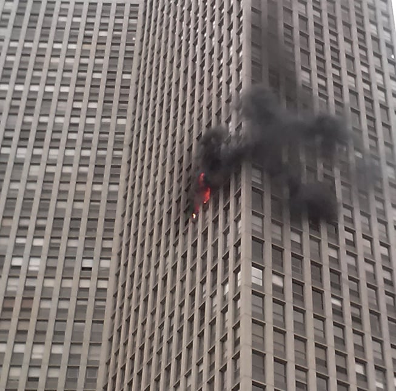
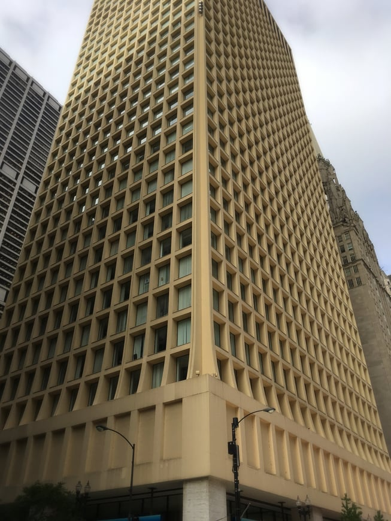

Recent residential high-rise fires are calling attention to sprinkler and other fire safety code requirements in the United States. While the horrific [Grenfell Tower fire in London](http://www.bbc.com/news/uk-england-london-40272168) has received a great deal of press, the July [Honolulu residential high-rise fire](https://www.theatlantic.com/news/archive/2017/07/honolulu-fire/533796/) that killed three people is more representative of conditions in many American cities.The 36-floor Marco Polo was built in 1971, predating Honolulu’s 1975 law requiring sprinkler systems. An automatic sprinkler system would have expedited fire extinguishment and prevented the deaths.

Lincoln Park 2013 residential high-rise fire

Honolulu’s building code sprinkler requirements are not dissimilar to those of other cities. Older residential high-rises in many parts of the country are not required to have sprinklers. Various interests must be balanced in developing sprinkler and other fire safety code standards. We thought we would review Chicago’s automatic sprinkler requirements for existing high-rise buildings and the history of the current standards.

## Chicago High-Rise Automatic Sprinkler Requirements

A [fire in the Cook County Administration Building](http://guides.library.illinois.edu/c.php?g=416856&p=2842528) in downtown Chicago took six lives on October 17, 2003. One of the main factors contributing to the tragedy was the lack of sprinklers.The construction of the Cook County Administration Building preceded the Chicago Municipal Code’s requirement that commercial high-rises built after 1975 have sprinklers on every floor. Chicago had largely relied on compartmentalization, the containment of fire in a small portion of a building, to protect against fire in high-rises.

In response to the fire, the Chicago City Council passed a fire safety ordinance in November 2003 that required older buildings over 80 feet to meet new fire safety standards. The ordinance added several sections to Chicago Municipal Code Chapter 13-196, the part of the code stating minimum requirements for existing buildings. The sprinkler system rules were specifically codified at § 13-196-205.

Pursuant to § 13-196-205, all existing commercial buildings over 80 feet were to install an automatic sprinkler system throughout the building. However, the sprinkler requirements for older buildings were phased in. Building owners were required to submit a plan for compliance by September 1, 2005. Sprinkler systems could be installed over time by installing sections of the system in thirds by specified dates, with completion required by January 1, 2017.

Cook Country Administration Building

## High-Rise Automatic Sprinkler Standard Exemptions

Section 13-196-205 exempts a number of different building types from its sprinkler system requirements:

-   Open-air portions of parking facilities and stadiums
-   Any non-transient, residential buildings such as rental apartments, condominiums, and condos (hotels and dormitories are examples of transient residential buildings that are not exempt)
-   Some Chicago landmarks and historic buildings

The exemptions essentially limit the automatic sprinkler requirements to all new high-rises built after 1975 and older commercial and transient residential high-rises.

## Life Safety Evaluations for Older Residential High-Rises

A proposal to require all existing high-rises, including residential, to have automatic sprinkler systems was introduced immediately after the 2003 Chicago fire. However, primarily due to concerns over costs, it was decided that existing high-rise residential buildings would undertake a Life Safety Evaluation instead of being required to install automatic sprinklers. Section 13-196-206 sets forth the standards for these evaluations.

A licensed architect or engineer must perform, sign, and seal the Life Safety Evaluation.The City of Chicago has a [Life Safety Evaluation Checklist](https://www.cityofchicago.org/content/dam/city/depts/bldgs/general/LSE/3022012LSE_REPORT_CHECKLIST.pdf) that must be used and is focused on fire safety measures such as those involving fire containment and ability to combat a fire, means of escape, the ability to communicate with building occupants, and general building fire safety measures. The Life Safety Evaluation requirement is accompanied by other code mandates for existing buildings such as voice communication systems and standards for the materials and installation of retrofitted fire protection systems.

For buildings that achieved the minimum required score, the evaluation was certified as the building’s life safety compliance plan to be submitted by January 1, 2006. Buildings that did not receive a minimum score were required to either install an automatic sprinkler system or propose a plan for achieving the appropriate life safety score with an implementation timetable that was to be completed by January 1, 2015. Originally, completion was required by January 1, 2012, but given that many buildings were behind schedule, the date for compliance was postponed three years.

Permits for work on an existing building with a life safety compliance plan may not be issued unless a licensed architect or engineer certifies that the work will not adversely impact the life safety compliance plan.

An ordinance was passed in 2012 to improve the Life Safety Evaluation process. The ordinance added provisions requiring a written disclosure statement be made available to building tenants signing a lease or lease renewal as well as those who own units in condominium or condos.

The statement lets the tenant or unit owner know whether a life safety compliance plan was filed, approved, and all required changes were made. A written disclosure statement is not required for a building that ultimately installs an automatic sprinkler system in lieu of the life safety plan. Also, written statements may not be required after January 1, 2015, for buildings deemed in full compliance with the life safety compliance plan requirements by the building and fire commissioners.

Penalties for violations of the automatic sprinkler and life safety evaluation requirements are set forth at § 13-196-039 as ranging from $1,000 to $2,500 per offense, with each day of the violation regarded as a separate offense. The 2012 amendments raised the penalty amounts to the current levels.

## State Requirements

Currently, the Illinois Office of the State Fire Marshall (OSFM) enforces the 2000 edition of [National Fire Protection Association](http://www.nfpa.org/public-education/by-topic/property-type-and-vehicles/high-rise-buildings) (NFPA) 101 - Life Safety Code (LSC). Contrary to popular belief, this version of the LSC does not contain an across-the-board requirement to provide or to retrofit all buildings with automatic sprinklers. In fact, the LSC specifically exempts apartments when an engineered life safety ‘system’ (evaluation) has been approved by the local authority.

However, the OSFM in 2013 introduced amendments to the state rules that would have adopted the 2012 edition of NFPA 101 requiring automatic sprinklers in all high-rises, including existing residential buildings. Chicago arguably could have been subject to these amendments had they become law (the applicability of home rule was debated). When realtors, condominium owners, and Chicago alderman objected to the proposed rule changes, the OSFM [withdrew the amendments](http://articles.chicagotribune.com/2013-08-05/news/ct-met-fire-marshal-sprinklers-20130803_1_older-high-rises-installing-sprinklers-fire-marshal-larry-matkaitis).

The residential high-rise sprinkler requirement for existing buildings is likely to re-emerge in Chicago. Organizations such as the NFPA are advocating for the greater use of sprinklers in residences, even in single family homes, and the debate over the need for automatic sprinklers in residential high-rises will continue.
