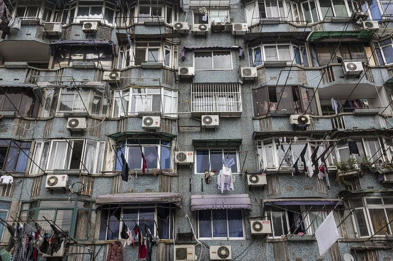

Choosing the right kind of air conditioner or chiller in your building project will help you proactively prepare for future refrigerant requirements. [Project Drawdown](/final-review-blog/burnham-nationwides-climate-change-drawdown-series/) ranks [refrigerant management](http://www.drawdown.org/solutions/materials/refrigerant-management) as the number one solution to global warming. The refrigerant hydrofluorocarbon (HFC) is the primary culprit in climate change resulting from air conditioners and chillers.

<em>Air conditioners in China.</em>

While proper management and destruction of HFCs currently in use can result in major reductions of greenhouse gases, the ultimate goal is the complete phaseout of HFCs. Members of the building industry should understand the current status of HFC use in the United States (US) and plan for their eventual elimination.

## Understanding HFCs

HFCs, super greenhouse gases, trap large amounts of heat in the atmosphere. According to the United States Environmental Protection Agency (EPA), [HFCs’ global warming potentia](https://www.epa.gov/ghgemissions/understanding-global-warming-potentials)l is thousands of times greater than that of carbon dioxide.

Unfortunately, the use of HFCs is increasing more rapidly than any other greenhouse gas, approximately [10-15% a year](https://www.osti.gov/scitech/servlets/purl/1235571). The demand for refrigerators and air conditioners, equipment that uses HFCs, is steadily increasing as income rises in developing countries.

The expanding application of HFCs began with the need to find a substitute for chlorofluorocarbons (CFCs), a commonly used refrigerant. Scientists became aware in the late 1970’s that CFCs were causing a hole in the ozone layer.

In response, 197 countries, including the US, signed [The Montreal Protocol on Substances that Deplete the Ozone Layer (Montreal Protocol)](http://ozone.unep.org/en/treaties-and-decisions/montreal-protocol-substances-deplete-ozone-layer), an international treaty finalized in 1987. The Montreal Protocol required the phaseout of ozone-depleting substances and went into force on January 1, 1989. Given HFCs don’t contribute to ozone destruction, their use as a refrigerant accelerated with the worldwide elimination of CFCs.

## Kigali Amendment

Scientists became fully aware only after the Montreal Protocol was ratified that HFCs have their own deleterious effects. The parties to the Montreal Protocol decided on October 15, 2016, to adopt an amendment requiring the phaseout of HFCs, known as the [Kigali Amendment](http://multimedia.3m.com/mws/media/1365924O/unep-fact-sheet-kigali-amendment-to-mp.pdf), to combat global warming.

The Kigali Amendment has a timetable for the elimination of HFCs. Developed countries will begin the process of phasing out HFCs followed by less developed countries stopping their use of HFCs. The Kigali Amendment requires more affluent countries to provide funding to help poor countries transition to alternative chemicals. Importantly, the amendment also contains an eventual ban on trade with countries that don’t comply with the treaty’s provisions.

According to the New York Times, the implementation of the Kigali Amendment is projected to prevent a [1 degree Fahrenheit](https://www.nytimes.com/2016/10/15/world/africa/kigali-deal-hfc-air-conditioners.html) rise in the atmosphere’s temperature. Even though it has received much less press, some view the Kigali Amendment, due to its clear timetable and commitments, as more powerful than the Paris Accord.

## US Ratification of the Kigali Amendment

Project Drawdown cites the Kigali Amendment as a major reason for optimism that HFCs will be phased out. However, it is important to understand that a variety of conditions must be met before the Kigali Amendment’s requirements will apply in the US.

For an international treaty to be in force, it must be ratified by at least 20 countries. The Kigali Amendment [reached this goal](https://www.unenvironment.org/news-and-stories/press-release/montreal-protocol-celebrates-another-milestone-agreement-reduce) in November 2017, so it will be effective beginning January 1, 2019. Yet, most countries, including the US, still need to ratify the amendment.

The US State Department has only begun the [process necessary for the United States to ratify](https://www.washingtonpost.com/news/energy-environment/wp/2017/11/22/after-ditching-paris-trumps-team-has-another-big-international-climate-decision-to-make/?utm_term=.2b853e5a6b09) the treaty. US ratification of the Kigali Amendment will most likely require Senate approval and no Senate timetable for the treaty’s consideration has been released.

Prior amendments to the Montreal Protocol took the US a number of years to ratify, and given the current political climate, approval of the Kigali Amendment could take longer.

## US Implementation of Kigali Amendment’s Requirements

The US will also need to create new policies and regulations to fully implement the Kigali Amendment domestically. Initial attempts to do this have been problematic.

EPA tried to use Section 612 of the Clean Air Act (CAA) to eliminate HFCs. To carry out the original Montreal Protocol’s requirements, Congress adopted Section 612, the part of the CAA requiring EPA to evaluate substitutes for ozone-depleting chemicals. EPA developed the Significant New Alternatives Policy (SNAP) to implement Section 612.

SNAP has separate lists of acceptable and prohibited substances. Given HFCs don’t cause ozone depletion, EPA placed them on the list of acceptable substances and businesses began using HFCs in lieu of banned ozone-depleting refrigerants.

In 2009, EPA determined that greenhouse gases such as HFCs were causing climate change, and the Obama administration announced in 2013 that EPA would find ways to reduce HFCs. EPA [issued new rules in 2015](https://www.gpo.gov/fdsys/pkg/FR-2015-07-20/pdf/2015-17066.pdf) pursuant to Section 612 that transferred HFCs to the list of unacceptable substances.

Several foreign manufacturers challenged EPA’s authority to prohibit HFCs under Section 612 in the case [Mexichem Fluor, Inc. V. EPA](https://www.cadc.uscourts.gov/internet/opinions.nsf/3EDC3D4817D618CF8525817600508EF4/$file/15-1328-1687707.pdf). On August 8, 2017, the United States Court of Appeal for the District of Columbia held that Section 612 does not allow EPA to ban the use of HFCs by manufacturers that already switched to using the refrigerant as a substitute for ozone-depleting substances.

EPA will now have to find a different way to prohibit the use of HFCs. The agency may be able to use its authority under the Toxic Substances Control Act or other CAA provisions. However, an act of Congress may ultimately be required for the US to fully comply with the Kigali Amendments, something unlikely happen in the near future given the current atmosphere in Washington.

Earlier progress in banning HFCs within the US may come at the state level. California’s Air Resources Board, for example, [approved a strategy in 2017 to phase out HFCs](https://www.businesswire.com/news/home/20170324005524/en/California-Approves-Strategy-Reduce-Super-Pollutants-EIA) in air conditioners and refrigerators.

## American Companies Developing HFC Substitutes

Many United States companies support the Kigali Amendment. They like the predictability offered by the Kigali Amendments’ schedule for phasing out HFCs and view a ban on the refrigerant as creating business opportunities for proactive manufacturers. American companies also realize that if the US doesn’t sign the Kigali Amendment, they could be subject to the treaty’s trade restrictions.

Chemours and Honeywell, two companies that intervened in support of EPA in Mexichem Fluor, Inc. V. EPA, have already created climate-friendly HFC alternatives. Manufacturers are also developing air conditioners and chillers to use these new refrigerants.

Johnson Controls, for example, has a [new line of chillers](http://www.johnsoncontrols.com/media-center/news/press-releases/2016/10/11/r513a) that employ the alternative refrigerant R-513A, and Schneider Electric also has a [line of chillers](http://www.apc.com/salestools/FFAI-ADYKVJ/FFAI-ADYKVJ_R1_EN.pdf) that use environmentally refrigerants. According to the [Climate & Clean Air Coalition](http://ccacoalition.org/en/news/next-generation-air-conditioners-be-more-energy-efficient-and-climate-friendly), the next generation of air conditioning systems will be more energy efficiency in addition to using HFC substitutes.

## Importance of Investing in Low Global Warming Potential Equipment

It is prudent for members of the building industry to proactively learn about and invest in air conditioners and chillers that use HFC alternatives despite the United States’ slow progress in prohibiting HFCs. The ban on HFCs will eventually take place.

For those wishing to learn more, EPA has several fact sheets on HFC-alternative refrigerants, including a 2016 document on [alternatives for residential and commercial air conditioning and chillers](https://www.epa.gov/sites/production/files/2016-12/documents/international_transitioning_to_low-gwp_alternatives_in_res_and_com_ac_chillers.pdf). The fact sheets describe currently available refrigerant substitutes, the type of equipment appropriate for each refrigerant, and the particular refrigerant’s efficiency, performance, and safety.

<em>This blog post is part of Burnham Nationwide’s [Drawdown Series](/final-review-blog/burnham-nationwides-climate-change-drawdown-series/).</em>
