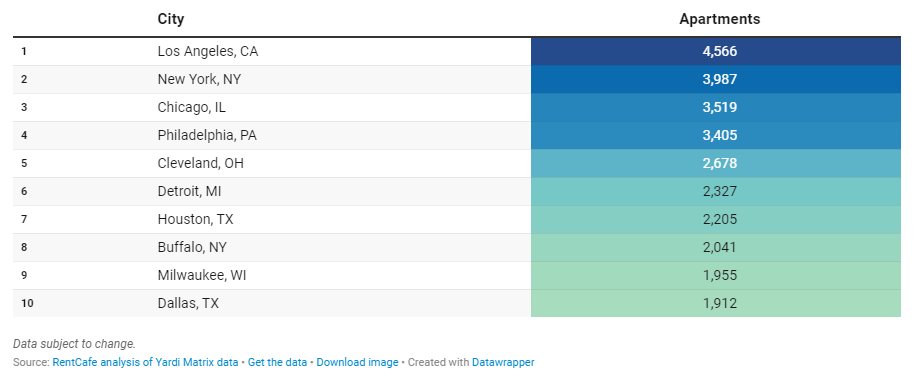

While real estate requirements are constantly evolving, the COVID-19 pandemic (and the subsequent shifts in work dynamics) accelerated many of these changes. Due to the increase of work from home policies, we have seen a surplus of office space and an increasing demand for affordable housing in urban areas. As a result, many cities are in a housing crisis while large, commercial buildings are sitting empty. 

In the context of office-to-residential conversions, we are specifically focusing on local laws dictating how land and buildings can be used within a specific area– even down to the neighborhood. Common zones include residential, commercial, and industrial. Rezoning, for the purposes of this discussion, is changing the classification of a property, or area within the city, from office to residential. 

## *Booming industry*

According to a [RentCafe analysis of Yardi Matrix data](https://www.rentcafe.com/blog/rental-market/market-snapshots/adaptive-reuse-apartments/), these conversions are happening across the country. In 2022 alone, a total of 10,090 apartments were converted in 2022. There is a projected 63 percent increase in upcoming projects. Where are the hotspots? The top 10 cities for future apartment conversions according to this data are:

## *Challenges and Considerations*

While there are many factors driving the desire of rezoning, we have already seen a number of considerations developers and city officials are considering before taking steps to rezone and convert existing buildings. 

1.  ### <strong>Zoning Regulations and Legal Hurdles:</strong>
    
    Navigating the complex web of zoning regulations and obtaining the necessary permits can be a daunting task. Property owners and developers must work closely with local authorities to ensure compliance.
    -   <em>Note: Burnham has extensive experience in due diligence analysis for any type of conversions.</em>
2.  ### <strong>Infrastructure and Utility Requirements:</strong>
    
    Converting office buildings into residences may require upgrades to utilities, such as water, electricity, and sewage systems. Adequate infrastructure is essential to support residential use.
    -   Simply put, offices and residential buildings are simply built differently. In many offices, the MEP (mechanical, electrical, and plumbing) placements are usually run in columns straight through the building. Meanwhile, residential buildings need MEP placements throughout each floor.
3.  ### <strong>Impact on the Local Community:</strong>
    
    Introducing more residents to an area may strain local resources like schools, public transportation, and healthcare facilities. Community engagement and careful planning are vital to mitigate these challenges. Neighborhoods currently zoned as commercial or industrial may just not have the amenities of a residential zoned area (schools, shopping, government access, etc.). 
4.  ### <strong>Historical and Architectural Preservation:</strong>
    
    Some office buildings may have historical or architectural significance. Balancing the desire for modern residential spaces with the preservation of these elements can be a delicate process. 

Keeping in mind these potential limitations, it’s no surprise that a study released by [Gensler](https://www.gensler.com/blog/what-we-learned-assessing-office-to-residential-conversions) analyzed these factors in over 300 buildings in 25 cities across North America. 

Their conclusion? “Our data reveals that only 30% of the buildings scored make for suitable candidates for conversion. Context, building form, location, floor plate size and several other factors all play a crucial role in assessing a building’s aptness for conversion.”

Of course, 30% ain’t nothing. 

We had the chance to touch base with Justin Manalo– head of the Burnham LA office– and Laurence Solis– head of the Burnham SF office– about what they have seen recently with adaptive reuse projects. 

## *Adaptive Reuse in Los Angeles*

The Adaptive Reuse Ordinance, implemented in 1999 for buildings built prior to July 1, 1974, has been instrumental in facilitating the conversion of vacant office buildings into housing units in Downtown LA, contributing to the city's residential growth. 

With a new state mandate to create zoning rules for an additional 255,000 homes, the city is considering expanding this ordinance citywide. The proposed expansion would make all buildings citywide that are at least 15 years old eligible for conversion, as well as buildings between five and 15 years old with the approval of a conditional use permit and parking garages at least five years old. 

The proposed regulations would retain provisions for flexibility in converting historic structures, including exemptions from parking requirements and density limits, with conversion projects subject to the city's linkage fee ordinance for generating funds for affordable housing development. The city is currently conducting a feasibility study to determine affordability requirements for these adaptive reuse projects. The [proposed changes](https://planning.lacity.org/odocument/6725f347-7fdb-42fa-aa6e-44c37f8fa999/Fact_Sheet_-_Adaptive_Reuse_Ordinance.pdf) would also waive ADA provisions which would ease the process for developers. 

## *Adaptive Reuse in San Francisco*

While San Francisco doesn’t top the lists of Adaptive Reuse cases, there has been recent movement. 

As of August 4, 2023 the “[Commercial to Residential Adaptive Reuse and Downtown Economic Revitalization](https://sfgov.legistar.com/View.ashx?M=F&ID=12136870&GUID=0FACE15F-39E2-483E-9B6B-AEC3B582813B)” ordinance has been effective. 

Of course, there are restrictions and guidance provided in this ordinance. 

First, the project needs to be in a special zoning area. Second, it can't ask for special permissions or exceptions to a few of the existing Planned Code Sections. Third, it can't make the building much bigger; must not propose an addition to the building envelope exceeding 33% of the existing building's Gross Floor Area. And lastly, the project needs to apply for this program before the end of 2028.

## *Burnham gets it done*

While it may seem like the ordinances progressing in California are straightforward, developers looking to engage in these reuse projects will want to dot all of their i’s and cross every t. 

Burnham is here to assist you. We know what policies exist in these cities. We can navigate which codes apply. We will be able to identify each and every permit needed for these specific projects and how to traverse each city’s requirements to save you time and money on your projects.

[Contact us](/contact/) through our site or give us a call at (800) 407-7990.

Has LA's Adaptive Reuse Ordinance expansion to the whole city actually happened? Yes, what was a proposal at the time of this post is now law. The Citywide Adaptive Reuse Ordinance took effect February 1, 2026, repealing the old geographic restriction (downtown, Hollywood, Koreatown, Chinatown) and making adaptive reuse eligibility available anywhere in the city. What buildings qualify for conversion under LA's Citywide Adaptive Reuse Ordinance? Buildings at least 15 years old qualify for a streamlined, by-right approval process. Buildings between 5 and 15 years old can still qualify but need approval through an administrative review or Conditional Use Permit process. Parking structures at least 5 years old and hotels under 300 units are also eligible. Why aren't more office buildings good candidates for residential conversion? Per Gensler's analysis of over 300 buildings across North America, only about 30% scored as suitable conversion candidates - floor plate size, building form, and location all heavily affect feasibility, and office MEP systems (mechanical, electrical, plumbing) are typically routed very differently than what residential buildings need. What's San Francisco's rule for office-to-residential conversions under its adaptive reuse ordinance? Projects must be located within a designated special zoning area, can't request exceptions to certain existing planning code sections, can't expand the building's gross floor area by more than 33%, and must apply before the program's end-of-2028 deadline. Does converting an office building to residential require different utility infrastructure? Often, yes. Office buildings typically run mechanical, electrical, and plumbing systems vertically through central columns, while residential units need those systems distributed across each floor - meaning conversions frequently require significant infrastructure upgrades, not just interior layout changes.
