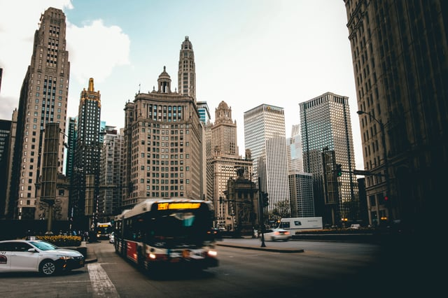
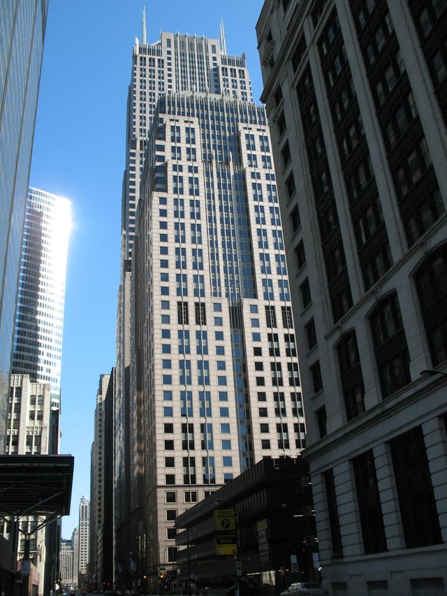
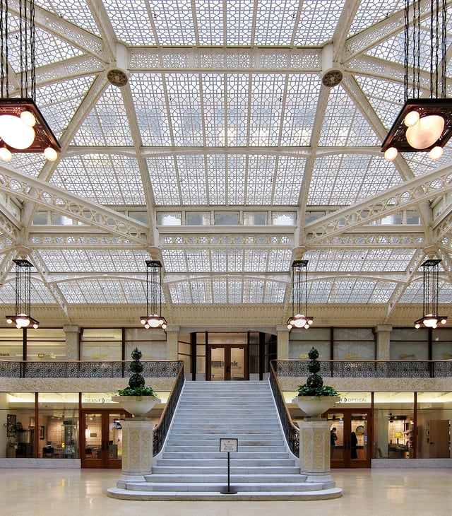

The Retrofit Chicago Energy Challenge (the Challenge), formerly known as the Commercial Buildings Initiative, promotes energy efficiency and sustainable solutions through voluntary participation by City of Chicago building owners, managers, engineers, and others involved in the real estate and management industries. Part of the greater [Retrofit Chicago](https://www.cityofchicago.org/city/en/progs/env/retrofit_chicago.html) efficiency program, the Challenge continues to provide building owners and managers with strategies and incentives for greener buildings.

<em>image credit: [Sawyer Bentson via Unsplash](https://unsplash.com/search/photos/chicago?photo=hBb_swGRCe4)</em>

## History of the Retrofit Chicago Energy Challenge

The Challenge began as the [Commercial Buildings Initiative](http://www.retrofitchicago.net/about) (the Initiative) established by Mayor Rahm Emanuel in 2012. In this first iteration, the program targeted existing commercial properties within the City of Chicago. Fourteen founding participants committed to an energy savings of at least 20% within five years including the Sheraton Chicago Hotel & Towers, the Wrigley Building, NBC Tower, and 224 South Michigan Avenue (formerly the Sante Fe Building).

The program continued to grow, doubling in size in 2013 and reaching 50 participants in December 2014, including 10 universities. In July 2016 the first non-commercial buildings joined the Initiative, prompting the name change and further program expansion to include diverse buildings of all ages and uses.

The Retrofit Chicago Energy Challenge reflects the City’s sustainability goals and participation in the [Better Buildings Challenge](/final-review-blog/energy-efficiency-better-buildings-initiative/), part of a federal program with the aim to reduce energy usage in commercial and industrial industries by 2020.

## Retrofit Chicago’s Goals, Requirements, and Partnering Organizations

Participants in Retrofit Chicago [commit](http://www.retrofitchicago.net/images/NRDC_Retrofit_report_productionREV_071714%202.pdf) to reducing energy usage by 20% or more within five years of joining the Challenge, must start improvements within six months, and also commit to sharing energy efficiency best practices with the public and with other participants.

The program is led by the City’s Chief Sustainability Officer with support from the Chicago City Director of the C40 Cities (Climate Leadership Group). To facilitate energy savings, provide recognition for benchmark achievements, promote the program, and measure the effects of the Challenge, participants [partner](http://www.retrofitchicago.net/partners) with organizations including the National Resource Defense Council, U.S. Green Building Council Illinois, BOMA-Chicago, and the Chicago Metropolitan Agency for Planning.

Partners also include companies such as ComEd and Peoples Gas and technical advisers that provide incentives for energy savings and make improvements cost-effective. These groups promote regional dialogues on commercial energy efficiency and provide cross-sector collaboration and support so that buildings can accelerate efforts and meet program goals.

## The AT&T Building

<em>image credit:</em> <em>[TonyTheTiger at English Wikipedia, CC BY-SA 3.0](https://commons.wikimedia.org/w/index.php?curid=10472224)</em>

Built in 1968, the [AT&T Building](http://www.retrofitchicago.net/participants/item/the-at-t-building) is a one million square-foot facility with 30 stories of office space. Occupied entirely by AT&T (formerly Illinois Bell) since construction, earlier savings initiatives at 225 W Randolph Street included window film application and high efficiency water systems installed in 2011. AT&T Corporate Real Estate - the property’s management team - targeted [interior lighting](http://www.retrofitchicago.net/images/NRDC_Retrofit_report_productionREV_071714%202.pdf) for achieving reduction in energy use as well as adapting older technology to be more efficient.

Installation of motion-activated lighting, designed to be turned on only when floors are occupied and dimmed during the day, has [reduced](https://www.nrdc.org/experts/att-building-225-west-randolph-laboratory-energy-efficiency-innovation) the building’s lighting usage by 60-65%. Improvements have also target the HVAC system, creating a localized air conditioning system that is active only where employees are working.

As of 2016, the AT&T Building exceeded the Challenge’s goals with 25% energy reduction within five years and has been inducted into the [Mayor’s Leadership Circle](https://www.nrdc.org/experts/lauren-zullo/leadership-honored-2016-retrofit-chicago-awards), part of a team providing peer feedback and leadership to other Challenge members.

## The Rookery Building

<em>image credit: [By Velvet - Own work, CC BY-SA 3.0](https://commons.wikimedia.org/w/index.php?curid=20159186)</em>

Located at 209 South LaSalle Street, the landmark [Rookery Building](http://www.retrofitchicago.net/participants/item/the-rookery-building) is one of the oldest participants and has been a Challenge member since March 2013. Built in 1888 and designed by iconic Chicago architects Daniel Burnham and John Root with a lobby redesigned by Frank Lloyd Wright, the over 300,000 square foot building is “one of the most historically significant buildings … at the center of Chicago’s downtown Financial District.”

Though the building had already undergone retro-commissioning through ComEd’s [program](https://www.comed.com/WaysToSave/ForYourBusiness/Pages/RetroCommissioning.aspx), the Rookery’s engineering team [further modified](http://www.sustainable-chicago.com/2017/03/23/the-rookery-evolving-standards-of-architecture-in-chicago/) the heating and cooling intake systems to be more efficient and achieved a 24% reduction in energy use last year - securing its place in the Leadership Circle.

Other [facilities](https://www.nrdc.org/experts/lauren-zullo/leadership-honored-2016-retrofit-chicago-awards) to exceed their goals prior to their target dates include the Fifth Third Center achieving 21% reduction in energy use, the Inland Steel Building achieving 23% reduction, and the School of the Art Institute of Chicago achieving 33% energy savings.

## The Challenge Leads by Example

As of 2017, the Challenge [now includes](http://www.thebiojournal.com/chicago-aims-at-being-the-most-sustainable-city-of-the-21st-century/) 76 buildings with a total area of 51.3 million square feet. Participants are diverse and include Loop office buildings, historic sites, nonprofits, affordable housing developments, and universities. The Retrofit Chicago Energy Challenge received the Midwest Energy Efficiency Alliance’s 2014 [Inspiring Efficiency Impact Award](http://www.retrofitchicago.net/awards) and continues to  attract new buildings dedicated to implementing sustainable technology and improving building performance. Using programs such as the Challenge, the City of Chicago will continue to lead the way for environmentally-conscious and responsible architecture.
