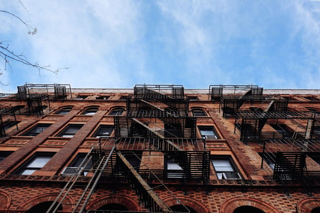
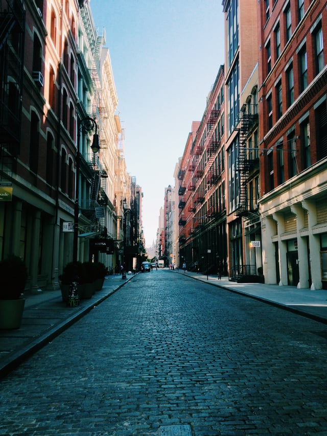

The [National Trust for Historic Preservation](http://savingplace.org) (National Trust) provides historic designations and advocates for the preservation of historic buildings throughout the country. The organization assists with funding efforts to save threatened structures and proposes ways to preserve buildings as part of sustainable development. The organization advocates for [Adaptive Reuse](/final-review-blog/high-to-low-adaptive-reuse-in-pursuit-of-urban-parkland/), a preservation strategy that develops existing buildings for new uses without demolition or severe loss of historic character.

One of these efforts involved the thorough study of the role of older buildings in modern cities by the Preservation Green Lab, leading to the development of the ReUrbanism Initiative and the “[Atlas of ReUrbanism](http://forum.savingplaces.org/act/pgl/atlas)”, an outline of the benefits of mixed-aged cities that we’ll explore in this post.

<em>image credit: [Daryan Shamkhali](https://unsplash.com/photos/yuhjpNvG9u0?utm_source=unsplash&utm_medium=referral&utm_content=creditCopyText) on [Unsplash](https://unsplash.com/?utm_source=unsplash&utm_medium=referral&utm_content=creditCopyText)</em>

## *Older, Smaller, Better* Data Supports Preservation

The National Trust’s [Preservation Green Lab](http://forum.savingplaces.org/act/pgl) “connects old buildings to new ideas” and is sustainability centered in its research, policies, and solutions. The Green Lab’s reports illustrate the benefits of adapting older buildings and includes precursors and related topics to the *Atlas*, including *Older, Smaller, Better* - a 2014 [report](http://forum.savingplaces.org/connect/community-home/librarydocuments/viewdocument?DocumentKey=83ebde9b-8a23-458c-a70f-c66b46b6f714) that outlines some of the valuable assets mixed-age blocks provide.

The report finds that older, mixed use neighborhoods are more walkable and have improved access to public transportation, a community characteristic that has become increasingly important to [both millenials and baby boomers](https://www.strongtowns.org/journal/2016/2/12/americans-want-walkable-neighborhoods). The growing trend of [transit-oriented developments](/final-review-blog/overview-of-chicago-transit-oriented-development/) (developments with reduced or eliminated parking ratios) presents another approach to increasing density in urban areas.

Mixed age blocks have “significantly higher Walk Score and Transit Score ratings than neighborhoods with large, new buildings” according to the report. Walk Scores, determined using [methodology](https://www.redfin.com/how-walk-score-works) created by the Walk Score advisory board, awards points based on time and distance to amenities. Walk Scores are consistently higher for older and mixed-age blocks than areas with majority new development according to the report.

Smaller vintage buildings are also linked to a “more diverse mix of residents from different age groups” in neighborhoods that have a lively nightlife. According to the Green Lab’s research, mixed-vintage buildings in San Francisco, Washington D.C., and Seattle have greater cell phone use on Friday nights with thriving businesses and a “significantly higher proportion of non-chain restaurants and retailers.”

In addition to a greater presence of these characteristics, mixed-age blocks also contain more diverse businesses and business owners, more small businesses within a thriving local economy, and a key finding - hidden density.

## The Importance of Hidden Density

The National Trust published a [blog post](http://forum.savingplaces.org/blogs/mike-powe/2017/04/18/the-hidden-density-of-older-buildings) earlier this year on some of the Green Lab’s reports, including *Older, Smaller, Better*, that indicate that older buildings have a hidden density that better addresses the needs of diverse demographic groups. While new buildings may be built with more units, the studies conducted in the aforementioned cities demonstrate that mixed streets have a greater population density and more businesses present than the majority of new buildings.

The report shows that the space-saving capabilities of smaller residential buildings that, contrary to popular belief, may not have originally been designed as single-family homes at all, provide “hidden density” on older blocks. These buildings may house multiple families or may have accessory buildings such as coach houses on the property not readily visible from the street. As cities continue to grow and demand increases for walkability, the hidden density provided by historic buildings is invaluable to meet housing needs for increasing populations.

Beyond residential density, the report found that high character blocks also had a higher density of small businesses and more job creation due to lower rents for more flexible spaces.

<em>image credit: [Nicholas Swanson](https://unsplash.com/photos/SyBYM8R6VU4?utm_source=unsplash&utm_medium=referral&utm_content=creditCopyText) on [Unsplash](https://unsplash.com/?utm_source=unsplash&utm_medium=referral&utm_content=creditCopyText)</em>

## The Atlas of ReUrbanism and the Role of Adaptive Reuse

The National Trust defines ReUrbanism as their commitment to a sustainable future and the reinvestment and revitalization of cities through adaptive reuse as the “[default option in American cities](http://forum.savingplaces.org/blogs/forum-online/2016/09/07/ten-principles-for-reurbanism-reuse-and-reinvestment-in-the-21st-century).”  Common examples include repurposing warehouse or loft space as residences or offices, but proposals may include unique historically-significant structures such as Chicago’s [water cribs](/final-review-blog/preserving-historic-endangered-places/) with more creative uses.

It is an inherently green practice that the National Trust examined in *The Greenest Building: Quantifying the Environmental Value of Building Reuse*. As environmentally-conscious building practices continue to be desirable, the Trust’s [determination](http://forum.savingplaces.org/connect/community-home/librarydocuments/viewdocument?DocumentKey=227592d3-53e7-4388-8a73-c2861f1070d8&CommunityKey=00000000-0000-0000-0000-000000000000&tab=librarydocuments) that “when comparing buildings of equivalent size and function, building reuse almost always offers environmental savings over demolition and new construction" makes a further case for the benefits of preservation.

After analyzing the trends revealed in the 2014 hidden density report, the Green Lab expanded their research to 50 US cities of varying sizes to form the [Atlas of ReUrbanism](http://forum.savingplaces.org/viewdocument/report-atlas-of-reurbanism-buildi). Relased in November 2016, the findings indicate that the majority of the benefits (increased diversity, walkability, etc.) found in Seattle, Washington D.C., and San Francisco are trends throughout the country.

Adaptive reuse and the preservation of historic character provides cities with tangible and desirable benefits as well as an economically viable and environmentally conscious way to grow. The Atlas positions these benefits not as simply amenities, but as necessary to the fabric of a sustainabile city.

## The Atlas Demonstrates that Preservation and Progress Can Exist Together

While not every block examined in every city supported the above findings, and the National Trust believes that [responsible new development](http://forum.savingplaces.org/blogs/mike-powe/2017/04/18/the-hidden-density-of-older-buildings) is also key to healthy cities, the reports provide data that stress that not only can new development and preservation co-exist, but it can guarantee that cities remain healthy and vibrant. By pursuing adaptive reuse programs, neighborhoods can provide more affordable housing, support local economies, and continue to preserve their unique character.
