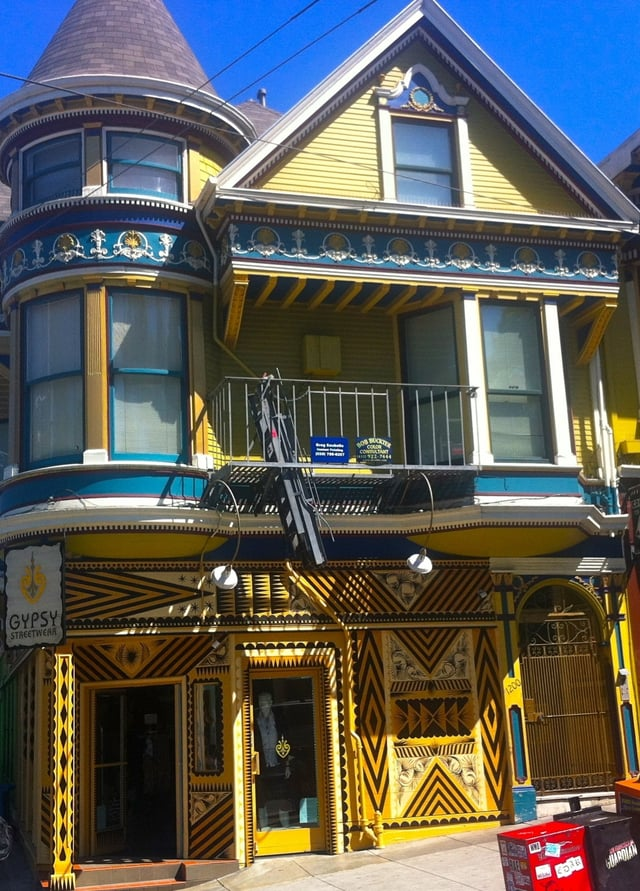

In April 2016, San Francisco adopted legislation intended to increase access to businesses for people with disabilities. [Ordinance No. 51-16](http://www.sfbos.org/ftp/uploadedfiles/bdsupvrs/ordinances16/o0051-16.pdf), known as the Mandatory Disabled Access Improvements Ordinance (Ordinance), sets forth primary entrance requirements for owners of existing buildings that serve as places public accommodations. The San Francisco Department of Building Inspection (Department) is currently working on the details necessary for implementing and enforcing the new law that improves disability access.

## Background

The Americans with Disabilities Act (ADA) Title III requires that any existing building that operates as a place of public accommodation or commercial facility remove barriers to accessibility unless barrier removal is “not readily achievable.” The regulations implementing the ADA Title III, the 2010 Standards for Accessible Design, make it clear that eliminating barriers to access for places of public accommodation from public sidewalks, parking, or transportation is a priority.

The California Building Standards Code, Title 24 of the California Code of Regulations, requires existing buildings operating as places of public accommodations to remove barriers to accessibility as part of the permit application process. Additionally, several California civil rights laws, including the Unruh Civil Rights Act, trigger accessibility requirements and allow private parties to recover damages for ADA violations.

California also has a unique requirement that inspections must be performed by a certified disability access specialist known as a CASp Inspector. The Department only enforces the state accessibility requirements. However, San Francisco businesses must also comply with the federal ADA requirements.

The Ordinance was originally introduced by Supervisor Katy Tang in July of 2015. The San Francisco Office of Small Business was interested in a law that would improve access to existing buildings by clarifying who is responsible for accessibility compliance. Landlords and tenants each believed the other was responsible for compliance with accessibility requirements. The end result was that improvements were not made and disabled persons were denied proper access. The new law would increase such accessibility by specifying that building owners are responsible for making these improvements.

In addition, California has seen a large increase in ADA Title III and accessibility lawsuits, particularly those brought by serial litigants. It is hoped that such lawsuits will be prevented if businesses are given a path to compliance.

## Compliance Categories

The Ordinance adds a new Chapter 11D to the San Francisco Building Code (Building Code) and requires that any place of public accommodation, as defined by the ADA and California law, has primary points of entry and entrance routes that are accessible. The new program has four categories based on the type of building entrance.

The four categories apply only to buildings built or altered prior to January 1, 2002, and therefore, new construction after that date does not fall under the program. Such new construction is presumed to be accessible. The following are the four compliance categories as set forth in Section 1103D:

-   Category 1 - primary entrance(s) without steps and is in compliance with Chapter 11D
-   Category 2 - primary entrance(s) without steps but other elements are out of compliance with Chapter 11D
-   Category 3 - primary entrance(s) has one step and one or more elements are out of compliance with Chapter 11D
-   Category 4 - primary entrance(s) with more than one step and one or more elements are out of compliance with Chapter 11D

If any building built prior to January 1, 2002, does not fall into one of the above four categories, the Department will determine which category should apply.

## Compliance Timeline

The compliance deadlines depend on the building’s category. The Ordinance’s timeline for compliance is modeled on the system used for another San Francisco program, the Mandatory Soft Story Program, that creates a phased approach for retrofitting older, wood-framed buildings to protect against earthquakes.

Owners of buildings that fall in any of the Ordinance’s four categories must obtain an inspection and submit a Primary Entry Compliance Checklist by the deadline set for the building’s category. With the exception of Category 1, a building must apply for the requisite building permit to correct any non-compliant building elements within 90 days of submitting the checklist. As part of the permit process, a plan must be submitted for coming into compliance. The building permit must be obtained within a year of the permit application.

All work must be completed prior to the expiration of the building permit as outlined in Section 106A.4.4 of the Building Code and be inspected. Some compliance timeline extensions may be granted but require a written request. An extension may be allowed for up to six months with the possibility of additional extensions. All work required by the Ordinance must be completed by six years from the effective date of the Ordinance, May 22, 2016.

Originally, the first compliance deadline was planned for May 22, 2017. However, given that the details for implementing the Ordinance are still being worked on, that deadline is being postponed.

## Exceptions

The Ordinance allows a building owner to demonstrate that bringing a particular element into compliance is technically infeasible, as defined by the Building Code Chapter 2. An owner may also submit a Request for Approval of an Unreasonable Hardship which will be considered by the Access Appeals Commission. In addition to the supporting documentation, a Request for Approval of an Unreasonable Hardship must demonstrate that an equivalent facilitation will be available. There are also unique requirements for buildings that must comply with the California Historical Building Code.

## Disability Access Compliance Unit

The new law also mandates the creation of the Disability Access Compliance Unit that is responsible for enforcing the Ordinance’s requirements. Additionally, the Disability Access Compliance Unit will coordinate with other City departments and carry out a variety of other functions to implement the program. The new unit will consist of a minimum of one CASp Inspector as well as other necessary Department employees.

## Implementing the Law

A task force is still working on many of the critical steps necessary for implementing the Ordinance. They are in the process of defining or clarifying a number of terms and conditions used in the Ordinance, for example, what constitutes structural and non-structural technical infeasibility. The task force also needs to create some of the documents required by the Ordinance, such as the Primary Entry Compliance Checklist. Once everything is finalized, a Department representative has assured us the requirements and additional information will be well publicized. We are looking forward to seeing how this innovative law increases accessibility.
