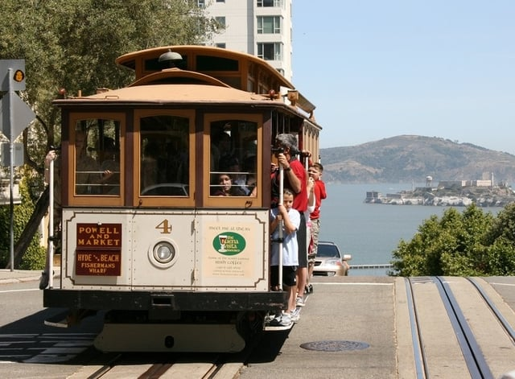

On February 17, 2017, San Francisco’s Mayor Lee approved the city’s progressive [Transportation Demand Management (TDM) Program](https://sfgov.legistar.com/View.ashx?M=F&ID=4946748&GUID=EFA4DD2C-96CE-4464-ADA0-09491EA0BF17). The TDM is designed to promote sustainability by requiring building developers to provide on-site amenities and incentives that encourage the use of public transportation and other alternatives to driving. It is critical for developers to understand the TDM Program’s requirements.

## Part of Transportation Sustainability Program

The TDM Program is part of San Francisco’s Transportation Sustainability Program that proactively responds to the city’s growth in housing and jobs. According to the ordinance implementing the TDM Program, “San Francisco is expected to grow by approximately 191,000 jobs and 102, 000 households from 2010 to 2040.”

The Transportation Sustainability Program seeks to increase and improve San Francisco’s transportation system. It is comprised of three policy initiatives:

1.  Invest - increase transportation funding to support the transportation system’s growth by assessing a development impact fee for new projects;
2.  Align - update the project environmental review process by including as a factor the amount and distance of driving caused by a project, known as the Vehicle Miles Traveled (VMT); and
3.  Shift - encourage people to use more sustainable modes of transportation.

The TDM Program is the final phase, the Shift portion, of the Transportation Sustainability Program. It requires new project developers to “incorporate design features, incentives, and tools” to make it easier to use sustainable transportation options instead of driving. In addition to offering environmentally friendly transportation, the program is intended to reduce traffic congestion and provide protections for pedestrians and cyclists.

## Development of the TDM Program

The San Francisco Planning Department (Planning Department), San Francisco Municipal Transportation Agency, and San Francisco County Transportation Authority jointly developed the TDM Program. The program was adopted as an ordinance amending the San Francisco Planning Code, including the addition of Section 169 to the code. Several hearings, as well as other stakeholder outreach, were conducted and resulted in amendments to the original proposal prior to the TDM Program’s adoption.

## TDM Program Requirements

The TDM Program’s requirements apply to new residential developments containing ten or more units, commercial developments that are 10,000 occupied square feet or greater, and changes of use of 25,000 occupied square feet or greater. Residential development projects comprised of one hundred percent affordable housing are exempt from the TDM Program’s requirements.

Developers subject to the TDM Program must submit a TDM Plan Review Application to the Planning Department together with the Development Project Application. As outlined in the most recent version of the [TDM Standards](http://default.sfplanning.org/plans-and-programs/emerging_issues/tsp/TDM_Program_Standards.pdf), new developments must attain a point target based on the project’s land use category and planned parking spaces.

Developers achieve the required target by incorporating different TDM measures into their project. They can choose from more than 60 different TDM measures which are assigned point values derived from the VMT a particular measure is projected to eliminate. A project can use up to 26 different TDM measures, and a portion of the TDM measures are only available to a particular land use category. A project ‘s TDM Plan is comprised of the measures selected for the project. Some of the measures included in the program:

-   Improved walking conditions
-   Bicycle parking
-   Car-share parking
-   Provide delivery services
-   Contributions for sustainable transportation
-   Shuttle bus service
-   Real time transportation information displays
-   Unbundled parking from rent or leases

The Planning Department provides an [online tool](http://sf-planning.org/shift-transportation-demand-management-tdm) to calculate a project’s point target and measures to reach the target. Currently, there is a $6,000 fee for the TDM Plan Review and additional fees for subsequent reviews.

All projects will be inspected for compliance with the TDM Plan upon the project’s completion and prior to receiving the First Certificate of Occupancy. There will be periodic inspections of buildings after completion with potential monetary penalties for those that remain out of compliance after input from the city.

Developers will also be required to periodically submit compliance reports. The first Ongoing Monitoring and Reporting Form is due within 30 days from the 18th month of the First Certificate of Occupancy’s issuance. After the building permit is issued, the TDM Plan must be modified using the TDM Plan Update Application if the project is changed to no longer meet the TDM Program Standards or the TDM measures used in the original plan are altered.

The Planning Department will prepare periodic reports analyzing the TDM Program’s effectiveness and will recommend any necessary changes. Thus, some of the TDM measures may change over time.

## Important Dates for Compliance

Compliance with the TDM program is being phased in. Projects with development applications submitted after September 5, 2016, and prior to January 1, 2018, need to meet 75% of the applicable target. After January 1, 2018, projects must fully comply.
