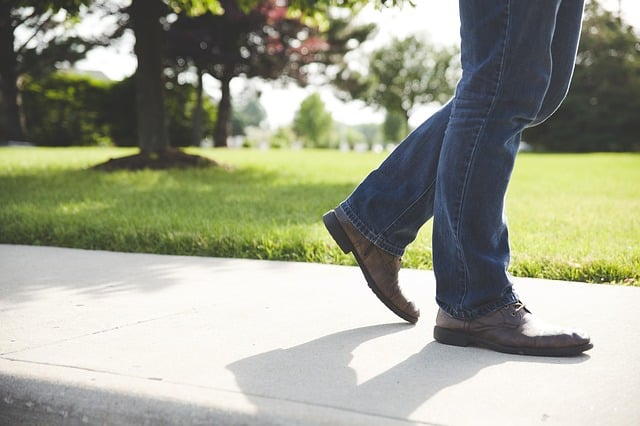

Rough surfaces can impact sidewalk accessibility for people with disabilities, particularly wheelchair users. The United States Access Board (Access Board), the federal agency responsible for creating accessibility guidelines, has sponsored research on surface roughness and the development of a standard for measuring sidewalk smoothness. In this post, we will take a look at the research and the proposed standard to make sidewalks more accessible.

## Importance of Creating a Surface Roughness Standard

Public pathways with rough surfaces can lead to harmful whole-body vibrations for people in wheelchairs. Vibrations can cause pain or injury to a wheelchair user’s body as well as fatigue. Being seated provides less support for the spine and increases sensitivity to vibration from rough surfaces. Therefore, it is very important to set a standard that limits vibrations for wheelchair users traversing different surfaces.

Currently, there is no standard for sidewalk surface smoothness or measurement of surface roughness. The [2004 ADA Accessibility Guidelines](https://www.access-board.gov/guidelines-and-standards/buildings-and-sites/about-the-ada-standards/background/ada-aba-accessibility-guidelines-2004) (ADAAG) created by the Access Board have very general provisions addressing surfaces. ADAAG Section 403 governs walking surfaces and references ADAAG Section 302 that contains requirements for ground surfaces. Section 302 only states that, “Floor and ground surfaces shall be stable, firm, and slip resistant.” ADAAG does not directly address surface roughness.

The International Organization for Standards (ISO) has a standard, ISO 2631-1, that sets a limit on whole body vibration from a vehicle called the Exposure Caution Zone. However, exposure to vibration levels within the Exposure Caution Zone may still result in an elevated risk of health impairment if they occur repeatedly over several years. Also, the ISO standard reflects how much vibration can be harmful but doesn’t help determine surface roughness’ effect on vibrations.

## The Study of Pathway Surface Roughness

The University of Pittsburgh's Human Engineering Research Laboratories conducted a study, [Development of Surface Roughness Standards for Pathways Used by Wheelchair Users: Final Report](https://www.access-board.gov/attachments/article/1680/surface-roughness.pdf) (Study), sponsored by the Access Board. The 2014 Study looked at the effect of surface roughness on whole-body vibration for manual and power wheelchair users to decide on a limit for surface roughness.

The Study used 76 different subjects split between manual and power wheelchair users. Accelerometers were attached to parts of the selected wheelchairs to test vibration, and National Instruments SignalExpress software was employed for collecting the data from the accelerometers. In addition to the quantitative data, subjects were also asked to give a subjective rating for the surfaces.

Wheelchair users drove over different outdoor surfaces, including those made of brick, concrete, and asphalt. They also tested an indoor platform consisting of wood slats that could be changed to test different roughness. A measurement tool was created to calculate the surface roughness of each surface.

The Study confirmed that as surface roughness increases so do the magnitude of vibrations and certain surfaces can impact the health and comfort of wheelchair users. A correlation was found between the quantitative data collected from the accelerometers and the subjective feedback. Although some adjustments can be made to wheelchairs to reduce vibrations, this is not a realistic option. Therefore, there is a need for a surface roughness standard.

As part of the Study, the researchers developed a measurement standard, the Pathway Roughness Index, to compute the surface roughness of a sidewalk or other pedestrian surface.The Pathway Roughness Index is an algorithm based on a 2.5 diameter wheel traveling over a surface. The goal is to make using the Pathways Roughness Index a standard practice for determining surface roughness. Also, the Study proposed a roughness index threshold of 1.20 inches per foot for a small area of less than 10 feet and 0.60 inches per foot for areas greater than 100 feet.

## Development of an ASTM Standard for Measuring Pathway Smoothness

The Study results and recommendations were sent to ASTM International (ASTM), one of the largest organizations dedicated to creating voluntary standards. The ASTM Committee on Vehicle - Pavement Systems is overseeing the development of the new standard, [ASTM WK 41917 - New Practice for Computing Pathway Roughness Index from Longitudinal Profile Measurements](https://www.astm.org/DATABASE.CART/WORKITEMS/WK41917.htm).

Currently, the ASTM standard is only in draft form and is still being worked on by the Committee on Vehicle - Pavement Systems. It will take time for ASTM to approve a standard for calculating pathway roughness because it must follow ASTM’s procedures for developing standards. A task group of an ASTM committee creates a draft standard based on an identified need. Once a proposed standard is developed, the related subcommittee, main committee, and entire membership all have opportunities to vote on the standard. Any member who casts a negative vote must also provide a written explanation that is considered before the draft standard can move on in the process. The Committee on Standards reviews any proposed standard before it is finalized.

Given that any ASTM standard for calculating pathway roughness is a voluntary standard, the goal is for the Access Board to incorporate the new standard into its guidelines. They will become an enforceable standard once adopted by the Department of Justice.

## Improved Standards for Public Rights-of-Way

Creating a standard for sidewalk smoothness is only one important step in improving sidewalk accessibility. For a number of years, the Access Board has been trying to develop guidelines for public rights-of-way that address a variety issues that would make sidewalks and other pathways more accessible. We at Burnham will keep you informed as new standards for accessible sidewalks become available.
