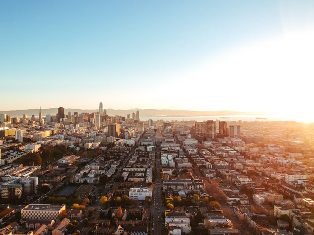

Our Burnham Nationwide office location in San Francisco is open to meet the needs of our West Coast clients that need permitting services in Northern California. The San Francisco area has seen a building boom over the last few years, as tech companies chose the city over Silicon Valley and prices for office and rental space skyrocket, and construction show little sign of slowing down. If you're building in San Francisco, what do you need to know to permit your project successfully?

Here are six things to consider when applying for building permits in San Francisco:<em>image by [Robert Bye](https://unsplash.com/photos/R-WtV-QyVnY)</em>

## San Francisco is in a Building Boom

In 2015, 12,766 single or multifamily housing permits were issued in the San Francisco metro area, according to U.S. Census Bureau data gathered by the [San Francisco Chronicle](http://www.sfchronicle.com/business/networth/article/Bay-Area-building-boom-may-not-end-housing-7223711.php). This represents a 28% increase from 2014. But it’s not just housing permits that are seeing a boost. According to [San Francisco Business Times](http://www.bizjournals.com/sanfrancisco/blog/real-estate/2016/02/bay-area-largest-office-projects-underconstruction.html), the largest office projects under construction total more than 5 million square feet of space with more than $1.2 billion in building costs.

## San Francisco Permit Services

Permit Services, part of the City & County of San Francisco’s Department of Building Inspection (DBI), is responsible for issuing all permits to ensure that proposed construction meets all safety requirements in a timely manner. There are three main entities that make up the Permit Services department: Central Permit Bureau (CPB), Initial Permit Review (IPR), and Permit Processing Center (PPC).

-   <strong>Central Permit Bureau:</strong> The CPB accepts and issues construction, electrical, plumbing, and street space permits for all public and private buildings. CPB also assesses and collects fees for all structures, building enlargements, and change of use.
-   <strong>Initial Permit Review:</strong> IPR handles reviewing building permit applications and plans prior to review.
-   <strong>Permit Processing Center:</strong> PPC handles the coordination of building permit applications between the different departments of the Department of Building Inspection prior to issuance of the permits. It also handles cancellation notices and revisions given by the Planning Department.

## Online Permit Applications

The DBI offers [instant online permits](http://sfdbi.org/instant-online-permit) for electrical, plumbing and mechanical permits, and boiler permit to operate. In order to file your online permits, you first need to register with the DBI. Here’s how:

-   Read and comply with the Instructions and Registration Requirements for DBI Online Electrical, Mechanical and Plumbing Permits.
-   Complete the Contractor’s Agreement and Terms of Service
-   Send completed and signed forms to the Department of Building Inspection, Management Information Services via the mail, fax, or email.

Once the forms are received and your license verification is completed, DBI Online Services will issue you a username and password to begin the online permit process.

## Building Permit Fees and Cost Schedule

A new 2016 Cost Schedule went into effect March 21, 2016. According to the DBI, a valuation based on the [permit fee table](http://sfdbi.org/fees) “represents the valuation at the completion of all construction work authorized by a building permit. Permit fees are based on a percentage of this valuation. These valuations are not to be used as accurate guides to the actual cost of construction.”

The [cost schedule](http://sfdbi.org/cost-schedule) is updated on an annual basis, and the valuation information is based on a variety of sources including local contractors, design professionals, cost estimators, and nationally published construction cost data.

## Development Impact Fees

Additionally, effective January 1, 2016, most Development Impact Fees will increase by 5%. Development Impact Fees are fees assessed to projects in order to mitigate the impacts caused by new development on public services and infrastructures. For example, an impact fee charged to a new office building may go towards improving MUNI. Generally, impact fees are assessed by the Planning Department and collected by the DBI when permits are issued.

## Permit/Complaint Tracking System

The City and County of San Francisco has a [Permit/Compliant Tracking System](http://sfdbi.org/dbi-permit-tracking-system) that allows you to track building, electrical, plumbing and boiler permits as well as any complaints online. The system allows you to search by site address, permit application or number, application information, a specific keyword, or by browsing a map. The online permit records go back as far as the 1980s, so you can search for the permit or complaint history of a building in addition to the status of current projects.

If you’re having trouble navigating the San Francisco building permit process, let the experts at Burnham help! [Contact us today](/contact/).
