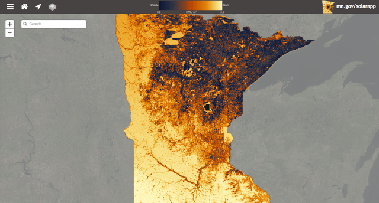

The University of Minnesota has created the [Minnesota Solar Suitability Analysis application](http://solar.maps.umn.edu/app/), an ongoing project aiming to map solar potential across Minnesota using Lidar data and GIS technology. The project is led by graduate students in the Masters of Geographic Information Science program.

Minnesota adopted comprehensive state legislation designed to expand solar in 2013. The policy includes a requirement that 1.5% of electricity generated in the state come from solar by 2020 with a goal of 10% of electricity coming from solar by 2030. While there has been an increase in demand for solar panels in recent years, there has not been an increase in publicly available information for site suitability analysis to determine ideal solar panel placements. The Solar Suitability app is designed to help homeowners or businesses interested in solar energy learn more about solar potential.

## Understanding Solar Mapping Technologies

Solar maps such as the Solar Suitability app are designed to show the potential for solar at a particular location. Solar maps allow homeowners and businesses to estimate the amount of solar energy that may be generated on their roof.

The primary data used in the Solar Suitability Analysis was Lidar elevation points gathered between 2006 and 2012 and made publicly available through the Minnesota Department of Natural Resources. The analysis also used a combination of proprietary and open-source Geographic Information Systems (GIS) technology. Geographic information system (GIS) technology is designed to capture, store, manipulate, and analyze all types of geographical data.

Lidar, or Light Detection and Ranging, is a surveying technology that measures distance by illuminating a target with a laser. It is often used to make high-resolution maps. Lidar can also be used to optimize photovoltaic systems at the city and state level by determining rooftops suitable for solar installation. The technology is able to focus on buildings’ facades and the influence from vegetation and other terrain to determine solar potential.

## Focus of the Minnesota Solar Suitability App

The purpose of the Minnesota Solar Suitability Analysis was to develop a method for conducting shade analysis to calculate solar insolation at a high resolution across the entire state of Minnesota. Solar insolation varies by latitude and climate, and is also greatly affected by intermittent shading due to trees and adjacent structures, which particularly affects small scale solar installations. The results of the study provide an estimate of solar insolation in kilowatt-hours (kWh).

Users are able to search by inputting an address, using their current location or selecting a spot on the map. Then, the map returns an analysis of the landscape and the sun’s path across the sky throughout the day and year to measure the amount of incoming direct and diffused solar radiation for that particular location.

Other places across the country like New York, Boston, and Cook County, IL have done similar analysis but the maps have generally been limited to individual cities or metropolitan areas. The Minnesota Solar Suitability app is unique because it maps solar potential for the entire state.

We recently wrote a post about the [Cook County solar map](/final-review-blog/cook-county-solar-map-bringing-community-solar-to-illinois/) and its focus on stimulating the development of community solar in Illinois. The Cook County solar map shows locations suitable for community solar projects. Community solar programs increase the number of people who may have access to solar energy because there is no need to own one’s own rooftop to participate. Residents can rent or own shares in a community solar program instead of buying their own solar systems. Like the Solar Suitability app, the Cook County solar map uses Lidar and GIS data.

New York City developed its own [NYC solar map](/final-review-blog/new-york-city-and-state-innovative-solar-maps/) to facilitate the adoption of solar. In addition to Lidar data, the NYC solar map also uses meteorological data from the National Renewable Energy Laboratory (NREL), as well as the solar modeling tool PVWatts and ESRI’s topographic map and solar model. The NY Solar Map, which incorporates data for the entire state of New York was officially released in June 2016. The NYC Solar Map is now rolled into the new statewide map.

## Features of the Minnesota Solar Suitability App

This data provided in the Solar Suitability app helps a variety of Minnesota stakeholders:

-   Home and business owners are able to identify the solar potential of their property
-   Solar installers can efficiently provide site assessments
-   Energy companies can find large arrays that integrate with their current network
-   Utilities are able to incorporate solar into their integrated resource plans
-   Planners can identify specific neighborhoods to target for solar projects
-   Local officials can develop policies to encourage local development and preserve solar resources

The interactive solar map allows users to gather information on whether a particular site in Minnesota is good for solar energy by viewing solar radiation per square meter or measuring insolation at the user’s current location. The map details the amount of actual sun in a particular location on a scale from 0 to 3.5 kWh/m2. It also provides a full report of the site, available for download, including a rating from Poor to Optimal, how large of a system the site would require, the approximate cost of the system, and the estimated time of system payback after tax credit. Users can also view existing solar installations on the map.

Additionally, Minneapolis has used the data from the Solar Suitability app to create a project, [Find My Solar Suitability](http://cityoflakes.maps.arcgis.com/apps/PublicInformation/index.html?appid=b4f39fdbcb6942b6afb14d304619158d), pairing the solar insolation data with building information to provide information on solar suitability for every rooftop in the city.

The Solar Suitability app is an exciting step forward in bringing solar energy to home and business owners across the state of Minnesota. We at Burnham will update you as new information or features added to the app are released.
