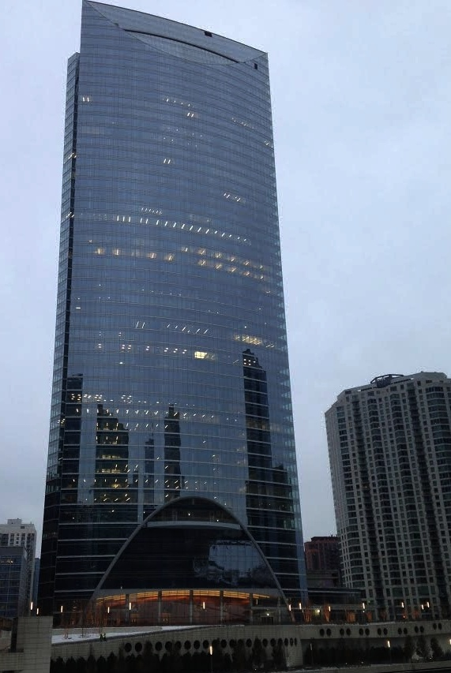
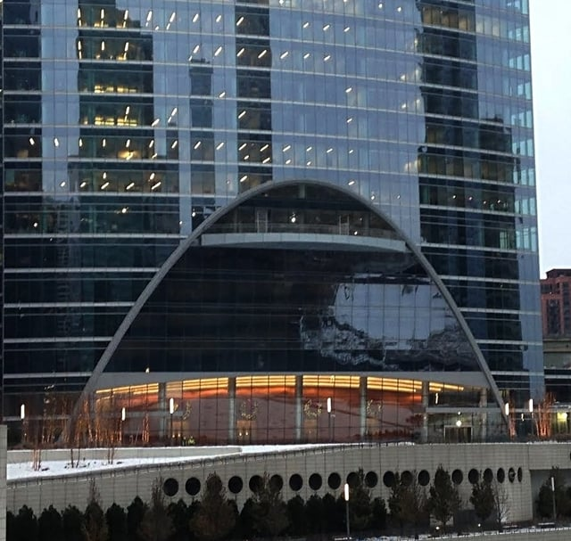

River Point, the 52-story office space soon to open along the Chicago River, was [recently reviewed](http://www.chicagotribune.com/news/columnists/ct-river-point-kamin-met-1218-20161216-story.html) by Blair Kamin, the Chicago Tribune’s architecture critic.The article highlights some important elements of this exciting addition to the Chicago skyline and riverfront. Burnham is proud to have assisted with all phases of River Point, including helping with the tower’s substructure, the riverside plaza overbuild and the tenant build-outs. We want to call attention to some important observations in Mr. Kamin’s review.

## New Plaza and Tower Designed Around Existing Train Lines

We featured River Point’s new 1.5-acre riverside plaza and extension of the current riverwalk in a [recent post](/final-review-blog/how-burnham-supported-chicagos-newest-riverfront-development-river-point/). Kamin points out that before the “inviting” new plaza added by the River Point development, the site “marred the riverfront with exposed railroad tracks and a surface parking lot.” The plaza sits on a brand new overbuild which hides five Metra train lines and sits above a CTA Blue Line tunnel. According to Kamin, the plaza “offers much-needed open space and spectacular views of the skyscraper-lined waterfront.”

Kamin notes that to avoid the train tracks, some of River Point’s steel columns are angled inward. The CTA tunnel below the new building also dictated the placement of some of the skyscraper’s caissons to avoid damage to the tunnel.

Behind the scenes, Burnham worked on the required approval and coordination with the 27 city agencies and utilities that comprise the Chicago Office of Underground Coordination to make the overbuild and skyscraper’s substructure possible. We coordinated early meetings with Metra to demonstrate that they would still have easy access to their tracks even with the new overbuild. Similarly, we arranged the presentation of plans to CTA because we needed to assure them that the drilling for the overbuild caissons would not weaken the CTA tunnel’s integrity and possibly cause its collapse.

## River Point’s Unusual Design Features

The glass at the building’s base is slanted to replicate the angled columns designed around the train tracks. Kamin points out that the use of “super-transparent, low-iron glass” results in the angled glass acting as an unexpected mirror of the river and boats traveling across it. A parabolic arch forms a border around the angled glass and a shorter arch also appears at the top of River Point. The remainder of the building is comprised of “curving green glass walls that exquisitely mark a bend in the Chicago River.”

Burnham’s work on River Point included facilitating all the necessary approvals for the exterior curtain wall system. One interesting feature not mentioned in Kamin’s review is the ninth floor terrace located near the top of the parabolic arch and belonging to anchor tenant, DLA Piper. The terrace required special city reviews and administrative approvals for the glass guardrail system designed to be in keeping with the aesthetic of the building’s glass facade.

## River Point’s Thoughtful Interior

More than half of the skyscraper was [pre-leased by late in 2015](http://www.chicagobusiness.com/realestate/20151124/CRED03/151129932/river-point-office-project-adds-two-more-tenants) according to Crain’s Chicago. The building is slated to include two major law firms, McDermott, Will & Emery and DLA Piper, as well as serve as the corporate headquarters of Mead Johnson Nutrition Company.

Burnham is currently assisting with the permits for the tenant buildouts. We are obtaining permits for 31 of River Point’s floors, the majority of the skyscraper’s leasable floor space, on behalf of 13 different tenants.

According to Kamin, the new floors are well-sized and open with “striking views created by floor-to-ceiling windows.” The building’s thick facade protects against noise from the nearby CTA tracks. Also, Kamin compliments the skyscraper’s carefully designed lobby. The low-iron glass used at the building’s base contributes River Point’s lobby’s “sense of expansiveness.”

We are proud to have assisted with River Point that Kamin characterizes as taking “full advantage of its prominent riverfront site.”
