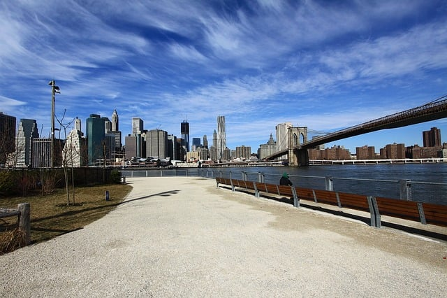

The New York City Department of Building (DOB) is moving to a completely digital system for processing building permits and inspections. The new online portal, called DOB Now, will streamline DOB’s procedure for approving construction projects. DOB Now is currently being phased in and is an exciting development. We at Burnham are looking forward to using our own state-of-the-art electronic database to interface with DOB Now and believe it will expedite the entire approval process for New York City building permits.

## DOB Now is Part of the Building One City Plan

In 2015, DOB issued a report, [Building One City](http://www1.nyc.gov/assets/buildings/pdf/building_one_city.pdf), outlining a plan for changes at DOB. The goal of Build One City is to help DOB improve customer service and function more efficiently, transparently, and fairly. Building One City notes that all of DOB’s data is stored in an outdated mainframe system developed in the 1980’s that prevents customers’ access to DOB’s system, including a way to check on the status of a New York City building permit application. The current system also limits DOB’s ability to process applications efficiently.

DOB has already undertaken a number of steps to improve their system. For example, the department initiated the Develop Hub, a system for electronic filing, in 2011. The HUB enables quicker reviews of larger building projects. DOB’s 2015 Inspection Ready program provides inspectors with handheld tablets, gives them greater access to information in the field, and now provide online scheduling of construction inspections.

Building One City states that further changes are needed and more up-to-date technology should be employed to improve DOB’s processes. The report calls for replacing DOB’s current mainframe system and redesigning DOB’s website so customers can conduct all their DOB transactions online, including submitting permit applications, scheduling inspections, making payments, checking project status, and interacting virtually with DOB staff.

## Components of DOB Now

DOB Now is being released in stages during 2016 and 2017. To be able to use DOB Now, a customer must be registered in DOB’s Inspection Ready system. Recently filed jobs can be connected to a job in the DOB Now system. There are four major parts to DOB Now:

#### DOB Now: Inspections

DOB Now: Inspections was launched in December 2015 and the older Inspection Ready system was rolled into DOB Now: Inspections. All owners and licensed professional must use DOB Now: Inspections for a variety of inspections, including construction, electrical, signs, fire suppression, cranes & derricks, elevators, plumbing, and sustainability. However, almost any kind of inspection can be scheduled through DOB Now: Inspection and there is no additional fee for using the system. In addition, even though owners and licensed professionals are required to use the new system, anyone may utilize it and DOB has staffed kiosks at each borough office providing help with DOB Now: Inspections registration. DOB’s website also provides training materials such as videos and reference guides.

One can use DOB Now Inspections to request and schedule inspections as well as review any inspection results. The system also provides the ability to track inspections and receive notifications. Inspection certifications may also be submitted through the DOB Now Inspections system.

#### DOB Now: Build

DOB started phasing in DOB Now: Build this week. For now, the system may be used to submit applications for new and renewed plumbing and sprinkler permits. DOB Now:Build will be expanded to other types of permits at a later date. Anyone may use the new system.

Plumbing and sprinkler projects filed in DOB Now: Build will not appear in the DOB Building Information System, the current DOB database. Instead, DOB Now will be the portal for any permit-related information. DOB Now: Build enables online payments, uploading of documents, viewing of objections and other information about a project. Once a project is filed with DOB Now, one must use the portal and will no longer be able to make payments at the borough office.

The DOB Now: Build system also emails letters of completion as well as notices at application process milestones. According to DOB, the new portal will automatically start the process to obtain a letter of completion and will send an email listing all the documents still needed to complete the process. Once registered, one can also use the new portal to file post-approval amendments and corrections and pull after hour variances and work permits.

Plan examiner meetings will no longer be in person at the DOB borough offices for any project filed in DOB Now. Instead, the new system provides the ability to schedule and conduct a virtual meeting with a plan examiner to review objections. DOB Now uses GoToMeeting video conferencing software which supports desktop sharing and document review in addition to meeting online.

#### DOB Now: Safety and DOB Now: Licensing

DOB Now: Safety, projected to start in the fall of 2016, will allow online compliance filings for facades, elevators, and boilers and will also be used for certain job filings. DOB Now: Licensing will provide for online examines as well as license issuance and renewal. This part of the portal should be available in 2017.

## Exciting Future With DOB Now

The DOB Now portal will definitely streamline the processing of building permits and other related approvals in New York City. Based on our experience using online portals across the country, we at Burnham are anxious to use DOB’s new system. We maintain all our client records in our extensive and flexible database that works seamlessly with municipal online portals. DOB’s new system will allow us to take full advantage of our  state-of-the-art database. If you have questions about building permits in New York City or around the country, please [Contact Us](/contact/).
