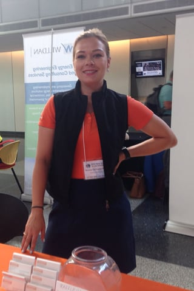

Burnham was pleased to be a sponsor of this year’s New York Solar Summit (Solar Summit) coordinated by Sustainable CUNY of the City University of New York (CUNY). The event, held on June 20, 2016, focused on different initiatives in New York State to bring down solar soft costs and encourage the adoption of solar. Speakers and attendees included leaders from federal, state, and municipal agencies, utilities, non-profits, and private industry. We want to share highlights from the 2016 Solar Summit.

## Unveiling of the NY State Solar Map and Portal

The [NY Solar Map](https://nysolarmap.com/), covering all of New York State, was officially released at the Solar Summit. For details about the map’s features see our recent post about both the [New York State and New York City maps](/final-review-blog/new-york-city-and-state-innovative-solar-maps/). Various policy leaders spoke about the benefits of a statewide solar map and portal. Dr. Lidija Sekaric, Solar Energy Technologies Office Director, U.S. Department of Energy, stated that the NY Solar Map is an innovative tool for helping reduce solar soft costs. It will stimulate an increase in the number of solar installations by attracting solar companies to the state. Ultimately, such growth will foster competition which will drive down costs.

David Sandbank, Director of NY-Sun, New York State Energy Research and Development Authority (NYSERDA), spoke about the importance of information transparency regarding solar potential. For example, solar developers need to know which properties have the most promise for solar energy generation. Also, utilities want solar developers to consider where solar can benefit the entire system. The NY Solar Map supports information sharing and will hopefully be part of greater dialogue between utilities and developers.

According to Jeff Irvine, Lead NYC Ombudsman, Sustainable CUNY, more items and data will be added to the NY Solar Map over time. For example, LIDAR data, three-dimensional information about surface characteristics, is presently only included for certain parts of the state. However, it is planned that LIDAR data for more areas will be incorporated over time. Also, [Interactive Solar Permitting Guides](https://nysolarmap.com/permitting-and-zoning/interactive-guides/) will be added for more communities. Additionally, more information will be provided for the [NYC Grid Ready Solar](https://nysolarmap.com/interconnection/grid-ready/) project, a program to reduce barriers for large-scale New York solar projects.

## Changing Role of Utilities

A number of presenters discussed how utilities are expanding their role beyond just providing electricity. New York’s Reforming the Energy Vision (REV) regulatory initiative seeks to move the state from its current centralized electricity system to a more decentralized model for providing electricity. In addition, REV’s goal is to foster competitive electricity markets. REV requires utilities to test new models, including those encouraging solar adoption.

Stuart Nachmias, Vice President, Energy Policy and Regulatory Affairs Con Edison, described the utility’s recent investment in smart meters, the largest capital investment in their history, to leverage technology. Smart meters give utilities important information, for example, it provides data about a customer’s energy usage hour-to-hour, not just month-to-month as before. This enables utilities to make recommendations to customers about increasing energy efficiency and the benefits of solar.

Kenneth Daly, President, National Grid and Mr. Nachmias also talked about their utilities changing the way they relate to customers. For example, National Grid and Con Edison now have an ombudsman to communicate with solar installers. One of the things the ombudsmen are working on is encouraging solar installers to work in areas where rooftop solar is really needed rather than locations where there is an overly high penetration of solar.

There was also significant discussion about the steps utilities are taking to preserve the reliability of the transmission and distribution systems while interconnecting increasing amounts of solar. The NY Grid Ready project is playing a significant role in helping determine the best way for large-scale solar to be interconnected to the grid.

## Advancing Community Solar

Many presenters at the Solar Summit talked about growing interest in community solar. There is a focus on community solar as a vehicle for providing the benefits of solar energy to customers who don’t own their own homes and low-income residents. However, many states don’t have laws and financing models in place to support community solar.

It is clear from the discussions at the Solar Summit that community solar is still in its infancy. A number of the utilities mentioned proposed community solar projects in their territories but the details necessary to complete the projects still need to be worked out.

John Rhodes, President and CEO NYSERDA, highlighted in his keynote address the [Halfmoon Community Solar Project](http://www.nyserda.ny.gov/About/Newsroom/2016-Announcements/2016-04-27-First-Shared-Renewables-Solar-Project-in-New-York-State), the first New York State community solar program. Construction on this NY-Sun Initiative supported community solar project began this past April. The Halfmoon Community Solar Project will allow over 100 participants, including low-income customers, in New York State Electric & Gas Corporation’s territory to access the benefits of solar energy.

White Plains Mayor, Thomas Roach, spoke about how his city is ramping up solar. There has been more solar installed in White Plains during the last month than the previous nine years. However, to provide an opportunity for others in the White Plain’s community to have access to solar, White Plains is working on installing community solar. They have narrowed down the options for community solar to two sites.

There was also discussion about the need for proper financing vehicles to support community solar. One option available in New York State is Property Assessed Clean Energy financing to fund solar projects such as community solar at very low interest rates.

## Resiliency and Battery Storage

Several of the Solar Summit presentations were devoted to the importance of solar for creating a resilient energy infrastructure. In addition, there was a lot of discussion about the current state of solar combined with energy storage. Look for our second post on the 2016 NY Solar Summit to read about these topics.
