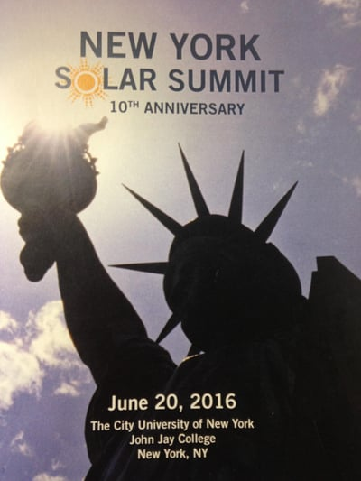

Burnham sponsored and attended the June 20, 2016, New York Solar Summit (Solar Summit) organized by Sustainable CUNY of the City University of New York (CUNY). In our recent post, we discussed [sessions from this year’s Solar Summit](/final-review-blog/the-2016-ny-solar-summit-ny-solar-map-and-community-solar-part-i/) on the following topics: the unveiling of the NY State Solar Map, the changing role of utilities, and the advancing of community solar. However, there were also important presentations on the ways solar is helping resiliency and developments in energy storage that we will discuss here.

## Solar Providing Resiliency

There was significant discussion about using solar energy to offer greater resiliency in the face of increasing extreme weather events. One of many goals of New York State’s Reforming the Energy Vision (REV) initiative, especially in the wake of Hurricane Sandy, is to replace the state’s aging distribution system with new models that provide greater resiliency.

Con Edison’s exciting REV demonstration project, the Clean Virtual Power Plant, was mentioned at the Solar Summit and is one example of using solar to provide greater resiliency. The demonstration project will combine 300 homes with rooftop solar and energy storage to operate them jointly as a virtual power plant. In February 2015, The New York Public Service Commission required New York’s utilities to develop REV demonstration projects to test new ways utilities may facilitate the integration of distributed energy resources such as rooftop solar. One role of the Clean Virtual Power Plant will be the ability to operate as a microgrid disconnected from the grid during severe weather conditions. The demonstration project is still at a very early stage, and to read more about the [Clean Virtual Power Plant](/final-review-blog/pairing-solar-and-energy-storage-con-edisons-clean-virtual-power-plant/) see our recent post.

Lars Lisell, Mechanical Engineer, National Renewable Energy Laboratory, spoke about the NY Solar Smart DG Hub’s Resilient Solar Project. The program is designed to develop a way to integrate resilient forms of solar, solar combined with energy storage, into the grid and place a value on resiliency that can be incorporated in the Solar Potential Calculator that is part of the [NY Solar Map](https://nysolarmap.com/). A Resilient Solar Project report will soon be released. The data that has been collected is showing the economic and resiliency benefits of installing solar combined with energy storage.

## Current Status of Energy Storage

It was clear from the discussions that energy storage is still at a very early stage. A big challenge is how to best integrate energy storage and put a dollar value on its benefits. Michael Voltz, Director, Energy and Efficiency and Renewables, PSEG, stated that they are working on some energy storage projects in Long Island. Representatives from Con Edison and Central Hudson also mentioned they are working on projects to determine how to best integrate storage but do not yet have large amounts of energy storage in their territories. One barrier to increased energy storage is its high cost, and to make energy storage cost-effective for the customer it needs to have uses beyond just providing resiliency. Basically, battery storage is currently where the solar market was 10 years ago.

Lieutenant Paul Rogers, Hazardous Materials Unit, Fired Department of New York (FDNY), spoke about first responders’ safety concerns regarding battery storage. FDNY views battery storage as a new technology that still needs to be thoroughly evaluated. Most of Lieutenant Rogers’ talk focused on lithium-ion batteries. However, he pointed out there are many different variations of lithium-ion batteries which make understanding them more challenging.

Accord to the Lieutenant, there is a still too much we don’t know about batteries. Although many batteries have safety features, they sometimes don’t work. When the safety feature fails, there can be major problems. A big concern is toxic fumes and dangerous gases that may be released in a battery fire. It is also unclear to firefighters what is the best way to suppress battery fires and what quantities of a suppressant are necessary.

There are also significant issues after a fire is extinguished. Normally, first responders will shut down power if there has been a fire. However, with a battery, even if the system is shut down, there is still stored electricity that can endanger first responders. In addition, there is no way to tell how much energy is still left in the system. Also, even if the battery fire is put out, batteries may reignite, and it is also unclear how best to remove a damaged battery after a fire. Firefighters need proper training and the development of protocols to know how to respond to battery fires.

Also, Davion Hill, Energy Storage Leader, DNV GL, spoke about a current battery safety testing program being funded by Con Edison and NYSERDA. They are examining different types of batteries, not just lithium-ion. The focus of the study is how batteries may fuel a fire rather than cause it. One of the things they are looking at is the most effective way to extinguish different types of batteries. Dr. Hill’s team is hoping to have a draft of the report this coming fall. Ultimately, the report’s findings should help with the battery permitting process.

## Access to Solar Summit Presentations

Slides from some of the [2016 Solar Summit presentations](https://nysolarmap.com/about/ny-solar-summit/2016-ny-solar-summit/?utm_source=NYSolar+June+Newsletter+2016&utm_campaign=NYSolar+Smart+June+Newsletter&utm_medium=email) are available on the NY Solar Map Portal. Unfortunately, the very valuable panel discussions are not currently online. We at Burnham appreciate the Solar Summit’s ability to bring together stakeholders from various sectors and promote discussions that will help the adoption of solar.
