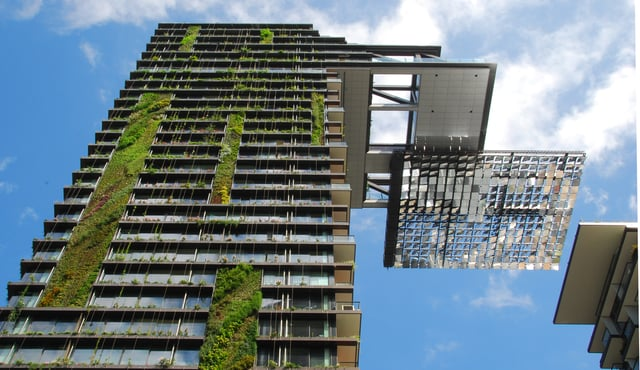

The next edition of the International Energy Conservation Code (IECC), the 2018 version, is currently under development. The draft updates have sparked controversy because some of the new provisions appear to reverse the energy efficiency requirements of earlier IECC editions. Many stakeholders believe each new version of the IECC should improve upon the energy efficiency standards of the prior editions. Net-zero buildings may be attained by 2050 if a 5% energy efficiency gain is achieved when the IECC is updated every three years. Given there are still opportunities to shape the 2018 IECC, different stakeholders are mobilizing to eliminate the proposed energy efficiency rollbacks.

## How is the International Energy Conservation Code Updated?

The International Energy Conservation Code is a comprehensive model code setting minimum energy efficiency requirements for buildings. The code has separate sections governing commercial buildings and residential buildings (three stories or less). For each section, the code sets requirements for energy-efficient mechanical, lighting, and power systems and building envelopes.

The IECC is published by the International Code Council (ICC), an association that develops model codes and standards for the design and construction of buildings. The model energy code was first published in 1998 and is updated on a three-year cycle. The most recent version is the 2015 IECC, and the 2018 edition is currently under development. The IECC, similar to other model codes, is designed to be adopted by state and local jurisdictions.

The ICC uses a governmental consensus process for developing the IECC and other model codes. For each IECC update cycle, code officials, representatives from trade associations and relevant industries, design professionals, and other stakeholders, propose changes to revise the code. The proposals are considered by the relevant code development committee. The committee presents a draft update which is discussed at hearings, open to public comment, and voted on by the ICC’s membership. There are additional hearings, and the final set of votes is cast by government officials representing jurisdictions across the country. The ICC is using an online tool, [cdpACCESS](https://cdpaccess.com/), to facilitate participation in the code development process.

## What is the U.S. Department of Energy’s Role?

The U.S. Department of Energy (DOE) is mandated by law to support the development of model energy building codes and review the technical and economic basis of such codes. [42 U.S.C. § 6836](https://www.law.cornell.edu/uscode/text/42/6836). Based on this requirement, DOE participates in the IECC development process by proposing code changes and analyzing building code energy efficiency and cost-effectiveness. DOE’s [proposed changes](https://www.energycodes.gov/doe-proposals-2018-iecc#proposals) to the 2018 IECC were submitted as part of the 2018 IECC update process and made available for public comment.

After a new version of the IECC is published, DOE is required to place an official determination in the Federal Register stating whether the most recent IECC improves upon the energy efficiency standards of the prior version. A DOE affirmative determination triggers a requirement that states certify they have reviewed their residential building code energy efficiency provisions and decided whether they need to be updated. [42 U.S.C. § 6833](https://www.law.cornell.edu/uscode/text/42/6833).

## What Stage is the 2018 IECC in the Development Process?

The 2018 IECC was introduced at the Technical Advisory Committee hearings in Louisville, Kentucky this past April. In addition to hearings, there was subsequent membership voting and opportunity for public comment.

October 16-25, 2016, there will be public comment hearings in Kansas City, Missouri, and the results of the hearings will be posted on November 2, 2016. Online governmental voting that represents officials from states, counties, and cities, will take place in November. The final code changes will be posted on December 6, 2016.

## Which Proposed 2018 IECC Provisions Roll Back the Energy Efficiency Standards?

Contrary to the expectations of some stakeholders that the IECC will strengthen and improve energy efficiency with every update, the draft 2018 IECC introduces some provisions, particularly in the residential section, that appear to weaken the IECC. These changes were introduced to support the desire of some members, including home builders, to lower the cost of building a home. The following are a few examples of the proposed 2018 IECC residential provisions that are at issue:

-   **Uses trade-offs that reduce energy efficiency** - A variety of trade-offs were introduced that weaken the energy efficiency standards. For example, in buildings using the performance path option to determine energy efficiency, it will be possible to use less energy-efficient insulation materials if more efficient heating, cooling, and water heating equipment is installed. This is viewed as weakening the standards because it is likely such equipment would be installed anyway, together with better insulation, and the trade-off may actually raise the ongoing energy costs. 
-   **Allows substituting onsite generation for energy efficiency** - The proposed updates allow for onsite energy generation, such as solar panels, to be included when using the Energy Rating Index (ERI) score. While some forms of generation are a good thing, they are not a form of energy efficiency, the purpose of the IECC. Also, some stakeholders are concerned that this provision may be used as a loophole to avoid complying with the energy efficiency standards.
-   **Raises the ERI score** - The current ERI score is 51-55 (climate zone dependent). These scores were intended to make a building utilizing ERI scoring be as energy efficient as one built according to the prescriptive method. The new provisions raise the ERI score to 57-62, reducing the energy efficiency of the ERI scoring method.

A weakening of the IECC’s energy efficiency standards may have wide-reaching implications. For example, if DOE is unable to determine that the 2018 IECC residential standards improve upon prior versions of the code, states will not be required to undertake a review of their energy codes and improve their energy efficiency standards.

## Is There An Effort to Eliminate the Energy Efficiency Rollbacks?

Various organizations are mobilizing their members to respond to what they see as a reversal of the energy efficiency gains of the IECC. For example, the US Conference of Mayors (USCM) adopted a [resolution](http://www.usmayors.org/resolutions/84th_Conference/displayresolution.asp?resid=a0F61000003rjGLEAY) this past June stating they do not want the 2018 IECC to be weaker than past codes. The resolution calls for municipal code officials to vote against energy “efficiency rollback and trade-offs” in the proposed 2018 IECC. The USCM recommends following an approach that would result in a 5% energy efficiency gain in the 2018 IECC.

There is still time left for revisions to the proposed 2018 International Energy Conservation Code updates before the new version of the code is finalized. We are closely watching the upcoming hearings in October and the final vote in November.
