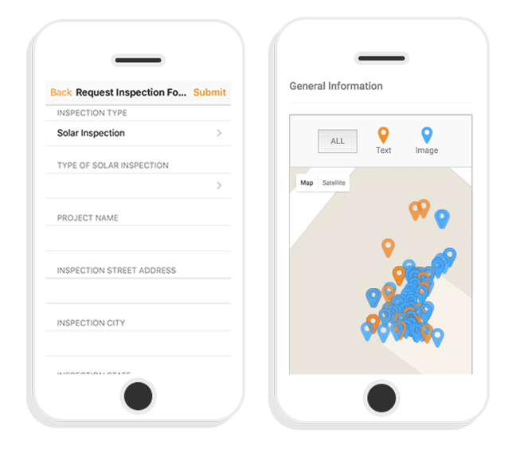

Arizona’s largest electric utility, Arizona Public Service Company (APS), is using the [BurnhamEYE™](/our-technology/burnham-eye/) for its pioneering utility-owned rooftop solar program, the Solar Partner Program. APS is employing the BurnhamEYE to inspect the installation of its solar panels for compliance with code requirements and APS standards. This post will examine how APS is using the BurnhamEYE, a mobile application that verifies the quality and code compliance of a solar installation in a consistent, secure, and cost-effective manner.

## The APS Solar Partner Program Places Rooftop Solar on 1500 Homes

The APS Solar Partner Program, the first utility-owned rooftop solar program in the country, provides solar panels for 1500 homes. Prior to approving a customer for the program, APS needs to assess whether the customer’s roof conditions qualify for the program. APS is using eight local companies to install its rooftop solar panels. See our recent post for more details about the [Solar Partner Program](/final-review-blog/arizona-public-service-leading-the-way-with-utility-owned-distributed-solar/) and other innovative APS programs.

## APS’s Goal is to Check that 100% of its Rooftop Solar is Correctly Installed

We spoke with Jimi Diaz, Engineering Project Manager of the Solar Partner Program, about APS’s goals for the program. According to Diaz, APS wants to make sure the rooftop solar is properly installed and the correct equipment is used on all homes participating in the Solar Partner Program. Diaz emphasized that it is essential for, “APS to avoid any incidents of fire, leaks, or injury resulting from their solar panels. Installers must comply with APS’s requirements and the relevant codes.”

Given APS is using independent contractors to install the APS-owned solar panels, APS needs a way to independently verify that each installation is performed correctly. The goal is to inspect one hundred percent of the Solar Partner Program installations, but APS does not have the staff to conduct these inspections. Also, APS employees are not allowed to go up to a roof where critical solar installation components requiring inspection are placed.

## The BurnhamEYE is a Quality Assurance Tool

The BurnhamEYE application may be used with any smartphone and allows the user to collect solar installation photos and other information that are geo-tagged, synchronized in real time, and stored to be available anytime from a secure database. The data collected by the BurnhamEYE mobile application generates an easy-to-use reporting scorecard. A BurnhamEYE user may choose to directly review the scorecard and related data or use Burnham’s third-party review service.The BurnhamEYE incorporates Burnham’s years of experience as a leader in code compliance, permitting, and solar inspections.

## APS Uses the BurnhamEYE to Inspect Every Solar Partner Program Solar Installation

According to Diaz, “\[His group\] decided to use the BurnhamEYE for the Solar Partner Program after seeing a demonstration and evaluating the product.” APS is using both the BurnhamEYE mobile application and Burnham’s third-party review service.

APS requires all the installers participating in the Solar Partner Program to use the BurnhamEYE mobile application. Burnham trains the installers to properly use the BurnhamEYE application on their phone and document the entire APS solar system, including all of its components. Also, Burnham goes into the field to provide additional training and answer installer questions.

## The BurnhamEYE Guides the Installer Through a Correct Solar Panel Installation

Initially, APS only required the installers to use the BurnhamEYE’s Post-Installation Quality Assurance Form. The Post-Installation Quality Assurance Form is designed to be used right after the installation is completed but before APS approves turning on the system. When using the Post-Installation Quality Assurance Form, each installer follows the protocol in the BurnhamEYE which guides them through all the steps to properly install APS’s rooftop solar. Burnham worked with APS to customize their Post-Installation Quality Assurance Forms to incorporate APS standards, as well as code requirements.

Once an installer completes the Post-Installation Quality Assurance Form, it is sent to Burnham. Burnham professionals review the submitted data and email a scorecard to Diaz. If the installation does not comply with the relevant codes and APS standards, the scorecard states the installation didn’t pass, and the installer is required to make corrections.

## APS Expanded its use of the BurnhamEYE with Help from Burnham

APS decided it would be useful to have a form for any required corrections, and Burnham developed the Construction Verification Form to confirm that repairs were made. This additional form allows the installer to send back photos of only the portion of the installation that needs to be corrected.

Similarly, APS realized it could use the BurnhamEYE to assist installers surveying a customer’s roof to determine whether it qualifies for participation in the Solar Partner Program. Burnham developed the Pre-Installation Form that allows installers to record the roof conditions before APS approves a customer for the program. Now, APS consistently uses all three BurnhamEYE forms.

According to Diaz, “Burnham has been very responsive” to any feedback and suggestions from APS. For example, the different BurnhamEYE forms for a particular site were not linked together when APS began using them. APS suggested combining all a property’s forms in one BurnhamEYE report, and Burnham developed a way to make this possible. In response to installer input, Burnham now provides the ability to tie all of a property’s forms together even if they are sent from different smartphones.

## BurnhamEYE has Improved the Quality and Efficiency of the Solar Installation Process

#### BurnhamEYE Provides a Comprehensive Inspection

Diaz told us the BurnhamEYE has really helped APS assure the installation process is being done correctly by providing an accurate picture of how the solar panels are installed. According to Diaz, “We get a very thorough inspection every time because the installers are being told what pictures they need to take. Without the BurnhamEYE, an installer could just rush through a checklist and we don’t know if it was done correctly. BurnhamEYE is allowing us to put another set of eyes on what was done.”

#### BurnhamEYE Eliminates the Need for a Team of Inspectors

Diaz also shared that the BurnhamEYE is helping APS meet its goal to inspect every solar installation, “without hiring a team of inspectors to review each solar installation. Using the BurnhamEYE also eliminates driving time and problems like scheduling conflicts and traffic delays.” Given APS employees are not allowed to climb up to a roof, BurnhamEYE also provides a way to check roof conditions.The Solar Partner Program installers also like the BurnhamEYE because they don’t have to spend time waiting for an APS inspector to come to the work site.

#### Burnham’s Third-Party Review Accurately Catches Installer Mistakes

“Burnham’s team that reviews the forms and creates the scorecards is also a big help,” Diaz told us. At the beginning, APS double checked each report to make sure Burnham was catching everything. Now APS is comfortable with Burnham’s work and just looks at samples of the reports.

#### BurnhamEYE Data is Readily Available at any Time

Diaz finds that an added benefit of the BurnhamEYE is that all the forms and attached photos are stored in a database that can be easily accessed. If problems or questions arise, Diaz and his staff, “can check remotely without wasting time going out to the site.” According to Diaz, “it is useful to have a historical record of the equipment used and how it was installed at each site.”

> “Both the BurnhamEYE application and Burnham third-party review have helped us have more control over the quality of the installation on customer roofs. As far as I am concerned, it has been great not having to schedule inspections.” - Jimi Diaz, Engineering Project Manager, APS Solar Partner Program.
