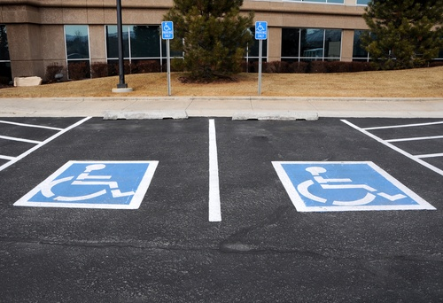

The United States Access Board is in the process of creating a very helpful online [Guide to the ADA Standards](https://www.access-board.gov/guidelines-and-standards/buildings-and-sites/about-the-ada-standards/guide-to-the-ada-standards) (Guide). This past June, the Access Board added another chapter to the Guide. We at Burnham thought we would take a closer look at the Guide and the added Chapter 5 covering Americans with Disabilities Act requirements for parking, passenger load zones, stairways, and handrails.

## Relationship of the Guide to the 2004 ADA Accessibility Guidelines and 2010 Standards

The [Americans with Disabilities Act of 1990](https://www.ada.gov/pubs/adastatute08.htm) (ADA) is the federal law prohibiting discrimination against people with disabilities. Title III of the ADA requires all new construction and modifications of public accommodations and commercial facilities to provide access to people with disabilities. The United States Department of Justice (DOJ) developed and enforces the 2010 Standards for Accessible Design (2010 Standards), the rules implementing the ADA.

The United States Access Board (Access Board), the federal agency responsible for creating the accessibility guidelines for the ADA, developed the [2004 ADA Accessibility Guidelines](https://www.access-board.gov/guidelines-and-standards/buildings-and-sites/about-the-ada-standards/background/ada-aba-accessibility-guidelines-2004) (ADAAG). DOJ’s 2010 Standards incorporate ADAAG and therefore the ADAAG requirements are now enforceable. The United Stated Department of Transportation (DOT) is responsible for creating accessibility standards for state and local government administered public transportation facilities. The DOT standards of 2006 (2006 Standards) also incorporate ADAAG. DOJ’s 2010 Standards and DOT’s 2006 Standards are very similar. However, each also has some additional rules that apply to the different types of entities DOJ and DOT separately regulate.

It is important to note that the [Architectural Barriers Act of 1968](https://www.access-board.gov/guidelines-and-standards/buildings-and-sites/about-the-aba-standards/guide-to-the-aba-standards/chapter-1-using-the-ada-standards-2#aba) (ABA) governs accessibility for any facilities designed, built, or altered with federal funds. Four federal agencies create standards for the ABA, and ADAAG is incorporated into those standards as well.

ADAAG sets forth the scoping and technical requirements for any new construction and alterations covered by the ADA and ABA.There are separate chapters for the ADA and ABA application and administration as well as scoping requirements. However, the ADA and ABA requirements are combined in the remaining eight chapters of ADAAG.

The focus of the Guide is the ADA requirements and was developed by the Access Board together with DOJ and DOT. There is also an online [Guide to the ABA Standards](https://www.access-board.gov/guidelines-and-standards/buildings-and-sites/about-the-aba-standards/guide-to-the-aba-standards) that applies to the accessibility requirements issued under the ABA by the Department of Defense, Department of Housing and Urban Development, General Services Administration, and the U.S. Postal Service.

The Guide tracks the ADAAG chapters incorporated into the 2010 Standards. It is noted in the Guide that it should be used along with a copy of the 2010 Standards. The Guide only explains some the requirements and does not reproduce the complete text of the 2010 Standards. Similarly, the Guide may be used to clarify sections of DOT’s 2006 Standards. In addition to explaining the ADA accessible design requirements, the Guide contains examples of voluntary best practices that exceed the minimum requirements contained in DOJ’s and DOT’s standards.

## Latest Installment of the Guide

The Access Board has been adding information to the Guide in installments. This June, Chapter 5 was added to the Guide. It provides explanations for ADAAG Chapter 5: General Site and Building Elements as well as the relevant ADAAG Chapter 2 scoping requirements. The Guide Chapter 5 specifically contains additional information on the ADAAG scoping requirements and minimum standards for parking spaces, passenger loading zones, stairways, and handrails.

#### Parking Spaces

The Guide diagrams and explains how to disperse and calculate accessible parking spaces for a site with both a parking lot and a garage. It contains a chart showing the minimum number of standard car and van spaces needed depending on the size of a parking facility. It also clarifies what is considered an alteration or addition to a parking facility.

Also contained in the Guide are detailed explanations and examples of the scoping and dispersion requirements for sites with multiple parking facilities such as those found in airports, shopping malls, and campuses. Accessibility requirements for different variations of garage parking, hospital outpatient facilities, rehabilitation and outpatient physical therapy facilities, and residential facilities are discussed with accompanying diagrams.

Accessible parking space discussions cover subjects such as the size of spaces and access aisles, floor and ground surface requirements, van space vertical clearance, and identification and connection of accessible aisles and routes. There is also a description of the requirements for van accessible parking spaces, pay stations, accessible space identification, and electric vehicle charging stations.

#### Passenger Loading Zones

The Guide explains when passenger loading zones are required. It also provides details about the requirements for vehicle pull-up spaces and access aisles, such as their dimensions, ground and floor surfaces, and vertical clearance. The Guide also clarifies what types of bus transportation must comply with the accessibility requirements for bus loading zones.

#### Stairways

Explanations of the staircase scoping requirements are contained in this section, including examples of the types of staircases that are exempt from the requirements. There is also mention of the types of alterations that trigger compliance with the DOJ’s 2010 Standards and DOT’s 2006 Standards. The Guide diagrams some of the staircase design requirements for treads and risers, surfaces, and nosing. Separate sections also address and illustrate handrail, handrail extension, handrail clearance and cross-section, and escalator technical requirements.

## Additional Guide Benefits and Future Installments

In the Guide to the ADA Standards Chapter 5, all three sections have a list of commonly asked questions with answers. The Guide also includes helpful animations and a recently added [animation for parking and passenger loading zones](https://www.access-board.gov/images/videos/parking-plz.mp4) explains many of Chapter 5’s requirements. The remaining chapters of ADAAG will be explained in the Guide’s future installments. Understanding the ADA requirements can be difficult and hopefully the Guide will add greater clarity. We at Burnham conduct ADA compliance reviews and can make sure your building plans meet all the federal, state, and local accessibility requirements. Please feel free to [Contact Us](/contact/) for a consultation.
