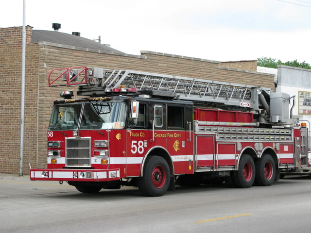

<em>As of 2017, [House Bill 6036](http://www.ilga.gov/legislation/BillStatus.asp?DocNum=6036&GAID=13&DocTypeID=HB&SessionID=88&GA=99) remains re-referred to Rules Committee and there has been no further action.</em>

A controversial bill was introduced in the Illinois General Assembly in February of this year, House Bill 6036 (HB 6036). The bill amends the Illinois Criminal Code by adding a new offense of criminal building management which would be a Class 4 felony. We at Burnham are taking a closer look at this proposed legislation, its background, and the concerns it has raised.

## House Bill 6036’s Background

The criminal building management offense was introduced in response to the death of a Chicago firefighter during a warehouse fire on December 14, 2015. A seasoned firefighter, Daniel Capuano, fell down the warehouse’s empty elevator shaft while searching through the burning building.

Construction work was taking place at the warehouse. However, there were no barriers indicating the elevator was gone and only an empty shaft remained. The elevator was removed without the requisite permit. As part of the permit process for elevator removal or demolition, a barrier preventing entrance to the shaft is required.

HB 6036 was originally filed by Representative Donald L. Moffitt on February 11, 2016. There have been three amendments to the bill’s language. In March, HB 6036’s Chief Sponsor changed to Representative Kathleen Willis.

## The Offense of Criminal Building Management

The Illinois Criminal Code Title III (Specific Offenses), Sections 720 ILCS 5/12-5.1 and 5/12-5.1a, already has the offenses of [criminal housing management and aggravated criminal housing management](http://www.ilga.gov/legislation/ilcs/ilcs4.asp?DocName=072000050HArt%2E+12%2C+Subdiv%2E+10&ActID) pertaining to residential buildings. If someone is convicted of aggravated criminal housing management, recklessly allowing building conditions or concealing building conditions that contribute to a person’s death, it is a Class 4 felony. The term of imprisonment for an Illinois [Class 4 felony](http://www.ilga.gov/legislation/ilcs/fulltext.asp?DocName=073000050K5-4.5-45) is one to three years, and an extended term Class 4 felony is three to six years. Also, a fine may be imposed up to $25,000.

HB 6036 would add a new Section 720 ILCS 5/12-5.1b, the offense of criminal building management, that pertains to commercial buildings and is a Class 4 felony. Under the most recent bill amendment, the [third amendment](http://www.ilga.gov/legislation/fulltext.asp?DocName=09900HB6036ham003&GA=99&SessionId=88&DocTypeId=HB&LegID=95555&DocNum=6036&GAID=13&Session=), the provision can apply to a person who is an owner, managing agent or “otherwise” has “personal or professional management or control of the commercial real estate.” Such a person may be convicted of criminal building management when: (1) conditions that were a building code violation or lacked a permit were a contributing factor in the permanent disability or death of a first responder; (2) they knew of the violations; and (3) they recklessly concealed or attempted to conceal the conditions.

## Opposition to the Bill

There has been strong opposition to HB 6036 from a variety of organizations, including the Building Owners and Managers Association of Chicago and the Illinois Chamber of Commerce. The following are highlights of the concerns raised by those opposed to HB 6036: 

-   HB 6036’s language defining what type of person may be subject to the offense is too broad. For example, owners may be charged under HB 6036. However, commercial buildings may be owned by diverse groups of people or entities, so a large number of people could potentially be charged with the commercial building management offense.
-   The wording of the bill doesn’t reflect the need for criminal intent that is a basic element of criminal liability.
-   The bill doesn’t account for situations beyond a building owner’s or manager’s control. A building owner or manager may be unaware of unsafe conditions or violations caused by tenants or pre-existing in a newly purchased building.
-   The conditions should be a primary cause of the first responder’s injury or death, not a “contributing factor” as stated by the bill.
-   Even a minor or recently cured building code violation could trigger criminal building management liability.

## Current Status of HB 6036

Most recently, HB 6036’s third amendment was re-referred to the House Rules Committee on April 22, 2016. Even if the bill does not move forward in the immediate future, Representative Willis appears to be committed to pursuing passage of HB 6036 in the next legislative session. The criminal building management offense does have some support. For example, the Illinois Fire Services Association, a partnership of fire services organizations, has testified in favor of HB 6036. Because of its potential impact on owners and operators of commercial buildings in Illinois, we at Burnham will continue to monitor HB 6036’s developments and keep you informed about any important changes.

<em>This post was last updated on January 24th, 2019.</em>
