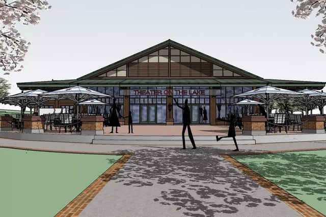
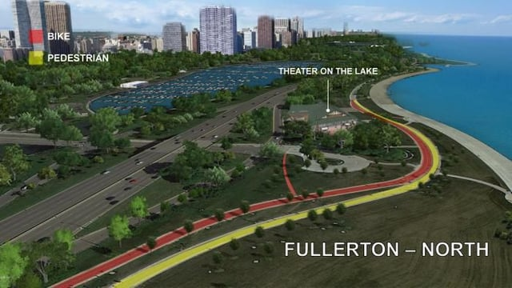

A unique space on Chicago's lakefront, the Theater on the Lake hosts a full summer theater schedule in its unusual location at the intersection of the Fullerton Avenue and Lake Shore Drive in the Lincoln Park neighborhood as the home of Chicago Park District’s off-Loop theater festival.

In its long history, the Prairie-style building has seen a host of different uses, and it will see yet another after a series of improvements - the Theater on the Lake’s renovation improves the accessibility of the space, adds new amenities, and converts the unique structure into a year-round venue on Lake Michigan.

image via [Kaufman | O'Neil Architecture](http://kaufmanoneil.com/)  

## Theater a Part of Chicago’s Prairie-Style Architecture

The Theater on the Lake building was [originally a sanitarium](http://www.chicagoparkdistrict.com/parks/theater-on-the-lake) and was preceded by two earlier temporary open-air hospital structures on piers in Lake Michigan, where the lake air was thought to cure diseases such as tuberculosis and be beneficial to the health of infants and children. In 1914, the Chicago Daily News financed a permanent structure known as the Chicago Daily News Fresh Air Fund Sanitarium and construction on the building was completed in 1920.

Providing meals and healthcare services to children, the building remained in operation as a hospital until 1939. The Theater was used as a recreation center by the United Service Organization (USO) and converted into the Theater on the Lake in 1953 and has seen programming since - though the theater has been vacant since 2013.

The structure is a Prairie-style building designed by Prairie School architect Dwight H. Perkins, a founding partner of the firm Perkins+Will. Perkins also designed additional Prairie and Arts and Crafts style structures near the theater in Lincoln Park, including the Lincoln Park Zoo’s Lion House, Café Brauer, and the North Pond Café, as well as the original Albert G. Lane Technical High School building and the 1909 Lyman Trumbull Elementary School in Chicago’s Andersonville neighborhood. The Trumbull school is also slated for [redevelopment](https://chicago.curbed.com/2016/7/15/12200552/chicago-redevelopment-news-andersonville-trumbull-school) and will be converted via adaptive reuse to a mixed-use (residential units and performance space) building.

## Renovation Fully Modernizes the Historic Structure

image via [Curbed Chicago](https://chicago.curbed.com/2017/5/17/15653678/theater-on-the-lake-lincoln-park-construction)

In its current state, the Theater still shares much in common with its original form although its front entrance was demolished during a major renovation of Lake Shore Drive. This year’s $6 million [renovation](https://chicago.curbed.com/2017/5/17/15653678/theater-on-the-lake-lincoln-park-construction) headed by the Lakefront Hospitality Group completely reimagines and modernizes the space as a destination for theater, concerts, and more at the lakefront and introduces a 35,000 square foot full service restaurant with seating for 280 at its planned outdoor patios.

The restoration, designed by [Kaufman & O'Neil](http://www.chicagobusiness.com/article/20170614/NEWS07/170619951/what-to-expect-at-theater-on-the-lake), replaces the existing screened-in sections with new glass windows, a modern wall of windows overlooking the lake to the east, and new cement flooring along with details such as terracotta tiling and wrought iron detailing on the location’s new bar. The 19,000 square foot space will also see expansion via a two-room space between the planned tavern, the Lakefront, and the 250-seat theater area.

## Permitting Process Required Administrative Reliefs

Though not a designated Chicago Landmark, obtaining building permits for renovations to [historically-significant structures](/final-review-blog/exploring-2017s-most-endangered-historic-places-in-illinois/) including a change in use is a complicated process along with challenges posed by its location. Since the Theater is on beachfront, there is limited power available, and we assisted with the approvals required for the electrical upgrades to the space.

During expediting of facilitating the permit submittal for this project, we utilized the City of Chicago’s [Administrative Relief Process](https://www.cityofchicago.org/city/en/depts/bldgs/supp_info/administrative-relief-permit.html), a process offered by the Department of Buildings (DOB) which grants minor code permissions on a case-by-case basis. These include specific requests where the proposed condition can be justified using technical information and national codes or standards.

Our Code Group worked to obtain Administrative Reliefs for the alteration of the existing stage  and for a reduction in the number of required plumbing fixtures. The Burnham expediting team facilitated permitting to create the new conditioned space as well as for third party [Structural Peer Review](https://www.cityofchicago.org/city/en/depts/bldgs/supp_info/structural_peer_reviewprogramoverview.html). The DOB offers this program to expedite plan reviews by allowing a certified structural engineer to act as a consultant and complete structural reviews externally.

## Updated Space Set to Debut This Summer

Construction has been ongoing since May 2017 and while regular programming is not set to return to the space until the 2018, the Lakefront and its patios are slated to open in [late summer](http://www.chicagomag.com/dining-drinking/May-2017/The-Lakefront/) with head chef Cleetus Friedman also expanding concessions offerings in the surrounding park area. We’re thrilled to watch the distinctive structure move into its newest phase as a fully modern venue on Lake Michigan.

<em>Though the theater isn’t currently operating, you can still see the Chicago Park District’s 2017 summer season [on the road](https://www.timeout.com/chicago/blog/heres-the-lineup-for-theater-on-the-lakes-2017-season-052417) in Chicago.</em>
