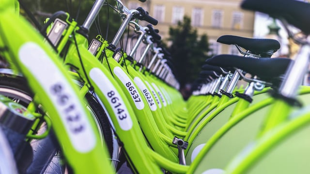

As part of our Project Drawdown series and our ongoing discussion of urban planning, we’ve explored many of the benefits and challenges facing alternative transportation across the globe. Cycling, and the promotion of biking as a car alternative within and around cities, is a frequent discussion topic: Project Drawdown makes a strong case for [bike infrastructure](/final-review-blog/bike-infrastructure-key-to-healthier-cities-reduced-emissions/) as essential for creating a transportation alternative to emissions-producing modes like private cars.   
Alternative transportation, including bikes, will continue to a play an increasing role in urban planning and design. Prioritizing ease of access, safety, and green solutions to issues in both large-scale planning and individual building design is quickly becoming expected, and designing safe cycling spaces is key to creating a culture that uses bikes as transportation.

[Project Drawdown](/final-review-blog/burnham-nationwides-climate-change-drawdown-series/) ranks Bike Infrastructure as #59 in solutions to global warming, estimated to reduce 2.31 gigatons of carbon dioxide by 2050 and a savings of $400.47 billion dollars. Better bike infrastructure promotes [cleaner air quality and healthier populations](https://www.fastcompany.com/3065591/bike-lanes-may-be-the-most-cost-effective-way-to-improve-public-health) and is less expensive to implement than other preventative health measures.

<em>image by [Viktor Kern](https://unsplash.com/photos/UdGEXZtlx-E)</em>

It also contributes to a snowball effect: the more accessible bike routes become and the safer riders feel, the more people choose to bike, and more bicyclists means more visibility and safety. More riders means bike commuting can more quickly become part of everyday life, leading to long term health improvements and reduction in car use. This growth, however, doesn’t happen organically.

In order to reach these goals, cities must develop and maintain robust bike infrastructure. Although such improvements are now common in Europe in cities such as Copenhagen, where networks of bike paths - including bicycle superhighways such as the *Cykelslangen* \- link pedestrian paths with cycling infrastructure, this is not the case in the United States.

Biking as an alternative to car trips is growing, many US cities do not have adequate bike paths and related elements to grow a healthy bike culture.

## US Biking Grows, but Infrastructure and Access Needs Improvement

The United States is experiencing a biking boom in many cities throughout the country including smaller and mid-sized municipalities. From 1990 to 2012, the share of commuters biking to work tripled in New York City, Chicago, and Washington D.C., San Francisco, Portland, Denver, and Minneapolis. Expansion of [existing infrastructure](https://www.citylab.com/transportation/2014/05/rise-bicycling-smaller-and-midsize-us-cities/9059/), prioritizing access to safer roads, and a renewed interest in biking has fueled this growth, improvement is not consistent across the U.S.

Though large cities receive the share of media attention, other cities have seen an increase in biking as well. As of 2012, Portland “led all large American cities with a [bike share of commuters](https://www.census.gov/acs/www/) at 6 percent, but lagged behind smaller cities such as Davis, California (19 percent), Boulder, Colorado (12 percent), Corvallis, Oregon (11 percent), and Santa Cruz, California (9 percent).” Additionally, “smaller cities may offer some advantages for cycling because their shorter trip distances are more easily covered by bike, and because lower volumes of motor vehicle traffic make cycling less stressful.” As of 2018, Madison, WI leads [Livability’s ranking](https://www.channel3000.com/news/madison-named-one-of-surprisingly-bike-friendly-cities/782731470) in bike-friendly cities, where 5.1 residents bike to work on more than 280 miles of existing bike paths and protected lanes. Despite its high ranking and significant network of bikeable paths, usage remains relatively low - many residents take short trips by car, a key travel component targeted by Project Drawdown and transportation advocates.

## PlacesforBikes Focuses on Quick, Effective Improvements

To shift short trips from cars to bikes, walking, or even mass transit, transportation advocacy concentrate on immediate improvements. The differing needs of urban and suburban bike users required different approaches: though [People For Bikes](https://cityratings.peopleforbikes.org/methodology/) and its PlacesforBikes project ranks Fort Collins, CO as its most bike-friendly U.S. locale, however it only averages a 3.5 out of 5 score in its five categories.

Focused on quickly reaching more riders with safer infrastructure options as quickly as possible, PlacesforBikes illustrates how many cities can make significant improvements in existing bike access and create a culture that makes switching to bikes easier and more beneficial. PlacesforBikes ranks cities based on five categories: Ridership, Safety, Network, Reach, and Acceleration examine existing transportation access and how it can be improvement, both through physical changes and culture initiatives.

-   Ridership: the amount of people biking in a given metropolitan area, including recreationally
-   Safety: number of injuries or fatalities for bikers as well as pedestrians and those driving
-   Network: how effectively infrastructure connects users with each other and destinations
-   Reach: how well a community’s low-stress network serves all members of the community and benefits underserved populations
-   Acceleration: how quickly a community is improving its infrastructure  
    

Even the best biking cities in the United States rank low in many of the categories - the Reach category is most often below 3, as under-served communities often lack both access to safer roads and to [bike-sharing services](https://www.huffingtonpost.com/entry/can-there-be-equity-in-the-bike-lane_us_5a8475c7e4b00e7aba2d2952). But biking, beside providing environmental benefits, is a reliable way of providing transportation access to communities not served by mass transit. Cities have begun to address the expansion of bikeshare programs, bike lanes, and safe cycling infrastructure in recent years - including Chicago's Divvy D4E (Divvy for Everyone) [program](https://www.divvybikes.com/pricing/d4e) which reduces the annual membership - a significant gap in access exists.

## Improving Access and Infrastructure Will Lead to Additional Benefits

Bike infrastructure [complements other transportation alternatives](/final-review-blog/drawdown-increase-mass-transit-use-to-fight-global-warming-promote-healthier-cities/) such as mass transit and is essential for covering “first/last mile” trips, the most common barrier to using transportation alternatives. Without ease of access to existing mass transit systems such as light rail, many users will instead choose private cars or ride sharing, especially if walking or biking is not safe or feasible.

Bike access is not yet equitable, and often other forms of transportation are also scarce. Without addressing equal transportation access and linking up multiple modes of transportation, U.S. urban areas will not see the much-heralded shift towards more sustainable transportation.

By improving access and prioritizing pedestrians and cyclists, cities can reach both Drawdown’s goals and create greater equity and resource access.  

How does bike infrastructure reduce carbon emissions compared to other climate solutions? Bike infrastructure works by shifting short car trips - the most emissions-intensive per mile - to zero-emission cycling. Project Drawdown estimates that widespread bike infrastructure adoption could reduce billions of tons of CO2 by 2050, making it one of the more cost-effective transportation solutions given its relatively low implementation cost compared to transit or electric vehicle infrastructure. What's the "first/last mile" problem and why does bike infrastructure help solve it? The first/last mile gap refers to the distance between where someone starts or ends a trip and the nearest transit stop - the most common reason people choose cars over public transit. Bike lanes, bike share programs, and safe cycling routes bridge that gap, making transit genuinely usable for a much larger share of daily trips. Does building more bike infrastructure actually increase the number of people biking? Research consistently shows yes - more people try it, more cyclists on the road increases driver awareness and safety further, and growing ridership creates political and cultural momentum for continued investment. Why does "Reach" consistently score lowest in US bike-friendly city rankings? Bike infrastructure investment has historically concentrated in wealthier, whiter neighborhoods, leaving underserved communities with both less safe infrastructure and less access to bike-share programs - which tend to be priced or located in ways that don't serve low-income residents equally. Equitable reach remains the biggest gap between the best US biking cities and their European counterparts. How does Chicago's Divvy bike share program address equity in bike access? Chicago's Divvy for Everyone (D4E) program - now called Divvy for Riders - offers significantly reduced annual membership rates for income-qualifying residents, addressing the financial access barrier that bike-share programs historically created. The program has expanded substantially since this post was written and now serves tens of thousands of low-income Chicago residents.
