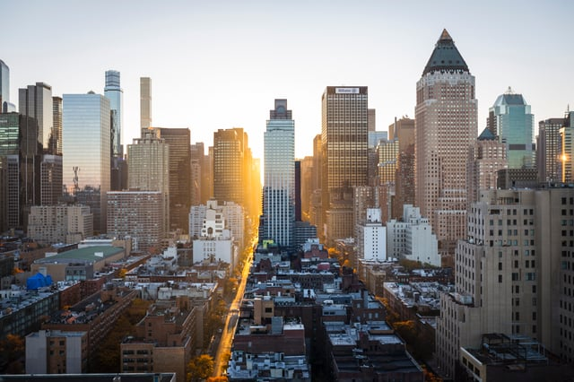

Across the country, cities of all sizes grapple with balancing planning for sustainable and resilient futures, preserving historic character, and meeting increased demands for walkable neighborhoods, easy access to transportation, and continuing interest in urban living. Strategies for addressing housing shortages, the need for affordable housing, and resilient and sustainable development vary from municipality to municipality and in this post, we’ll be highlighting some of the ways U.S. cities have been addressing the changing needs of their residents and population growth.

 <em>image credit: [Andrew Gook](http://unsplash.com/photos/VRLHw_rBjIw)</em>

## Sustainability and Resiliency Initiatives

Though related, sustainability and resiliency remain separate urbanism concepts. Urban sustainability efforts focus on maintaining existing infrastructure and creating systems that can run independently into the future - for example, movement from fossil fuels to alternative energy sources is a sustainability initiative. Resiliency, especially within the context of urban planning, focuses on creating adaptive communities and resource systems that can respond to changes in environment and resident needs in periods of uncertainty such as natural disasters, climate change, or economic uncertainty.

In the City of Chicago, sustainability and resiliency initiatives both play a part in the Chicago Metropolitan Agency For Planning’s (CMAP) comprehensive [plan](/final-review-blog/resilience-strategies-chicago-cmap/) for the metropolitan area titled *ON TO 2050*.

CMAP’s plan defines resilience as the “ability to prepare and recover from acute shocks and chronic stresses by transforming … infrastructure, natural systems, and social structures to be more durable.” Strategies include promoting walkable and mixed use communities that do not rely on automobiles, minimizing the impact of climate change through retrofitting existing buildings, and promoting collaboration between municipalities throughout the metro area in planning initiatives. The plan also draws attention to economic challenges and continuing inequalities in access to resources and education in the city and how these may be impacted by future stresses.

The plan has been released throughout 2017 and CMAP continues to open the plan to the public for comment as each of the five “[Alternative Futures](http://www.cmap.illinois.gov/onto2050)” that it proposes.

## Transit-Oriented Developments  
<em>image credit: [Sawyer Bengtson](http://www.unsplash.com/photo-1496849858694-9c2a93479df2)</em>

Cities experiencing significant new growth have also been focused on incorporating sustainable and resilient development strategies and strategic planning. The City of Denver’s FasTrack’s [expansion program](/final-review-blog/resilience-strategies-chicago-cmap/) plans to add new light rail service, improved bus service, and other infrastructure of the City of Denver and the surrounding area. Ranked ninth most sustainable city in the US by Arcadis, Denver’s light rail expansions reduce dependence on driving even as the city experiences additional sprawl as housing demand grows.

Transit-oriented developments (TODs) have been increasingly adopted throughout the country as a way to address density needs and combat urban sprawl. The [Transit-Oriented Development Institute](http://www.tod.org/) defines a TOD as a “walkable design with pedestrian as the highest priority” that functions as a “regional node containing a mixture of uses in close proximity.”While some TODs eliminate all parking, others feature reduced parking, and planning actively includes alternative modes of transportation such as bikes and scooters.

The City of Denver’s [Strategic Plan](https://www.denvergov.org/content/dam/denvergov/Portals/193/documents/TOD_Plan/TOD_Strategic_Plan_FINAL.pdf) uses TODs to address increasing demands walkable urban spaces by adapting developments to different typologies, including dense urban centers and the metro area’s suburbs.

TODs must meet certain criteria based on municipal ordinances and zoning to be considered transit-oriented. In the City of Chicago, the [2015 TOD Ordinance](/final-review-blog/overview-of-chicago-transit-oriented-development/) considers developments that are within quarter of a mile of a transit stop or half a mile if on a residential street to be eligible for the reductions in parking and increases in height and floor area ratio (FAR) granted to TODs.

Though TODs continue to be popular, the development strategy is not without critique, with [residents](https://chicago.curbed.com/2017/8/11/16131922/transit-oriented-development-public-forum) in cities such as Chicago citing concerns about increased density in areas that may not be accustomed to new development and that “the ability to build-up smaller parcels in outlying neighborhoods” away from downtown cores will overload transit systems.

## Affordable Housing Initiatives

Though many cities are experiencing building booms, housing shortages are common throughout these same major U.S. cities, and the U.S. severely lacks in affordable housing.

According to the Urban Institute, across the country, for every 100 low-income households, only 29 affordable rental units [are available](http://apps.urban.org/features/cost-of-affordable-housing/). Municipalities and non-profits vary in their strategies for addressing housing needs, including inclusionary zoning, changes to building codes, and developing new funding sources.

New York City finances housing initiatives and since 2014, the [Housing New York program](http://www1.nyc.gov/site/housing/index.page) has delivered 77,651 affordable units through subsidized building. The City also has inclusionary zoning ordinances requiring that developers either include affordable housing within new buildings or at alternative sites. The Mandatory Inclusionary Housing and [Zoning for Quality and Affordability](/final-review-blog/historic-zoning-changes-new-york-city-zoning-for-quality-and-affordability/) amendments require a minimum of housing be set aside as affordable units or requires developers to contribute to affordable housing funds.

The City of San Francisco [remains](https://www.bisnow.com/national/news/home/sf-nyc-and-boston-are-the-worlds-most-expensive-cities-to-rent-71086) the most expensive city to rent housing in the United States and the majority of residents are rent burdened, spending more than 53% of their monthly income on rent. The City has explored addressing the housing needs of both low-income and middle class residents by allocating public land for both mixed-income and affordable developments - though the initiative remains untested, the City’s [Proposition K](https://www.multihousingnews.com/post/five-cutting-edge-city-initiatives-in-affordable-housing/) allowed for the city to take inventory of surplus property to determine feasibility of the program.

<em>image credit: [Ben O'bro](http://www.unsplash.com/@benobro?photo=wpU4veNGnHg)</em>

## Solutions to Urban Development Issues Will Take Many Forms

Though cities are facing increasing challenges and major shifts in the needs of their residents, urban planning continues to work to address these changes. Solutions stretch across different issues -  sustainable transit developments address issues related to diminishing fuel resources and can also offer affordable housing, for instance - and cities are looking at their [existing housing stock](/final-review-blog/reurbanism-and-adaptive-reuse-preservation/) as a way of meeting walkability demands in another instance. By pursuing responsible programs, cities can provide more affordable housing, support residents, and continue to remain healthy into the future.
