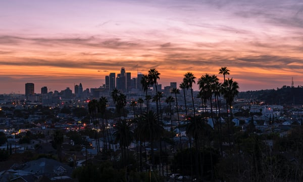

A permit from the Los Angeles Department of Building and Safety (LADBS) is required for any private property construction, alteration or repair work on buildings within the City of Los Angeles.There are five different types of [building permit processes in Los Angeles](http://ladbs.org/services/core-services/plan-check-permit/types-of-permit-processes): Express Permit, Counter Plan Check, Expanded Counter Plan Check, Regular Plan Check, and Parallel Design Permitting Process. In this post, we’ll share information on each of the processes in Los Angeles and when to use them for your project submittals.

<em>image by [Sterling Davis](https://unsplash.com/photos/4iXagiKXn3Y)</em>

## Express Permit

Permits for simple projects are issued as express permits. They can be filed in-person at a Development Services center or online as an e-permit, and are issued when work does not require any type of plan review or approval. Online express permits can be issued for different types of construction including:

-   Building
-   HVAC
-   Plumbing
-   Fire Protection
-   Electrical
-   Elevators and Pressure Valves
-   Temporary Special Events Permits

## Counter Plan Check

Permits for simple projects that require a plan check are issued over the counter through the Counter Plan Check process. The plans are reviewed the same day as they are submitted. Plans typically reviewed over the counter are small and medium-sized projects that can be reviewed in approximately 45-60 minutes. Counter Plan Check is available at the Metro (Downtown), Van Nuys, and West LA offices. Counter Plan Check permits can be issued for project types including:

-   Residential
-   Commercial
-   Temporary tent or structure and temporary events

## Expanded Counter Plan Check

Permits for medium-sized projects that require a plan check, like multi-floor tenant improvements and medium-sized home additions, can be issued over the counter through an Expanded Counter Plan Check (ECPC) process. The plans are reviewed the same day as they are submitted, usually taking two to three hours. ECPC is a pilot project and is only available at the Metro (Downtown), Van Nuys, and West LA offices. ECPC permits can be issued for projects including:

-   Residential
-   Commercial

## Regular Plan Check

Permits for large, complex projects are issued through the Regular Plan Check permit process. Depending on the workload of the LADBS, plans are reviewed and returned within weeks. Regular Plan Checks may be submitted to any Development Services Center but are only processed at the Metro (Downtown), Van Nuys, and West LA offices.

## Parallel Design Permitting Process

Traditionally, only a project with detailed plans that reflect a complete design could be submitted for plan check to the LADBS. LADBS implemented a new Parallel Design Permitting Process for major project developments that allows the design process and the permitting process run concurrently. LADBS starts the process by checking plans at the conceptual design phase and continues to provide plan check and correction verification services through the design phases. When final drawings are complete, the building permit is issued.

Permits issued using the Parallel Design Permitting Process authorize construction to commence prior to the issuance of the entire building permit by breaking the approvals into smaller parts. This ultimately shortens the construction timeline by allowing construction to begin on the foundation, for example, while the architects and structural engineers finalize plans for the rest of the building.

Burnham used the Parallel Design Permit Process during our work on the [Wilshire Grand Center,](/final-review-blog/burnham-expedites-construction-of-los-angeles-newest-iconic-building-the-wilshire-grand-center/) the first building in Los Angeles to use Parallel Design. We met with the LADBS and a variety of city departments during that process to help it be successful.   

Benefits of Parallel Design include:

-   Ability to identify and correct code violations early on and avoid cumbersome revisions to finished design
-   Identify clearances and obtain sign-offs from other agencies early on and avoid unexpected clearances
-   Reduce overall permit processing time, start and complete construction ahead of schedule
-   Reduce project cost due to time-saving

To initiate the Parallel Design Permitting Process for major project developments, contact Colin Kumabe at (213) 482-0447 at Metro Plan Check. If you have any questions about the permit process in Los Angeles, feel free to [Contact Us](/contact/) at any time.
