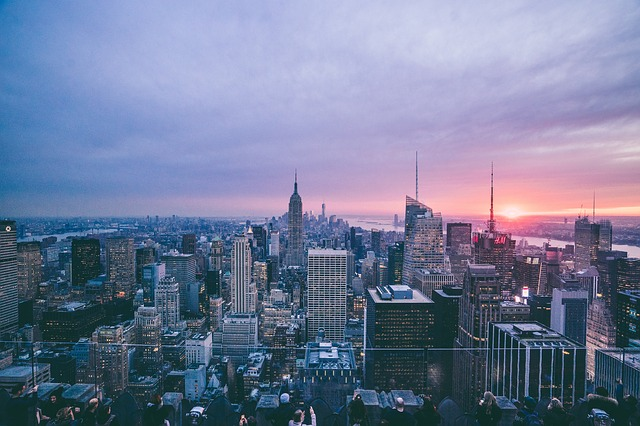

New York City and State Solarize programs are locally organized community outreach efforts aimed at getting a group of homes and businesses in one area to install solar energy. New York State supports [Solarize community solar](https://www.nyserda.ny.gov/All-Programs/Programs/NY-Sun/Communities/Solarize) programs as part of the NY-Sun Incentive Program. The NY-Sun is Governor Cuomo’s $1 billion initiative to advance solar energy. In his 2016 State of the State address, Governor Cuomo set the goal to install solar projects in 150,000 new homes and businesses by 2020. In this post we’ll share how the Solarize program is performing across the state as well as share updates to the New York shared renewables program and Solarize NYC.

## Solarize Campaigns Across New York State

In February 2016, Governor Cuomo announced that [900 solar projects](http://www.nyserda.ny.gov/About/Newsroom/2016-Announcements/2016-02-19-Governor-Cuomo-Announces-900-Solar-Projects) are underway as part of 26 different Solarize campaigns. The Governor also announced that an additional 31 Solarize campaigns are set to begin this spring. The Solarize initiative is a collaboration between the State and local communities. Those communities are able to simplify purchasing and obtain discounts for participants on solar projects.

## New York’s Shared Renewables Program

Both the shared renewables program and the Solarize campaigns got their start as part of the New York State [Reforming the Energy Vision](http://www3.dps.ny.gov/W/PSCWeb.nsf/All/CC4F2EFA3A23551585257DEA007DCFE2?OpenDocument) (REV) Process and is part of the NY-Sun program. The shared renewables program extends New York’s net energy metering policy to centrally-located solar arrays. The program allows rooftop arrays, as well as shared solar arrays, to qualify for retail rate reimbursement. Phase two of the shared renewables program went into effect May 1, 2016.

As community solar programs continue to grow across the state, it is important to establish rules for the shared ownership of solar energy. The shared renewables program establishes the full rules, which you can view in this [document from New York State](https://www.burnhamnationwide.com/hubfs/blog-files/76520435-25ED-4B84-8477-6433CE88DA86.pdf). As part of the rules, a project sponsor can be an energy services company, a municipal entity, or any other type of business or non-profit. The sponsor will be responsible for building, interconnecting, owning, and operating the behind the meter generation.

While the shared renewables program extends to communities across New York State, industry professionals are excited to see how it will affect New York City in particular. With so much real estate occupied by renters, a shared community solar program will allow those buildings to take advantage of rooftop solar. Learn more about the [shared renewables program](http://www.utilitydive.com/news/inside-new-yorks-aggressive-new-community-shared-renewables-program/402896/#.V084xdlAMRA.mailto) in this article from UtilityDive.

## Solarize NYC

Mayor Bill de Blasio announced in April a new Solarize NYC plan to help make solar energy more affordable in New York City, where residents face some of the highest energy costs in the country. Solarize NYC was created to help remove barriers for communities that typically have had limited access to clean energy. The program allows communities (which can include neighborhoods, business districts and houses of worship, among others) to purchase solar power together as single purchasing entities. This community solar initiative can save users between 10 and 20 percent on energy costs.

Solarize NYC builds upon the success of the 2015 [NYSolar Smart Solarize Brooklyn CB6](http://www.cuny.edu/about/resources/sustainability/nyssolar/solarize/BrooklynCB6.html) pilot program led by Sustainable CUNY, through which 26 contracts have been signed to date, representing 141 kilowatts of power.

This program falls under both Governor Cuomo’s NY-Sun and Mayor de Blasio’s OneNYC initiative. The program is also part of the NYC Solar Partnership. Formed in 2006, the NYC Solar Partnership consists of Sustainable CUNY of the City University of New York, the New York City Mayor’s Office of Sustainability, and the New York City Economic Development Corporation.

A goal of the OneNYC initiative, as well as the NYC Solar Partnership, is to have 350 megawatts of installed solar capacity on public and private building by 2025. [According to Politico](http://www.politico.com/states/new-york/city-hall/story/2016/04/city-to-launch-new-community-solar-program-100932), 75 megawatts have been installed at this point in time. Another goal of Solarize NYC, according to a [press release](http://www1.nyc.gov/office-of-the-mayor/news/378-16/onenyc-nyc-solar-capacity-tripled-since-2014-mayor-de-blasio-launch-citywide), is to increase access to solar through community purchasing groups over the next nine years.

While NYC remains a difficult place to install solar, due to code restrictions and the layout of the City, this initiative appeals to both developers and individual users of solar energy. Solarize NYC encourages developers to build out solar capacity and sell the energy to community groups.

According to the press release from Mayor de Blasio, Solarize NYC is also a core component of the OneNYC goal of expanding in-city renewable energy and part of the mayor’s commitment to reducing greenhouse gas emissions 80% by 2050.

Additionally, as part of the OneNYC program as well as due to a push from solar development companies, the mayor’s office has made a commitment to cutting red tape at the Department of Buildings in order to speed up approval of solar installation projects. This includes updating Fire Department guidelines on roof classifications to ensure larger solar projects can be safely installed on more rooftops. You can learn more about the [improved fire code guidelines](/final-review-blog/improved-fire-code-guidelines-for-new-york-city-solar-installers/) for NYC solar installers in this recent blog post.

## How to Take Part in Solarize NYC

Both community groups and solar installers interested in taking part in the Solarize NYC program can apply online by submitting a Letter of Interest at [nycsolarize.com](http://nycsolarize.com). Once accepted, applicants can expect to receive financial support from the city, marketing materials and templates for community outreach, technical assistance and training from Solar Ombudsmen, and connections to partners to assist you throughout the process.
