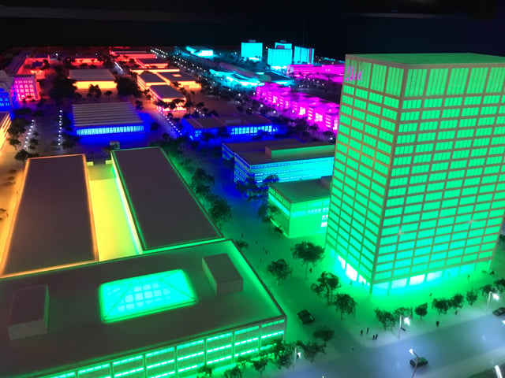

The Illinois Institute of Technology (IIT), a private research university in Chicago, is at the forefront of microgrid development. There is growing interest in microgrids as an emerging way to help build more resilient communities. IIT’s microgrid serves as an important model and testing ground for initiatives around the country incorporating microgrids into urban planning. We recently received a tour of the IIT microgrid.

## Reasons to Build a Microgrid

The microgrid is a project of IIT’s Robert W. Galvin Center for Electricity Innovation (Gavin Center). Prior to constructing the microgrid, IIT was faced with several costly power outages a year. Also, the university’s electric power system, largely built in the 1960’s, was outdated and inefficient.

IIT decided to build a microgrid, a group of electric loads that are linked and jointly controlled, as a solution to the problems it faced. Microgrids may be used successfully to respond to extreme weather events and an aging electrical infrastructure. A microgrid can be connected to the larger power grid, or in the event of a utility outage, disconnected and run independently of the grid.

Microgrids are usually comprised of a variety of distributed energy generation as well as storage technology. We recently wrote about [Hoboken, New Jersey’s planned microgrid](/final-review-blog/creating-a-more-resilient-city-hobokens-microgrid/), one of several steps Hoboken is undertaking to create a more resilient city after recovering from Hurricane Sandy’s impact in 2012.

## Scope of IIT’s Microgrid

IIT began its microgrid project in 2008 together with a number of partners. The project was funded by a United States Department of Energy grant of eight million dollars. IIT provided an additional five million dollars in funding. The university had planned to pay for a new substation to support IIT’s growth. However, funds originally intended for the new substation were used for the microgrid once the microgrid’s planners convinced the university that a new substation would not be needed if replaced with a microgrid that could control the electrical load.

The university placed the microgrid, called the Perfect Power System, on its main campus known for its buildings designed by the famed architect Mies van der Rohe. In addition to designing the microgrid to eliminate outages and reduce power disturbances, it was intended to support the research university’s increasing energy demands while reducing greenhouse gas emissions. The microgrid’s planners also wanted to design a system that could serve as a demonstration project and was capable of being duplicated by other communities and universities..

IIT’s microgrid supports an average load of nine megawatts but can reach twelve megawatts during times of peak load. The system includes rooftop solar, a wind turbine, natural gas turbines, and several different types of battery storage. About one megawatt of power comes from the microgrid’s renewable energy resources and the remaining eight megawatts is generated using natural gas.

To facilitate the microgrid’s adoption, the university’s substations and buildings needed to be upgraded. A new campus distribution system supports 52 buildings on campus and eliminates the old radial system. The new design includes three clusters and seven feeder loops using smart high-speed switches. This loop system gives several options for feeding power to each building, the ability to detect problems more quickly, and prevents a power loss by immediately isolating a fault such as a short circuit.

Staff look at the weather forecast and the utility’s electricity pricing to develop a daily schedule for the microgrid to reduce energy usage and costs. Modifications are continuously made throughout the day. The microgrid includes a master controller that monitors the system, and data is constantly collected from the microgrid to help make adjustments and optimize energy usage. In addition to the master controller, the system has controllers for each building. One way the university saves on energy costs is by undertaking load shifting, for example, using energy from battery storage during peak load times.

## Relationship to Other Developments

Commonwealth Edison Company (ComEd), the area utility, had plans to set up its own microgrid project in Chicago’s Bronzeville neighborhood adjacent to IIT’s microgrid. We previously wrote about [ComEd’s microgrid](/final-review-blog/a-closer-look-at-comeds-microgrid-in-bronzeville-chicago/) that would form the world’s first microgrid cluster if combined with IIT’s microgrid. Currently, ComEd’s project is on hold due to developments in the Illinois legislature.

The University is also developing several nanogrids, smaller systems that can operate independently from the microgrid. IIT created a nanogrid for its gymnasium lighting. LED lights that can operate on direct current were used in the system so the lights can accept power directly from the facility’s solar panels without the use of inverters. A second nanogrid is currently being developed for the university’s data center.

The Galvin Center is using the microgrid to help with smart grid development and workforce training. IIT also has several other exciting energy-related initiatives such as research on carbon capture and the coordination of electricity and natural gas infrastructure.
