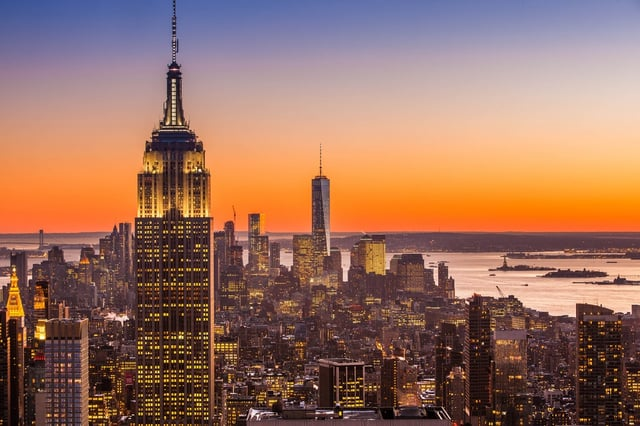

Last month, New York City enacted amendments to its administrative code that would update the New York City Energy Conservation Code. The New York City changes are intended to conform the city’s code with recent revisions to the New York State Energy Conservation Construction Code that incorporated the 2015 International Energy Conservation Code. The effective date of the updated New York City Energy Conservation Code is October 3, 2016, so any applications filed on or after that date must be in compliance with the updated code.

## New York State’s Recently Updated Energy Conservation Construction Code

In March 2016, the New York State Fire Prevention and Building Code Council voted to update the Energy Conservation Construction Code of New York State (ECCCNYS). The changes to the ECCCNYS are included in the [2016 New York State Energy Code Supplement](http://www.dos.ny.gov/dcea/pdf/2016%20DOS%20Energy%20Code%20Supplement%202016-03-13.pdf). The revised ECCCNYS incorporate the most recent version of the International Energy Conservation Code (IECC), the 2015 update. The IECC is a model code developed by the International Code Council and revised through a consensus process on a three-year cycle. It contains minimum standards for energy-efficient buildings and has separate provisions for commercial buildings and low-rise residential buildings, those that are three stories or less above grade.

The revised ECCCNYS adopts the 2015 IECC for both the state commercial and residential provisions with modifications. However, for commercial buildings, the IECC provides the option to use an alternative standard, the model energy efficiency standards of The American Society of Heating, Refrigerating, and Air-Conditioning Engineers (ASHRAE). In keeping with the IECC, the updated ECCCNYS allows commercial buildings to use the 2013 ASHRAE Standard 90.1, ASHRAE’s energy standard for commercial buildings.

The ECCCNYS will be effective on October 3, 2016. However, the state allows municipalities to create their own energy conservation codes if these codes are at least as stringent as the ECCCNYS. New York City has had an energy conservation code that has been revised several times since it was adopted in 2009.

## Recent Updates to NYC Energy Conservation Code

The New York City Energy Conservation Code (NYC Energy Conservation Code) is a compilation of city laws and the latest version of the ECCCNYS. The recent [amendments to the NYC Energy Conservation Code](http://legistar.council.nyc.gov/LegislationDetail.aspx?ID=2694009&GUID=CAEE60DC-4E40-4BC0-8B74-0202EE140791&Options=ID%7CText%7C&Search=energy), adopted as Local Law 91 of 2016, incorporate the 2016 changes to ECCCNYS with some New York City-specific modifications. In addition to any applications filed on or after October 3, 2016, being subject to the 2016 NYC Energy Conservation Code, DOB’s website states that incomplete applications filed before October 2, 2016, may be required to comply with the new code.

## Enforcement of the NYC Energy Conservation Code Provisions

The New York City Department of Buildings (DOB) intends to increase enforcement of the NYC Energy Conservation Code. For example, DOB will audit more plans to check they comply with the code. Also, progress inspections are required during construction to confirm that everything is built to conform to the approved energy efficient design. The Rules of the City of New York have specific standards governing how progress inspections are conducted and who may qualify as a progress inspector.

It should be noted that according to state law, New York City does not have the authority to grant variances from the NYC Energy Conservation Code. Only the New York Secretary of State may provide such variances, and it is necessary to contact the Codes Division of the Department of State for a variance application at (518) 474-4073 or [codes@dos.state.ny.us](mailto:codes@dos.state.ny.us).

## Resources for NYC Energy Conservation Code Compliance

DOB’s website provides a variety of resources to help with understanding and complying with the NYC Energy Conservation Code. For example, the website contains information about the types of software that may be used for energy analysis and made available for free by the U.S. Department of Energy. It also has training information and answers to frequently asked questions. Some the of the training information, such as the training modules, needs to be updated to include the recent amendments.

DOB also partners with other organizations to make available in-person training on the NYC Energy Conservation Code. The American Council of Engineering Companies of New York is working with DOB to provide an upcoming [training](http://www.cvent.com/events/introducing-the-new-2016-nyc-energy-conservation-code/event-summary-129c1e5f390a483ea03be93d3588bee2.aspx) on September 29, 2016.

We are very pleased with the updated New York City Energy Conservation Code. The amendments are critical to helping the City reach its greenhouse gas reduction goals and decreasing energy costs.
