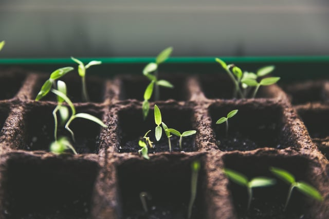
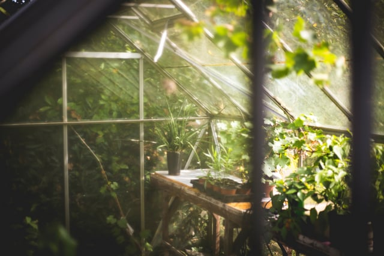

While often deemed a new trend, the history of agriculture in urban setting is both [ancient and modern](https://dirt.asla.org/2012/05/09/urban-agriculture-isnt-new/). Changing attitudes towards agriculture in cities based on space, place, and time have caused a shift in production to rural areas. However, as [sustainability and resiliency](/final-review-blog/high-to-low-adaptive-reuse-in-pursuit-of-urban-parkland/) become more important in urbanism discussions, this divide has started to change. The revival of urban farming in the United States highlights some of the new perspectives on urban agriculture along with some of the inherent challenges in bringing farming to the city.

<em>image credit: [Markus Spiske](https://unsplash.com/search/photos/community-garden?photo=vrbZVyX2k4I)</em>

## An Urban Agriculture Overview

According to the [Food and Agriculture Organization of the United Nations](http://www.fao.org/urban-agriculture/en/), urban and peri-urban agriculture is defined as “the growing of plants and the raising of animals within and around cities” and may also include horticulture and forestry.

Historically, the [majority](http://www.zoomoutmycology.com/blog/repeating-history-urban-farming-in-america-is-back-and-here-to-stay) of farmland was located near cities for ease of transportation and population growth was limited by the amount of food that could be grown adjacent to these centers. Among many examples, the [practice](http://www.nature.com/nature/journal/v540/n7634/fig_tab/540522a_G1.html) of locating food production next to urban areas was present in the Aztec Empire, where chinampas - artificial floating islands - were a significant food source for the capital city of Tenochtitlan, and urban gardens were incorporated into the planning of the City of Philadelphia.

Locating farms in or adjacent to cities became obsolete with the advent of extensive railroad networks. Food could now be transported in larger quantities more quickly and growing shifted to outlying areas so that yields could support growing populations.

[Euclidean Zoning](https://recode.la/updates/news/types-zoning-codes), a zoning system that regulates land use to single uses separated by impact types (e.g.: Residential, Commercial, and Industrial) that was adopted extensively in the early 20th century, further cemented the [separation](http://www.nature.com/nature/journal/v540/n7634/full/540522a.html?foxtrotcallback=true) of agriculture and the urban environment in the United States. Adopted to address dangerous pollution and overcrowding, single-use zoning also contributed to the ruralization of farming industries.

Urban farming movements within the U.S. have most often been limited to periods of economic depression or wartime and the association lingers to the present. Additionally, the pervasiveness of the Euclidean model promotes the idea that farming is better on open land and that because of space constraints, urban agriculture can’t produce enough to be a viable source of food.

Despite these preconceptions, 800 million people worldwide practice [urban agriculture](http://www.fao.org/urban-agriculture/en/). Farming in cities is economically viable has been included in planning for more sustainable cities because of its numerous health benefits, reduced transportation needs, and positive land use practices.

## Community Gardens, Commercial Operations Provide Sustainable Green Space

Conversations surrounding city farms usually focus on the success of commercial operations in [unusual locations](https://www.curbed.com/2016/8/16/12462190/rooftop-farm-brooklyn-grange-gotham-greens), and although commercial farming remains a major part of the new movement, community gardening is essential to local communities and cities as a whole.

[Green Thumb NYC](http://www.greenthumbnyc.org/) is the largest community gardening program in the U.S. and is rooted in [activism](https://www.nycgovparks.org/about/history/community-gardens/movement) that advocated for the transformation of vacant lots in New York City into community parks and gardens. Developed out of work by the Green Guerrillas whose “seed bombs” were the impetus for creation of the [first community garden](http://www.lizchristygarden.us/) in New York, Green Thumb NYC provides assistance and support for more than 600 gardens. These community gardens provided needed maintenance for vacant lots without requiring city manpower and assisted in neighborhood revitalization efforts. <em>image credit: [Thomas Verbruggen](https://unsplash.com/search/photos/community-garden?photo=vrbZVyX2k4I)</em>

The gardens now managed by Green Thumb NYC are park space for residents and contribute to beautification as well as tangible benefits to the city ecosystem - including [reduction](http://www.lamar.edu/sustainability/_files/documents/Multiple%20Benefits_2012.pdf) in soil erosion and runoff, reduction of air pollution, and increased quality of life. Even on a small scale, gardens can mitigate some environmental impacts including the [heat island effect](https://www.epa.gov/heat-islands/heat-island-cooling-strategies).

[Studies](http://www.lamar.edu/sustainability/_files/documents/Multiple%20Benefits_2012.pdf) have shown that “people who garden… tend to eat more fruits and vegetables on a daily basis” and that “community gardens provide access to fresh, traditional produce and nutritionally rich foods in low-income neighborhoods… where nutritious food is much less available than in other areas.” Gardens also provide provide green space that is managed by community members, reducing the demand on municipalities to caretake more expensive parkland.

Commercial farms and community gardens are unique because they are [not monocultures](https://www.curbed.com/2016/8/16/12462190/rooftop-farm-brooklyn-grange-gotham-greens) unlike the majority of green roof installations. By nature of being bio-diverse, they attract and support more animal and insect life, which in turn benefits the health of the garden or farm, and a more natural, healthy, and balanced microsystem can support more growth varieties.

## Adapting Zoning Codes to Promote Urban Agriculture

Though urban gardens provide a host of benefits, many municipalities prohibit most types of agricultural activities including the keeping of animals, forestry, and commercial gardens through restrictive zoning despite acceptance of urban farming.

Most zoning codes are not purely Euclidean and include types such as Performance/Impact Zoning, which allows variances based on compliance with a set of standards, Incentive Zoning, which allows exceptional uses with benefits for the local community, and Form-Based Zoning, which adjust zoning requirements based on location, use level, and other factors. These are more flexible codes that often allow for variances or for the complete removal of some restrictions.

The City of Chicago adopted [modifications](https://www.cityofchicago.org/content/dam/city/depts/zlup/Sustainable_Development/Publications/Urban_Ag_Ordinance_9-1-11.pdf) to the Chicago Zoning Code in 2011 that allows  agricultural uses including community gardens and urban farms  and permits  the  sale of surplus produce from community gardens, construction of accessory buildings such as greenhouses or sheds, and composting.

New York City also [amended its zoning laws](http://www1.nyc.gov/assets/planning/download/pdf/plans/zone-green/adopted_text_amendment.pdf) in 2012 to allow rooftop greenhouses certain exemptions for height and size requirements, leading to the development of commercial farms such as [Gotham Greens](https://www.curbed.com/2017/9/5/16236160/green-roof-farm-city-rooftop) in Brooklyn.

A [bill](http://legistar.council.nyc.gov/LegislationDetail.aspx?ID=3106769&GUID=C1DA662E-E6E5-471D-91FF-170F1B12332A&FullText=1) was introduced in the New York City Council this past July that requires the New York City Department of City Planning to develop a plan for urban agriculture to support the expansion of farming. Included in the bill is a recommendation that the current zoning resolution and building and fire codes be reviewed. If the City moves forward with the plan and removes some current restrictions, vertical farming could become more widespread and would be positioned to provide a hyperlocal food source for New York’s growing population.

The [Sustainable Cities Institute](http://www.sustainablecitiesinstitute.org/topics/food-systems/urban-agriculture/promoting-urban-agriculture-through-zoning) also profiles the following cities who have shifted to promoting sustainable urban food production through zoning amendments:

-   Boston: the City has established a community garden subdistrict
-   Chattanooga: the Chattanooga Zoning Code lists an “Urban Garden District” that permits raising of animals, growing of crops, and forestry within city limits
-   Nashville: Permits commercial and non-commercial gardens with Special Exemptions
-   Seattle: Established the goal of one (1) community garden per 2,500 households

## Urban Farms Can Play a Key Role in a Sustainable Future

Urban agriculture continues to [attraction attention in the media](https://www.wsj.com/articles/a-farm-grows-in-the-city-1494813900) with alternative methods including hydroponics, vertical farms, and expansive rooftop operations, however the benefits of both large and small operations are not merely novelty. By incorporating urban agriculture into future planning, cities can continue to promote healthier neighborhoods and provide creative solutions to future food production needs.
