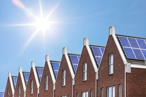

Utilities are going through a transformation. At Burnham, we have observed that many utilities are realizing they must enter the distributed generation market to stay profitable and relevant. Consumers have choices as evidenced by rooftop solar’s tremendous growth. Some utilities are adapting their business models to include distributed solar rather than losing their customers to this expanding market. Also, federal and state laws and regulations are forcing utilities to expand their renewable energy generation capacity, and distributed solar offers utilities a way to comply with such mandates. As a result of these pressures, more utilities will consider expansion into distributed solar during 2016. In this post, we will discuss two emerging trends in utility distributed solar: programs in community solar and residential rooftop solar. We will also look at the Clean Power Plan’s potential impact on the future of utility-led distributed solar.

## Continued Growth of Utility-Led Community Solar

Utility-led community solar is an important example of utility entry into the distributed solar market. Community solar programs have dramatically increased in recent years, and this trend will continue in 2016. Community solar is popular because it provides access to solar for consumers whose living or financial situation does not permit an individually owned solar system. Instead, multiple customers can share in the benefits of a solar installation in their community.

Although entities other than utilities run community solar programs, the vast majority of programs are utility owned. Utilities may directly manage the program or use the services of a third party. Community solar is an easy way for utilities to expand into solar given they have the infrastructure and customer relationships to create programs. In some cases, community solar initiatives may help utilities meet their state-imposed renewable energy goals. Also, some states have laws or policies that require or encourage utilities to develop community solar programs such as Colorado’s highly successful and recently expanded [Solar Gardens Program](http://www.xcelenergy.com/Energy_Solutions/Residential_Solutions/Renewable_Energy_Solutions/Solar*Rewards%C2%AE_Community%C2%AE_-_CO) run by Xcel Energy. In other cases, utilities voluntarily undertake community solar programs to respond to customer demand.

## The Rise of Utility-Led Rooftop Solar

Utility-owned residential rooftop solar installations are also becoming an area of utility distributed solar development. These programs are controversial due to concern they may reduce opportunities for solar developers. However, some utilities are finding that rooftop photovoltaic programs are an attractive way to grow their renewable energy capacity, increase revenues, improve grid resiliency, and help customer relations. At the end of 2014, the Arizona Corporation Commission approved the residential rooftop pilot programs of Arizona’s two biggest utilities, Arizona Public Service (APS) and Tucson Electric Power. Under its program, APS provides each customer with a monthly credit on their electric bill in exchange for APS’ use of their roof for its solar panels.

New utility-led residential rooftop programs were launched in 2015 such as those initiated by Georgia Power and Consolidated Edison. In 2016, more utilities may consider developing their own residential rooftop programs.

## The Clean Power Plan Impacts Utility-Led Distributed Solar

The United State Environmental Protection Agency’s (EPA) August 3, 2015, release of the final rule known as the [Clean Power Plan](https://www.gpo.gov/fdsys/pkg/FR-2015-10-23/pdf/2015-22842.pdf) (CPP) is the most significant regulation of power plants in many years. The CPP is a critical example of the way regulations are forcing utilities’ entry into the renewable energy market, and this new rule under Section 111(d) of the Clean Air Act will impact utility-led solar energy programs in 2016 and beyond. The CPP establishes carbon dioxide (CO2) emission rates for power plants and will stimulate greater use of renewable energy. In fact, due to the huge growth in solar and other renewables, EPA’s final rule contains more aggressive goals than the proposed version of the rule.

During 2016, CPP activity will continue at the state level. It is now up to each state to determine how they will meet the CPP’s state-specific CO2 emission reduction goals. Increased solar energy generation is one of the tools states may use to reach these goals. States must submit their CO2 emission reduction plans to EPA by September 6, 2016, or request an extension until September 6, 2018. Any extension request must include a description of the approaches to emission reduction the state is considering.

Right now, states are beginning to meet with utilities, solar energy proponents, and other stakeholders to develop their plans.This activity will continue during 2016. States also have the option of working with other states on multi-state plans.

Given that many states and utilities have already invested in significant solar energy development, it makes sense for states to build on these existing solar programs to reach their CPP goals. This should result in more robust solar programs. Also, the market for solar is still very concentrated in a small number of states. The CPP will encourage the use of solar across the country, and states with a well-developed solar industry will serve as models for other states working on their plans.

EPA has specifically [stated](http://www.epa.gov/sites/production/files/2015-11/documents/cpp-key-topics.pdf) that distributed solar may be used by states to reach CPP compliance even though the agency only included utility-scale solar to calculate the renewable energy portion of the CPP’s emission goals. As state plans develop in 2016, we will begin to see the CPP’s impact on utility adoption of distributed solar.

The CPP also jumpstarts the expansion of solar with the proposed Clean Energy Incentive Program (CEIP), a voluntary program providing incentives to states for early investment in solar and other renewable energy, especially low-income community investment. EPA will release the final version of the CEIP in the middle of 2016. States must indicate their desire to participate in CEIP by September 6, 2016, and their final CEIP plan must be submitted to EPA by September 6, 2018. The CEIP is also likely to influence the expansion of utility-led distributed solar.

## Additional Changes to Watch in 2016

2016 will be a critical year for utility-led distributed solar. There are many potential legal and regulatory changes, besides ongoing CPP work, that will influence utility decision-making in 2016. State-level policy and regulatory work, such as state renewable portfolio standards and net metering policies, will impact utility investment in distributed solar. Just before the end of 2015, Congress approved the federal Investment Tax Credit’s extension. This major solar financial incentive will assure rooftop solar remains competitive and will place added pressure on utilities to enter the distributed solar market. We at Burnham will continue to stay abreast of significant developments in solar and look forward to keeping you informed in 2016.
