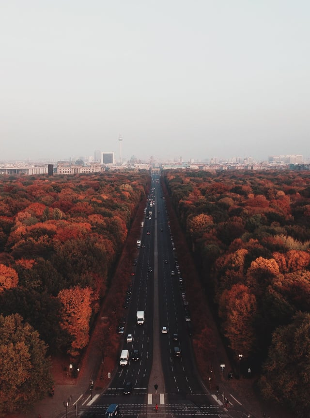

Last month, we covered [urban reforestation](/final-review-blog/efficient-water-distribution-essential-to-fight-against-carbon-emissions-water-scarcity/) as part of our Project Drawdown series and highlighted the importance of green infrastructure in the fight against global warming. The [Vibrant Cities Lab](https://www.vibrantcitieslab.com/) (Lab), an initiative by the US Forest Service, American Forests, and the National Association of Regional Councils, advocates for urban forestry in the United States by providing resources for cities seeking to improve their tree canopy or green space. By bolstering the urban tree canopy and [mandating living roofs](/final-review-blog/project-drawdown-green-roofs-mandates-denver/), cities will reap major benefits: urban heat island reduction, better stormwater management, new wildlife habitat and increased biodiversity, better and more efficient building cooling, and aesthetic improvement among others.

<em>image by [Alex Galperin](https://unsplash.com/photos/Z9J2Tau44Vg)</em>

  
Planting landscaped roofs, prioritizing new green parkland, and creating new urban forestry is essential to [Project Drawdown](http://www.projectdrawdown.org/)’s mission as well as crucial to a healthy future for cities throughout the the globe. By implementing the strategies developed by the Lab, both municipalities and communities are able to better advocate for environmentally-responsible, equitable urban forestry.

## Urban Forestry’s Benefits are Numerous and Long-Ranging

The Vibrant Cities Lab collects research on the benefits of trees in diverse sectors, including public health, economic development, equity, city planning, education, and transportation. In this post, we’ll provide an overview of some of these benefits and the ways in which the Vibrant Cities Lab can support forestry efforts.

### Human Health and Public Safety

According to the [Lab](https://www.vibrantcitieslab.com/human-health/), “urban forests reduce a variety of health issues such as respiratory diseases and skin cancer, and promote an active lifestyle which can reduce obesity” by providing quality green space for city residents, as well as provides extensive social and mental health benefits.

There is a correlation between accessible green spaces and positive social impacts. Residents of a Chicago public housing facility with robust greenery [reported](https://www.vibrantcitieslab.com/research/social-impact/) “they knew their neighbors better, socialized with them more often, had stronger feelings of community, and felt safer and better adjusted.” This includes reports of better community cohesion for senior residents and better health by providing accessible outdoor space.

Stress and low physical activity lead to both mental and physical health problems, and by providing green spaces accessible from downtown areas and surrounding neighborhoods, “views from windows help reduce stress \[and\] boost productivity” for workers as well as benefit students by “improv\[ing\] performance on tests of attention and students’ recovery from stressful experiences”, according to [analysis](https://www.vibrantcitieslab.com/research/mental-health/) by the Lab. Benefits are obtained by simply viewing green spaces as well as walking near or through them.

[Increasing tree cover](https://www.vibrantcitieslab.com/research/social-health/) reduces ultraviolet radiation reaching the skin, reducing the risk of skin cancer, and the Lab provides data that links the presence of greenery with reduce obesity rates and lowered rates of childhood asthma. Cardiovascular disease is also lower in areas with more trees.

### Air Quality and Urban Heat Islands

The [World Health Organization](http://www.who.int/phe/health_topics/outdoorair/databases/cities/en/) estimates that air pollution causes 200,000 premature deaths per year in the United States from both vehicular and power generation emissions.

Urban trees and other greenery provide air filtering benefits, removing air pollution by the “interception of particulate matter on plant surfaces and the absorption of gaseous pollutants through the leaf stomata”, according to a [study](https://www.fs.fed.us/nrs/pubs/jrnl/2014/nrs_2014_nowak_001.pdf) in *Environmental Pollution*.

Tree cover [removes](https://www.vibrantcitieslab.com/research/air-pollution-impact/) an estimated 651,00 metric tons of air pollution in the US per year, saving approximately $4.7 billion by removing ozone, nitrogen dioxide, sulfur dioxide, and particulate matter from the air. Vegetation barriers alongside roadways reduce air pollution at ground level as well as vertical mixing of pollution and surrounding air.

As a co-benefit, tree cover [also reduces](http://www.stateforesters.org/urban_forest_air_quality_primer) the Urban Heat Island (UHI) Effect by absorbing sunlight that would have otherwise been reflected off of concrete, glass, and other impermeable surface materials. Strategic placement of trees lowers summertime air temperatures and increases shade, lowering both surface and air temperatures.

### Equity

The benefits of urban forestry are numerous but distributed unequally. The Lab highlights this [significant facet](https://www.vibrantcitieslab.com/research/equity-planting-programs/) of reforestation programs - “without extensive engagement, tree planting programs can exacerbate environmental inequality” - and details successful traits of tree planting programs that promote more equitable benefits.

According to the Lab, the following are vital components to fair and successful programs:

-   Developing partnerships between the city and nonprofit groups,
-   Limiting responsibility for property owners
-   Concentrating plantings in smaller areas, and
-   Using public property for planting when possible.

Tree planting programs [should promote environmental justice](http://www.dcvb-nc.com/ScenicNC/Factors_Influencing_Participation_in_Tree_Planting_Programs.pdf), not exacerbate existing inequalities. Tree cover is more likely to be found in affluent neighborhoods and programs often target these areas, rather than less affluent areas with less access to green space. Initiatives by municipalities must focus on areas without access to prevent a clustering of health and social benefits.

## The Vibrant Cities Lab Toolkit Provides Step-by-Step Planning for Reforestation Projects

The [Urban Forestry Toolkit](https://www.vibrantcitieslab.com/toolkit/) is a guide to implementing community urban forestry. Participants can follow a research plan and set goals for individual projects, and the Lab offers a community [Assessment and Goal Setting Tool](https://www.vibrantcitieslab.com/assessment-tool/) to develop targets for reforestation projects.

The Toolkit details the organization, planning, and ultimately sustainability aspects of forestry programs. The Lab [advocates](https://www.vibrantcitieslab.com/toolkit/monitoring-maintaining-your-urban-forest/) for a living initiative that undergoes regular management and reevaluation of successful tree growth, levels of community involvement, and risk management.

Forests, both urban and rural, will face ongoing challenges as a result of global warming and urban forests are prone to effects from changes to the built environment. The [Urban Tree Growth and Longevity Working Group](http://www.urbantreegrowth.org/) is dedicated to providing information on successful programs and promote collaboration between researchers and community forestry participants and actively seeks answers to monitoring challenges for reforestation initiatives.

By promoting well-planned and equitable forestry, the Vibrant Cities Lab provides actionable items for community organizers and municipalities looking to create new green space or advocate for reforestation. The accessibility of materials and ample research can help bring about beneficial, lasting urban forests with health and cost savings.
