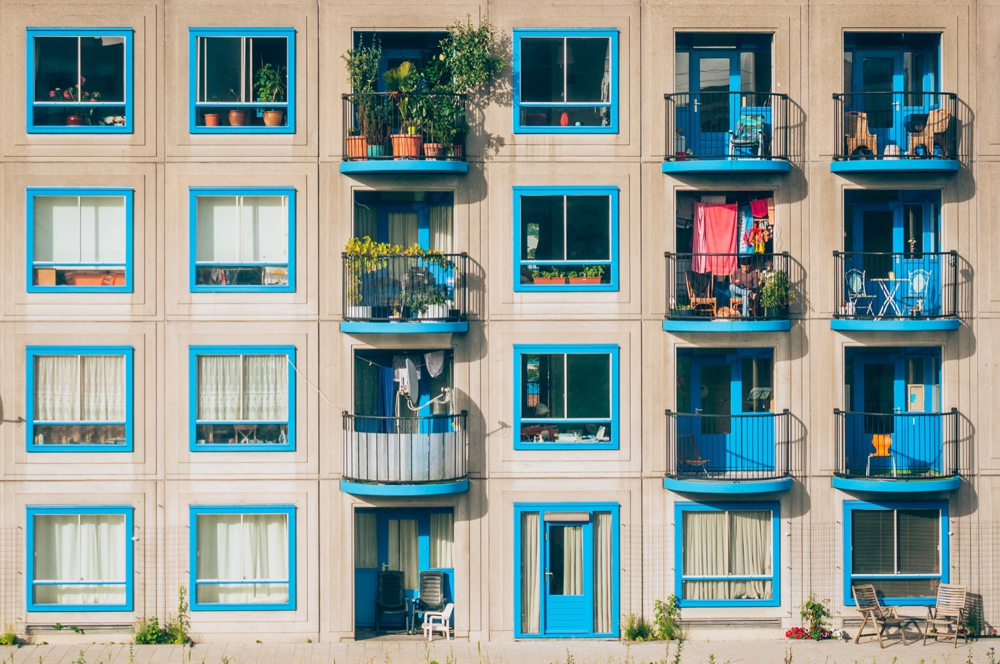

The U.S Department of Housing and Urban Development (HUD) [recently proposed](https://www.fairhousingfirst.org/) a rule that would recognize additional sets of standards and model building code editions that, when followed in the design and construction of new multifamily housing, will ensure compliance with the accessibility requirements of the Fair Housing Act. 

  
  
Photo by [Ján Jakub Naništa](https://unsplash.com/@janjakubnanista?utm_source=unsplash&utm_medium=referral&utm_content=creditCopyText) on [Unsplash](https://unsplash.com/s/photos/apartments?utm_source=unsplash&utm_medium=referral&utm_content=creditCopyText)

“HUD is happy to propose these additional safe harbors as a way to further encourage the development of housing that is open to all.” said HUD Secretary, Ben Carson. Anna MAria Farias, HUD’s Assistant Secretary for Fair Housing and Equal Opportunity added  “Adopting a model building code that HUD recognizes as a safe harbor is one very powerful way for states and local governments to deliver housing opportunities to people with disabilities.”

The Fair Housing Act requires that multifamily housing built after March 1991 contain accessible features for people with disabilities. 

Requirements include: 

-   Accessible common areas in buildings and developments
-   Usable bathrooms and kitchens, wider doors, and environmental controls that can be reached by persons who use wheelchairs.

The failure to include these features in buildings constructed after March 1991 violates federal law and makes a property difficult or impossible for persons with disabilities to use.

Under the proposed rule, HUD will incorporate more recent editions of currently recognized safe harbor standards and model building codes. 

HUD will amend its regulations to include: 

-   2009 edition standards of the American National Standards Institute (ANSI)
-   The 2009, 2012, 2015, and 2018 editions of the International Building Code, as safe harbors for compliance with the accessibility requirements of the Fair Housing Act.

<strong>Proposed Rule:</strong> Fair Housing Act Design and Construction Requirements; Adoption of Additional Safe Harbors

[**SUMMARY**](https://www.federalregister.gov/documents/2020/01/15/2020-00233/fair-housing-act-design-and-construction-requirements-adoption-of-additional-safe-harbors): This rule proposes to amend HUD’s Fair Housing Act design and construction regulations by incorporating by reference the 2009 edition of International Code Council (ICC) Accessible and Usable Building and Facilities (ICC A117.1–2009) standard, as a safe harbor. The Accessible and Usable Buildings and Facilities standard is a technical standard for the design of facilities that are accessible to persons with disabilities. HUD proposes to determine that compliance with ICC A117.1–2009 satisfies the design and construction requirements of the Fair Housing Act and its amendments. This rule also proposes to designate the 2009, 2012, 2015 and 2018 editions of the International Building Code (IBC) as safe harbors under the Fair Housing Act. The IBC is a model building code and not law, but it has been adopted as law by various states and localities. The IBC provides minimum standards for public safety, health, and welfare as they are affected by building construction.

For more details check out the the [proposed rule here](https://www.fairhousingfirst.org/).

Did this proposed HUD rule from January 2020 actually get adopted? Yes — what's described here as a proposal was finalized later that year. HUD adopted the rule in December 2020, with the new safe harbors (the 2009 ICC A117.1 standard, plus the 2009, 2012, 2015, and 2018 editions of the IBC) becoming effective for use starting March 8, 2021. Why did HUD propose adding these additional safe harbors in the first place? Before this rule, HUD's only Fair Housing Act safe harbors were tied to older code editions, leaving a gap between what most states and municipalities had actually adopted as their current building code and what HUD recognized as automatically FHA-compliant — this rule closed much of that gap by recognizing more current IBC editions. Does meeting the Fair Housing Act's accessibility requirements only apply to brand-new buildings? It applies to any multifamily housing designed and constructed for first occupancy after March 13, 1991, not just buildings built today. This has been a continuously enforced requirement for over three decades, not a one-time historical cutoff. What basic accessibility features does the Fair Housing Act require in covered multifamily housing? Accessible common-use areas, usable kitchens and bathrooms, wider interior doors, and environmental controls (light switches, thermostats, outlets) positioned within reach range for wheelchair users features intended to make units usable by residents with mobility disabilities without requiring renovation. Is HUD's safe harbor list still based on the 2018 IBC, the newest edition mentioned in this 2020 post? No, as covered in this blog's separate FHA Safe Harbor Update post, HUD still hasn't approved the 2021 or 2024 IBC editions as safe harbors even as of 2026, meaning the 2018 IBC remains the newest code edition with safe harbor protection, despite many jurisdictions having since adopted newer code versions.
