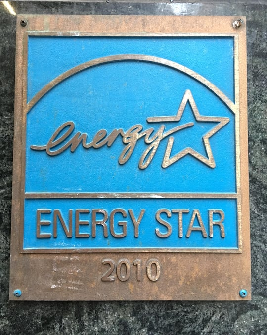

The ENERGY STAR program, critical to energy efficiency gains, is in jeopardy. The program is one of the environmental and energy programs slated to be eliminated under President Trump’s 2018 Budget proposal. In addition to reducing greenhouse gas emissions, the 25-year-old voluntary program has saved Americans billions of dollars in utility costs. Although most people are familiar with ENERGY STAR products, there are other critical components of ENERGY STAR that will also be lost if the program is eliminated.  

## The Budget Blueprint

On March 16, 2017, President Trump released highlights of the 2018 Budget, [America First: A Budget Blueprint to Make America Again](https://www.whitehouse.gov/sites/whitehouse.gov/files/omb/budget/fy2018/2018_blueprint.pdf) (Blueprint). According to the Blueprint, a more detailed budget will be released later in the spring. The focus of the Blueprint is spending changes for major federal agencies, including the elimination and reduction of hundreds of programs. It also removes funding for a host of independent agencies.

The Blueprint cuts $2.6 billion from the United State Environmental Protection Agency’s (EPA) budget, a 31 percent reduction from the agency’s 2017 Budget. According to the Blueprint, this budget decrease reflects, “the President’s priority to ease the burden of unnecessary Federal Regulations that impose significant costs for workers and consumers without justifiable environmental benefits.” It is estimated that the 2018 Budget will result in the loss of approximately 3200 EPA positions.

The ENERGY STAR program is listed in the Blueprint as one of over 50 EPA programs to be eliminated. EPA and the United States Department of Energy (DOE) jointly administer the ENERGY STAR program. DOE is also facing a significant budget cut, including a reduced budget for the DOE office that works on ENERGY STAR and other key programs, the Office of Energy Efficiency and Renewable Energy.

## Other Measures Impacting Energy Efficiency Gains

The federal agency spending and program cuts are in addition to the President’s January 23, 2017, memorandum requiring a federal government hiring freeze. Further impacting federal agencies’ ability to carry out their mandates is the President’s Executive Order 13771, [Reducing Regulation and Controlling Regulatory Costs](https://www.whitehouse.gov/the-press-office/2017/01/30/presidential-executive-order-reducing-regulation-and-controlling), signed on January 30, 2017. The Executive Order requires executive agencies to repeal two existing regulations for any newly promulgated regulation, and the incremental cost of any new regulation in 2017 must be zero. For subsequent years, the incremental cost of any new regulation must be offset by other new or repealed regulations.

Executive Order 13777, [Enforcing the Regulatory Reform Agenda](https://www.whitehouse.gov/the-press-office/2017/02/24/presidential-executive-order-enforcing-regulatory-reform-agenda), issued on February 24, 2017, requires each agency to designate a Regulatory Reform Officer and establish a Regulatory Reform Task Force within each agency. According to the Blueprint, the Regulatory Reform Task Force will, “identify regulations that eliminate jobs or inhibit job creation; are outdated, unnecessary, or ineffective; or impose costs that exceed benefits.”

In addition to ENERGY STAR, the Blueprint and recent executive orders put at risk a host of EPA and DOE programs and regulations that encourage energy efficiency.

## The ENERGY STAR Program

### ENERGY STAR Products

ENERGY STAR is a voluntary program created by EPA in 1992 pursuant to the agency’s authority under the Clean Air Act.The 2005 Energy Policy Act also calls for both EPA and DOE to establish a program that supports energy efficiency.

The [vast majority of Americans recognize](https://www.energystar.gov/about/content/more_45_us_households_purchase_energy_star_certified_products) the ENERGY STAR label placed on products to signifying they meet the ENERGY STAR product specifications for energy efficiency. The program is dependent on a private and government partnership.To carry the ENERGY STAR label, a product must be tested and certified by an EPA-approved laboratory. DOE is responsible for the development of the [ENERGY STAR product test procedures](https://energy.gov/eere/buildings/energy-star) which are periodically revised.

There are more than [70 different categories](https://www.energystar.gov/index.cfm?c=partners.pt_products_and_program_reqs) of ENERGY STAR products. According to a recent [EPA update](https://www.energystar.gov/about/content/more_45_us_households_purchase_energy_star_certified_products), ENERGY STAR products helped, “families and businesses save $362 billion on utility bills, while reducing greenhouse gas emissions by 2.4 billion metric tons since 1992.”

For ENERGY STAR labeling to work, it needs to be an independent government-run program. The credibility of a completely industry-managed program will always be questioned.

### ENERGY STAR Homes

The ENERGY STAR program has grown far beyond the certification of products. In 1995, the program expanded to include the certification of new homes. Builders participating in the program commit to constructing homes to meet EPA’s energy efficiency requirements. Each home must also be certified by an Energy Home Rater who reviews the architectural plans and conducts energy efficiency inspections. Once the home is certified, it receives an ENERGY STAR label.

The program provides important resources, such as educational programs and materials, for construction industry professionals. The ENERGY STAR website also allows home buyers to find [energy efficiency builders, raters, and incentives](https://www.energystar.gov/index.cfm?fuseaction=new_homes_partners.locator&s=mega) for their area. Without these resources available to home builders and buyers, there will be far more obstacles to building energy efficient homes.

### Building Ratings and ENERGY STAR Portfolio Manager

ENERGY STAR certification has also been extended to new commercial and industrial buildings, as well as existing buildings. The ENERGY STAR program has a rating system, the [ENERGY STAR Energy Performance Scale](https://www.energystar.gov/ia/business/evaluate_performance/The_ENERGY_STAR_Energy_Performance_Scale_3.28.11_abbrev.pdf), to compare buildings in the same category. This ENERGY STAR Energy Performance Scale has been critical to energy benchmarking programs that examine a building’s energy use over a given period of time. Benchmarking programs allow a building owner to compare their building’s energy use data to other buildings in the same category so the building owner can identify ways to increase energy efficiency and decrease energy costs.

A growing number of municipalities are requiring energy benchmarking, and California has the [first state-wide energy benchmarking program](/final-review-blog/update-on-progressive-california-energy-benchmarking-law/). These programs depend on the [ENERGY STAR Portfolio Manager](https://www.energystar.gov/buildings/facility-owners-and-managers/existing-buildings/use-portfolio-manager), EPA’s online tool to measure and monitor a building’s energy and water use. If the ENERGY STAR tools used in energy benchmarking are eliminated, it will have a profound effect on local programs supporting energy efficiency.

## The Future of ENERGY STAR

The elimination of the ENERGY STAR program is not a certainty. Responsibility for the final version of the 2018 Budget will rest with Congress. Even for those who don’t believe in climate change, ENERGY STAR’s enormous financial benefits should provide reason enough to save this critical program. Also, given the voluntary nature of ENERGY STAR, it should be a program congressional leaders would want to support.

Numerous nonprofits, industry associations, and businesses are voicing their opposition to the ENERGY STAR program’s elimination. For example, 775  architecture firms recently signed a [letter](https://network.aia.org/committeeontheenvironment/advocacy#EPA) sent by the American Institute of Architects to EPA Administrator Pruitt that calls for the preservation of important programs, including ENERGY STAR. BOMA and a real estate coalition have also [shared their support](https://www.bomachicago.org/advocacy/energy/boma-fights-save-epa%E2%80%99s-energy-star-program) for the ENERGY STAR program with lawmakers. 

We will continue to monitor ENERGY STAR’s fate over the coming months.
