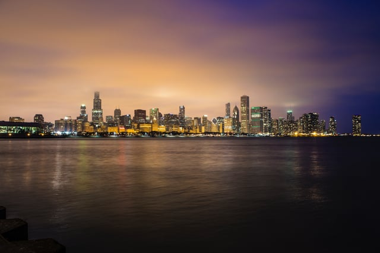

The City of Chicago Self-Certification Permit Program is designed to streamline the building permit process for qualified residential and commercial projects. By opting in to the program, permit applications will not require Chicago Department of Buildings (DOB) plan review, as the Architect of Record certifies that stamped plans are compliant with Chicago’s building code.

The program has undergone recent changes, including a new Debt Check process required by the Chicago Department of Finance as of July 2017. We’d like to provide an overview of these changes as well as reminders of some key components of the program for professionals looking to expedite their plan review process.  
<em>image by [Jeff Brown](https://unsplash.com/photos/4Y_f_LvAu3U)</em>

## Applying for Self-Certification Registration

In order to utilize the service, Professionals of Record must have valid Illinois architectural or structural engineering license and have held the license for at least three years. All registrants must take a training class coordinated by the City of Chicago Department of Buildings periodically to maintain registration. When enrolling, all applicants must include a valid Certificate of Liability Insurance with limits greater than $500,000 per claim and $1,000,000 in aggregate for all claims with their [enrollment application,](https://www.cityofchicago.org/dam/city/depts/bldgs/general/SPR/2013_SelfCert_Enroll_App.pdf) and renewing registrants must include a copy of their previous Self-Certification registration.

New applicants must also include a list of eight projects within the City of Chicago (including permit numbers) as the Architect or Engineer of Record or the project architect responsible for production of the construction documents. For projects of this nature, applications must include a signed and sealed affidavit letter verifying status as project architect.

The DOB held its most recent class on November 28th-30th, 2017 and the next class will be held in 2019, however architects and engineers have 12 months after the expiration of their current registration to renew. The DOB issues a new Certification of Completion after each training class is completed.

Fees for new enrollees are $2,500 and class completion includes 21 HSW hours and Self-Certification registration for 5 years, while renewal fees are $1,200.

## The Self-Certification Submittal Process

Once registered, the AOR and/or EOR may submit the Professional of Record Self-Certification Statement with the permit submittal documents for qualifying projects. The Statement certifies that the plans are correct and the Professional of Record agrees to correct any code compliance issues that may arise, as well as certifies that they are the party responsible for the drawings.

The process of submitting plans to the DOB follows the [Standard Plan Review process](/final-review-blog/the-three-different-types-of-chicago-plan-reviews/), however, the plans are not routed to the City’s reviewers but rather directly to an assigned City project manager for administrative review and Final Approval processes.

Eligible projects include commercial (Mercantile, Business, and Institutional use including schools), and residential projects as well as projects that include the installation of solar panels, solar thermal panels, wind turbines and other green energy initiatives. In addition, temporary structures such as tents have been included in the program. Though these projects are eligible for the Self-Certification program, all green elements must be submitted through the DOB’s [Green Permit Process](http://www.cityofchicago.org/city/en/depts/bldgs/provdrs/green_permit.html).

## Changes to the Self-Certification Process: Debt Check Requirement

The DOB implemented a fully electronic Debt Check process for Self-Certification projects [earlier this year](https://www.cityofchicago.org/content/dam/city/depts/bldgs/general/Self_Cert_Program/SelfCertNewDebtCheckProcessMemo062017.pdf). Before permits are issued by any city departments, the Department of Finance must confirm that the property owner or applicant has no outstanding debt. The applicant must submit the [Building Permit Applicant Debt Check Request Form](https://webapps1.cityofchicago.org/eforms/org/cityofchicago/debtcheck/index.jsp) prior to any plan submittals to the DOB.

Within 7 days after submittal, the Department of Finance will issue a Debt Clearance Certificate in connection with the project address either stating that there is no outstanding debt for the address, owner, or applicant, or information on outstanding debts that must be resolved. Debt Clearance Certificates are valid for 120 days after issuance and must be included with any permit submittals for the same address.

After resolving outstanding debt and receiving an approval stamp from the Department of Finance, the Certificate must be uploaded with the drawings and forms to the E-Plan system as per the City’s plan submittal process. The Certificate will be validated by a DOB project manager before permit issuance.

## Self-Certification Rules Updated in 2018

In January 2018, the City of Chicago [updated the program](https://www.chicago.gov/content/dam/city/depts/dol/rulesandregs/SelfCertPermitProgramAmendedRuleseff01012018.pdf), streamlining the process and expanding the project types eligible. 

Depending on the project size, exclusively residential buildings, single-occupancy non-residential buildings, some mixed-occupancy buildings, and existing commercial alterations may now apply for self-certification. The City retains final approval over whether or not projects qualify for the program, and some projects must also submit [structural peer review reports](/final-review-blog/new-chicago-structural-peer-review-program-rules/). 

We will continue to provide updates on the City's expansion of the program, including upcoming class dates. As always, the Burnham Nationwide team is always available to assist with Self-Certification projects and past project research for new registrants - contact our Chicago office below for further assistance.

<em>This post was last updated on January 25th, 2019.</em>
