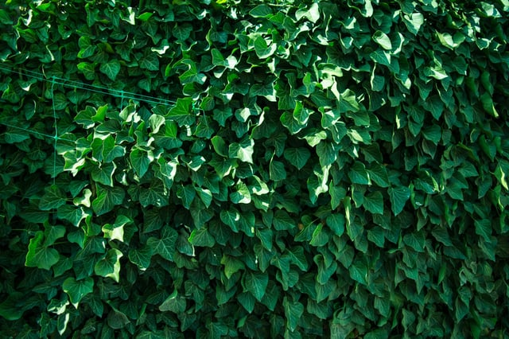

Last November, the Denver City Council enacted the Denver Green Roofs Initiative (the Initiative) after voter approval. The ordinance mandates “green roofs” for all large new construction projects and designates rules for retrofitting qualifying existing buildings at time of roof replacement with new environmentally-friendly roofs.

Green roofs, according to the first version of the ordinance, consist of either rooftop green space or solar panels on a percentage of the roof space. At time of passing,  the Initiative was the [most stringent green roof requirement](/final-review-blog/denver-green-roof-ordinance-requirements/) in the United States and surpassed San Francisco’s “Better Roofs” [mandate](https://sf-planning.org/san-francisco-better-roofs). It is one of the few mandates nationwide that require developers to install green roofs rather than offering incentives that encourage environmentally-responsible design. Advocates cited the benefits of green roofs - including a reduction in the urban heat island effect, lower heating and cooling costs - as key to a healthier, sustainable city.

<em>image by [Rodion Kutsaev](https://unsplash.com/photos/9Fong4i8CFk)</em>

However, [early reports](https://www.9news.com/article/news/local/next/not-one-green-roof-has-been-added-to-denver-since-city-passed-green-roof-initiative/73-549812167) indicated that despite its passing, the ordinance had failed to create a single new green roof by May 2018. Citing cost concerns, property and building owners have been forgoing building upgrades and new construction rather than complying with the new requirements. Additionally, weight concerns have prompted a reevaluation of the initiative’s mandates.

As a result, the Denver City Council [passed](https://www.thedenverchannel.com/news/local-news/denver-launches-updated-ordinance-to-make-city-buildings-more-environmentally-friendly) a revised version of the ordinance in October 2018 that alters the necessary green roof installations for both new and existing construction. We’ll cover the ordinance’s new requirements, as well as some of the motivations behind the revision.

## Initial Requirements as Passed in November 2017

Denver’s ordinance is partially based on a [2009 Toronto bylaw](https://www.toronto.ca/city-government/planning-development/official-plan-guidelines/green-roofs/green-roof-bylaw/) known as the City of Toronto Green Bylaw, which was the first bylaw in North America that established both a requirement for green roofs and the construction standards for installing them. According to the City of Toronto, the “Green Roof Bylaw sets out a graduated green roof requirement for new development or additions that are greater than 2,000 m² in Gross Floor Area. The requirement ranges from 20-60% of the Available Roof Space of a building.” The requirements were passed after a previous pilot program that encouraged environmentally-friendly rooftops, much like similar initiatives throughout the US that use incentives to promote green roofs.

As passed in 2017, the Denver Green Roof Ordinance was the most stringent in the United States and required that all buildings constructed after January 1, 2018 with a gross floor area of 25,000 square feet or greater must have at least 20 percent of available roof space covered with a green roof. The [requirements](http://www.denvergreenroof.org/wp-content/uploads/2017/08/Final-Version-Fully-Revised-.docx.pdf) increase with floor area up to 60 percent coverage for buildings with 200,000 square feet of space or greater. Residential building that are equal to or less than 4 stories or 50 feet high are exempt from the requirements.

If an existing building or building addition falls under the floor area requirements and the existing roof is being replaced, the building must comply with the requirements for a combination of green roof and solar system. The roof coverage area may be adjusted to avoid significant structural changes. There are also alternative requirements for industrial buildings.

A building may meet the green roof requirement by using a combination of green roof and solar panels as long as there is a minimum of 30% of green roof and meets certain rainfall reuse requirements.

The Initiative also contains detailed requirements for the design and construction of the mandated green roofs, known as the Denver Green Roof Construction Standard. The roof must be maintained following the ordinance’s maintenance plan.

## Concerns about Compliance Feasibility Led to Revision

The City of Denver, Initiative 300 organizers, and building owners began the revision process after citing both cost concerns - green roofs can cost up to 2.5 times [more than a traditional roof](https://denverite.com/2017/10/24/initiative-300-need-know-denver-green-roof-initiative/), but offer cost-saving cooling benefits as well as a longer roof life - and structural issues. According to a city-led task force, many buildings that would fall under the ordinance requirements do not have the load-bearing capabilities to support a green roof, and the costs to add either vegetation or panels are prohibitive for these structures. Though buildings can apply for exemptions, the City [preferred](https://www.9news.com/article/news/local/next/not-one-green-roof-has-been-added-to-denver-since-city-passed-green-roof-initiative/73-549812167) to look for ways to make green roofs more accessible and increase flexibility.

The initial ordinance faced considerable opposition from developers and property owners due to cost concerns, and the revaluation process led to the revision.

## New Requirements Offer a More Flexible Approach

The revised ordinance was passed by a special Denver City Council Committee on October 29th, 2018 and went into effect on November 2nd, 2018. While components of the initial version remain, there are a few notable changes, including more flexible [requirements](https://www.denvergov.org/content/denvergov/en/denver-development-services/commercial-projects/green-roof-initiative.html).

There are [new flexible compliance options](https://www.denvergov.org/content/dam/denvergov/Portals/696/documents/Green-buildings-handout.pdf) available for new buildings and additions, including a cool roof plus either: green space or green roofs, payment to the Green Building Fund, on-site solar panels, purchasing of off-site energy, energy conservation measures within the building, green building certification such as LEED v4 BD+Gold, or a combination of approaches.

Existing buildings and additions less than 50,000 square feet can utilize a cool roof and either green space or a green roof, payment to the Green Building fund, on site solar panels, energy conservation (for additions only), green building certification, or an energy program for roof replacements.

Below is some of the code language as updated by the City of Denver City Council:

-   New construction consisting of 25,000 square feet or greater of gross floor area must provide a cool roof and one of the following options:  
    

-   <em>Green space covering an area in one of the following amounts, whichever is least:</em>

-   *1\. Ten percent (10%) of the gross floor area of the building*
-   *2\. Sixty percent (60%) of the total roof area on the building*
-   *3\. The available roof space on the building*

-   <em>On-site solar panels covering an area anywhere on the building or zone lot equal to seventy percent (70%) of the total roof area or an area equal to an amount required to provide one hundred percent (100%) of estimated annual average electricity used at the building. Other renewable energy devices may be used in place of on-site solar panels so long as the owner provides evidence of similar generation capacity. Any net zero energy building complies with this subsection 4 10-301(a)(2)b.</em>

-   Off-site renewable energy purchase with the requirements detailed in the [ordinance](https://www.denvergov.org/content/denvergov/en/denver-development-services/commercial-projects/green-roof-initiative.html).  
    

-   Existing buildings with a gross floor area of 25,000 square feet or greater are are also required as follows:  
    

-   <em>A cool roof, plus either: green space covering an area in one of the following amounts, whichever is least:</em>  
    

-   *1\. For total roof area replacement: two percent (2%) of the gross floor area of the building; for individual roof section replacement: two percent (2%) of the gross floor area of the building, multiplied by the area of individual roof section(s) being replaced, divided by the total roof area of the building*
-   *2\. For total roof area replacement: eighteen percent (18%) of the total roof area on the building; for individual roof section replacement: eighteen percent (18%) of the individual roof section(s) being replaced*
-   <em>3\. Available roof space on the total roof area of the building, or the individual roof section(s) being replaced, as applicable.</em>
-   <em>4\. On-site solar panels located anywhere on the building or zone lot and covering an area in the least of the following:</em>  
    

-   *1\. For total roof area replacement: five percent (5%) of the gross floor area of the building; for individual roof section replacement: five percent (5%) of the gross floor area of the building, multiplied by the area of roof section(s) being replaced, divided by the total roof area of the building*
-   *2\. For total roof area replacement: forty-two percent (42%) of the total roof area on the building; for individual roof section replacement: forty-two percent (42%) of the individual roof section(s) being replaced*
-   *3\. An area equal to an amount required to provide one hundred percent (100%) of estimated annual average electricity used at the building*
-   <em>Building certification of LEED Silver, Enterprise Green Communities, the National Green Building Standard ICC/ASHRAE 700, or an equivalent certification approved by the Building Official.</em>  
    

The new compliance options offer significantly greater flexibility, including items mean to support compliance for buildings without the means to support a green rooftop load. Regardless of the method chosen, all new construction or roof replacements must utilize a [cool roof](https://www.denverpost.com/2018/10/27/denver-cool-roof-law/) - a light-reflective, white covering that helps reduce the urban heat island effect.

## The Revised Ordinance Poised to Initiative Better Roof Construction

Through the revisions, proponents of Initiative 300 and the City of Denver hope to spur construction of either green roofs or more environmentally-positive construction methods without limiting the building capabilities of property owners.

Even with revisions, the City of Denver’s requirements are stringent, and the City remains one of the few major cities to have a green roof mandate. We will continue to update with additional information on the ordinance and its implementation as Denver see the impact of the changes.

Is Denver's Green Buildings Ordinance still in effect and enforced today? Yes - now formally called the Green Buildings Ordinance (GBO) rather than the Green Roof Initiative, it applies to all new commercial buildings and additions of 25,000 square feet or larger, and to existing commercial buildings of that size upon roof replacement or roof recovery. For permits issued after May 1, 2023, it's enforced under the 2022 Denver Building Code. Is a traditional green roof (with vegetation) the only way to comply? No - this was updated substantially from the original 2017 version. New buildings must install a cool roof plus select one additional compliance option from a menu that includes green space, on-site solar panels, off-site renewable energy purchase, payment to the Green Building Fund ($50/sq ft), energy conservation measures, or green building certification such as LEED v4 BD+Gold. Does the ordinance apply when I'm just replacing an existing roof on a large building? Yes - existing commercial buildings of 25,000 square feet or larger must comply when replacing or recovering the roof, selecting from a slightly different (but similarly flexible) menu of compliance options, with coverage requirements scaled to the portion of roof being replaced. Who approves Green Buildings Ordinance compliance when I apply for a building permit? The Building Official is responsible for verifying compliance and determining whether a project is subject to any exemptions — and a Green Building Declaration Form (signed by the owner) must be submitted with the Site Development Plan, before permits are issued. Can paying into Denver's Green Building Fund substitute for installing solar or green space? Yes — for both new and existing buildings, payment to the Green Building Fund (currently $50 per square foot of required green roof coverage) is an accepted compliance path. However, when compared against the cost of solar installation (roughly $12/sq ft for an average commercial system that also reduces utility bills), paying the fee typically isn't the most cost-effective option.
