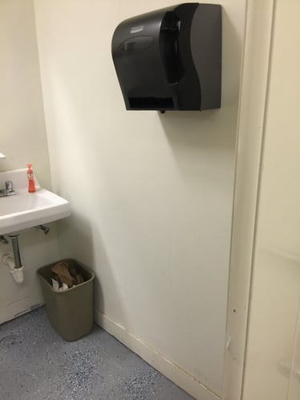
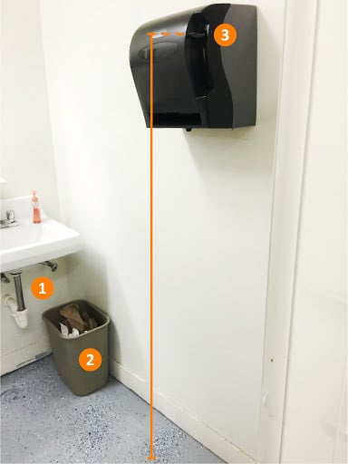
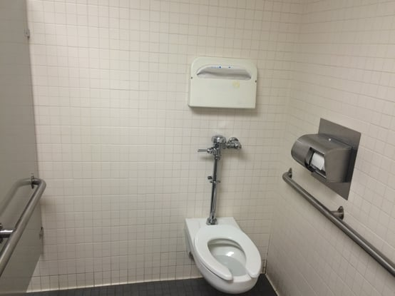
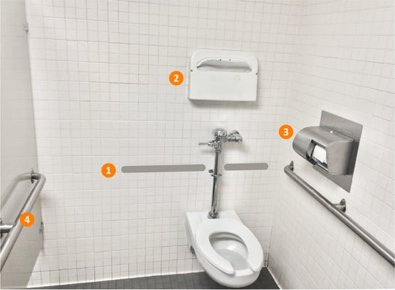

The Americans with Disabilities Act (ADA) has very specific requirements to make restrooms accessible. A variety of factors must be incorporated into the design and construction of toilet rooms so that they are compliant with the ADA. During our accessibility compliance reviews and site inspections, we see some common violations of these standards.

See if you can spot potential ADA violations in this picture:

**Where to Find the ADA Restroom Requirements**

Title III of the federal ADA requires any newly constructed or renovated places of public accommodation and commercial facilities be designed to prevent discrimination against people with disabilities. Existing buildings are also required to remove barriers to bring elements into compliance. The [2010 Standards for Accessible Design](https://www.ada.gov/regs2010/2010ADAStandards/2010ADAstandards.htm) (2010 Standards) are the rules implementing the ADA and incorporate the [2004 ADA Accessibility Guidelines](https://www.access-board.gov/guidelines-and-standards/buildings-and-sites/about-the-ada-standards/background/ada-aba-accessibility-guidelines-2004) (ADAAG).

ADAAG contains all the scoping and technical requirements relevant to restrooms. ADAAG, [Section 213](https://www.access-board.gov/guidelines-and-standards/buildings-and-sites/about-the-ada-standards/background/ada-aba-accessibility-guidelines-2004/ada-chapter-2-scoping-requirements) states the restroom scoping requirements, and [Chapter 6, Plumbing Elements and Facilities](https://www.access-board.gov/guidelines-and-standards/transportation/facilities/ada-standards-for-transportation-facilities/chapter-6-plumbing-elements-and-facilities), sets forth the relevant technical requirements. Specifically, Section 606.2 contains requirements for clear floor space at lavatories. Other sections of the chapter, such as Section 606.5 on exposed pipes and surfaces and Section 307.2 on protrusion limits, are also relevant.

1.  <strong>There are exposed pipes and surfaces.</strong> The ADA requires water supply and drain pipes under lavatories and sinks to  be insulated or otherwise configured <em>to protect against contact (606.5 Exposed pipes and surfaces)</em>.  There shall be no sharp or abrasive surfaces under lavatories and sinks.
2.  **There is limited clear floor space** for a forward approach under the lavatory (606.2 Lavatory clear floor space and 305 knee and 306 toe). While the garbage can is not a permanent element, this still is acting as an obstruction based on the location.  
3.  **The paper towel dispenser protrudes too far from the wall**, which doesn’t comply with the mounting height requirements. Leading edges more than 27 inches and not more than 80 inches above the finished floor or ground shall protrude 4 inches maximum horizontally into the circulation path (307.2 Protruding Objects).

  
<strong>Also, the control is located more than 48 inches above the finished floor,</strong> which does not comply with the reach range requirements of all operable parts to be between 15 and 48 inches from the finished floor (308.2 Forward Reach or 308.3 Side Reach).

See if you can spot potential ADA violations in this picture:  

**Where to Find the ADA Restroom Requirements**

Title III of the federal ADA requires any newly constructed or renovated places of public accommodation and commercial facilities be designed to prevent discrimination against people with disabilities. Existing buildings are also required to remove barriers to bring elements into compliance. The [2010 Standards for Accessible Design](https://www.ada.gov/regs2010/2010ADAStandards/2010ADAstandards.htm) (2010 Standards) are the rules implementing the ADA and incorporate the [2004 ADA Accessibility Guidelines](https://www.access-board.gov/guidelines-and-standards/buildings-and-sites/about-the-ada-standards/background/ada-aba-accessibility-guidelines-2004) (ADAAG).

ADAAG contains all the scoping and technical requirements relevant to restrooms. ADAAG, [Section 213](https://www.access-board.gov/guidelines-and-standards/buildings-and-sites/about-the-ada-standards/background/ada-aba-accessibility-guidelines-2004/ada-chapter-2-scoping-requirements) states the restroom scoping requirements, and [Chapter 6, Plumbing Elements and Facilities](https://www.access-board.gov/guidelines-and-standards/transportation/facilities/ada-standards-for-transportation-facilities/chapter-6-plumbing-elements-and-facilities), sets forth the relevant technical requirements. Specifically, Section 604 contains requirements for toilet compartments. Other sections of the chapter, such as Section 605 on urinals and Section 609 on grab bars, are also relevant.

It is important to be aware of other essential sections of the ADAAG, such as Section 309 governing operable parts, which relates to some of the elements found in a restroom. There are also specific requirements for children’s use depending on the nature of the facility.

1.  <strong>There is no rear grab bar.</strong> The ADA requires a 36” wide grab bar on the rear wall which extends a minimum 12” from the centerline of the water closet on one side, and a minimum 24” on the other side (604.5.2 Rear Wall Grab Bar). Exception 2 of this section further notes that where an administrative authority requires flush controls for flush valves to be located in a position that conflicts with the location of the rear grab bar, the rear grab bar can be split or shifted to the open side of the toilet area as shown above. 
2.  **The toilet paper cover dispenser is located above the water closet** which does not provide for a compliant side or forward reach over an obstruction (308 Reach Range) or (305 Clear Floor or Ground Space).
3.  **The toilet paper dispenser aligns with the edge of the toilet seat**, which doesn’t comply with the mounting requirement stating that the centerline of the dispenser must be between 7” to 9” from the edge of the toilet (604.7 Dispensers).
4.  Based on the size of the compartment, a **sidewall grab bar is only required on the side wall adjacent to the water closet** (604.5.1 Side Wall Grab Bars). Grab bars on both sides are only required in ambulatory accessible stalls, which are stalls required in toilet rooms with 6 (six) or more toilet fixtures (213.2.1 Toilet Compartments) and (604.8.2 Ambulatory Compartments).  

**Stay Informed About all the ADA and Accessibility Requirements**

The ADA restroom requirements highlighted here are the federal standards. However, it is also important to be aware of your state and local accessibility requirements as they may differ or be more stringent than those of the ADA. Staying informed about all of the ADA standards, including local requirements, can be difficult. Our team at Burnham frequently conducts plan reviews for ADA and other code compliance. Please feel free to [Contact Us](/contact/) for a consultation.

Follow our series as we highlight the common violations of the ADA that we often see.

Why do exposed pipes under a sink cause an ADA violation? Water supply and drain pipes under accessible lavatories must be insulated or otherwise configured to protect against contact — an uninsulated pipe can cause burns or injury to someone using a wheelchair who has reduced sensation in their legs. There also must be no sharp or abrasive surfaces anywhere under the sink. Does a temporary object like a trash can count as an ADA obstruction? Yes — if a garbage can or other movable object is positioned where it blocks the required clear floor space for a forward approach to a lavatory, it still constitutes a functional violation during a compliance review, even if the object isn't permanently fixed in place. How far can a paper towel dispenser protrude from the wall before it becomes an ADA violation? Any object mounted between 27 and 80 inches above the finished floor can protrude no more than 4 inches horizontally into the circulation path — beyond that, it becomes a hazardous protruding object under Section 307.2, which is a particular concern for people with visual impairments who may not detect it with a cane. Is a rear grab bar always required at a toilet, or are there exceptions? A 36-inch rear wall grab bar is required in standard accessible stalls, but there's a specific exception: if the flush valve location required by the administrative authority conflicts with where the bar would go, the rear grab bar may be split or shifted to the open side of the toilet area. When are grab bars required on both sides of a toilet instead of just one? Both-side grab bars are only required in ambulatory accessible stalls — the narrower stalls required in toilet rooms with six or more toilet fixtures. In standard accessible stalls, a side grab bar is only required on the side wall adjacent to the water closet, not both sides.
