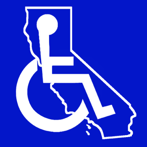

While you’re busy making sure your California construction or renovation project is properly permitted, don’t forget that every public, as well as many employee areas of the building must comply with the California Building Code Chapter 11 requirements, which incorporates the 2010 Americans with Disabilities Act (ADA). Ensuring compliance in the construction phase will save time and money down the road, not only for owners but also for those involved in the process. Even years after the construction has been completed, ADA compliance complaints can still be filed.

## Most Common Violations

California leads the nation in ADA non-compliance complaints. Why is this number so high? One reason is that it’s incredibly easy to file a complaint. There is only a simple form to complete and submit. Another reason filing ADA complaints in California seems so widespread is because if the complainant wins their case, they can be awarded $4,000 plus court costs and attorney fees.

Fortunately for building owners, someone who experiences a barrier (or even related embarrassment) can no longer be awarded $4,000 per access violation, but instead a one-time award related to the visit where full and equal access was denied.

What are a few of the most common claims when it comes to California ADA requirements?

-   Missing or incorrect signage for entrances and exits – no symbol of accessibility.
-   Sloped routes that are too steep for a wheelchair user, or a person with an ambulatory disability to navigate.
-   Bathrooms with no clear floor space for turning, no accessible stall, either none or incorrectly mounted grab bars and no compliant sink.
-   Stairways with incorrect riser heights and tread widths, no non-slip treads, handrails not mounted at the correct height or without extensions and open risers where a foot or cane could get stuck and cause a person to trip.
-   Parking spaces that aren’t wide enough, lack correct designation signage, or are not located closest to the accessible route and entrance.
-   Lack of properly designed seating for wheelchairs users.
-   Height of service counters, bars and work surfaces.

## Costs Can Add Up

In addition to fines and lawyer fees, a building owner, tenant, and those involved in the design or construction  may be responsible for fixing the problem. The law requires that owners make changes that are “readily achievable”, which could mean simply repainting the lines of a parking space or relocating a sign, or more complex repairs such as adding a ramp or retrofitting a restroom.

## CASp – The ADA Specialist

Clearly, the best time to ensure California ADA compliance is before the construction project is finished or better yet, during the planning stages. If you’re lucky, you may have access to someone on your staff with ADA compliance experience, but in California, help isn’t far away.

California Senate Bill 1608 created the Certified Access Specialist Program. A CASp professional has been trained and is certified to know which ADA requirements apply to your construction project, whether you’re building from the ground up, or renovating an existing structure.

It’s true that your architect or engineer can determine if the building meets ADA standards. However, involving a CASp specialist to certify compliance or identify non-compliant issues and determine the feasibility of bringing them into compliance carries significant weight if a complaint is filed. This may also result in reduced statutory damages.

A list of Certified Access Specialists is available on the [California Division of Architects’ website](https://www.apps2.dgs.ca.gov/dsa/casp/casp_certified_list.aspx).

Keep in mind that these professionals concentrate solely on the California Building Code Accessibility requirements; however, as California regulations are carefully crafted from federal ADA standards, achieving compliance with the California ADA requirements will generally cover you at the federal level.

If you still have questions about building codes, permits, and regulations, consult with the [experts at Burnham Nationwide](/contact/). We’ll make sure your project is compliant, street to door, floor to ceiling.
