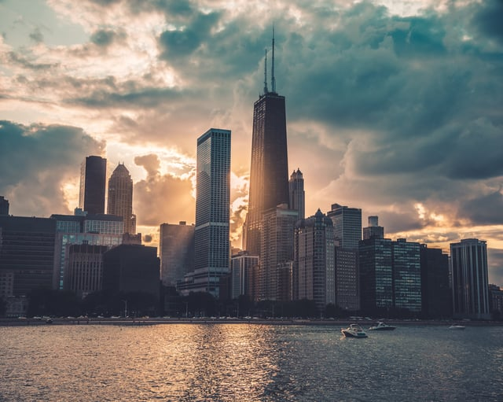

Previously, we covered the 2017 BOMA/Chicago Economic [Trends Report](/final-review-blog/chicago-market-trends-show-tech-growth/) that highlighted Chicago’s changing Central Business District (CBD) occupancy trends and tech growth, especially in rapidly-changing areas like the South and West Loop. Though the study found that the City of Chicago is home to a growing technology sector, Chicago’s economy remains highly diverse, and downtown office space occupancy rates continue to increase. 

<em>image by [Max Bender](https://unsplash.com/photos/yb7Yg3Rv7WA)</em>

Partnering again with JLL, BOMA/Chicago released their most recent report, the 2018 Economic Impact Series: “Why Chicago? A Study of Chicago’s Strengths and Opportunities” in November 2018. This year's research concentrates on what drives major businesses to choose Chicago and improvements that can make the city even more attractive in the future.

## 2018 Report Overview

### Chicago Remains a Viable Technology Center

One of the prominent trends from the report is how much businesses value Chicago’s talent base: out of the 37 key companies with Chicago headquarters surveyed in the in-depth study, over 60 percent of respondents listed talent as the most influential factor for choosing Chicago. The second-highest category, access to customers, was the deciding factor for only 15% of respondents. 

The City of Chicago has a significant educated talent base, and according to the findings, with growth occurring in the CBD: there has been a 15.3 percent increase in educated millennials, and 79 percent of CBD residents have a bachelor’s degree or higher. According to U.S. census figures cited in the report, “Chicago is the best educated big city in the country" with a technology talent base.

The report also references Chicago’s status as a new tech city - Chicago now ranks as the #2 U.S. technology center in KPMG’s [2018 report](https://info.kpmg.us/content/dam/info/en/techinnovation/pdf/2018/tech-hubs-forging-new-paths.pdf) - but with lower technology sector wages and a lower cost of living, a significant draw for employers.

### Key Neighborhoods such as the West Loop and Fulton Market Draw Companies

Corporations also cited neighborhood amenities, especially in growing areas such as [Fulton Market](/final-review-blog/the-changing-landscape-of-chicagos-fulton-market-district/) and the West Loop, as key to attracting talent. Factors that were previously overlooked such as dining and local culture are playing an increasing role location choice. The Fulton Market subarea has seen a 36.6 percent population growth since 2010, and respondents identified the West Loop as the [most productive](https://www.bomachicago.org/advocacy/economic-impact-study) submarket for business. Sixty-eight suburban headquarters [have relocated](http://www.chicagomag.com/Chicago-Magazine/March-2019/When-a-Suburb-Loses-Its-Headquarters/) to the City of Chicago since 2007, including McDonald's, which moved its headquarters to the Fulton Market neighborhood in 2016.

West Loop development shows little signs of stopping, bringing more residential and business-friendly amenities to the former packing district.

### Transit is Somewhat Accessible, but Need for Improvement Remains

The City of Chicago’s transit system is considered an amenity by corporations as well, but both those surveyed and external sources cite room for improvement.

As a whole, the state of Illinois received a C- in the American Society of Civil Engineers (ASCE)’s [2018 Infrastructure Report Card](https://www.infrastructurereportcard.org/wp-content/uploads/2016/10/FINAL-REPORT-CARD-FOR-2018-IL-Infrastucture.pdf), and Chicago’s significant traffic delays and aging commuter rail is in dire need of improvement. 

According to the Report, access to public transit and air travel - including both O’Hare and Midway Airports - ranked 4.45 and 4.67 out of seven in importance, respectively. Though the city's transportation systems do not have complete coverage, the Report does indicate that easy airport access from the CBD is key. The City of Chicago’s upcoming O’Hare Airport [expansion](https://www.chicagotribune.com/business/ct-biz-ohare-expansion-kamin-0117-story.html) promises to reduce passenger headache and serve a potential 100 million passengers by 2026.

## Long-Term Concerns Include Political Environment and Fiscal Stability

Though respondents are overwhelmingly positive about the future of Chicago, the survey also included executives that chose not to locate their companies in the city. The reasons for not choosing Chicago included concern over the city and state’s political environment, crime, and property taxes.

A history of “political discord, resulting in a polarized environment that has driven a wedge between elected officials, \[has\] disrupted compromise needed to pass fiscally sound budgets”, according to the [Report](https://www.bomachicago.org/sites/default/files/boma_chicago_eis_why_chicago.pdf), and the reputation of Chicago as a center of violent crime continues to linger despite a reduction in crime over the last two decades. Concern over the city’s political environment was the leading reason to not locate in the city, and the State of Illinois received an “F” in Truth in Accounting’s 2016 report released last year, “Financial State of the States”.

The Report advocates that, though these are very real challenges faced by the City of Chicago and the State of Illinois, the city remains primed for further growth through its “incredibly deep and diverse talent base, supported by world-class cultural amenities and an established transit network to make them accessible.” Addressing the major issues facing the state and city through a concerted effort towards crime reduction, a balanced budget, and political cooperation can assuage fears and help Chicago to continue to attract major corporations to its downtown and nearby neighborhoods.

## 2018 Report Reflects On-going Trends

In comparison with last year’s report, the 2018 BOMA/Chicago Economic Impact Series reflects similar conclusions albeit with different data. Chicago remains a growing technology center, with a healthy downtown business district and nearby growing neighborhoods. Corporations continue to choose Chicago as a destination due to a diverse economy and talent base, and world-class amenities.

Major new developments such as Sterling Bay’s ‘[Lincoln Yards](/final-review-blog/chicago-north-branch-corridor/)’ on the Near North Side promise new office space and new amenities for younger, educated residents, and Chicago’s trend of attracting headquarters for companies such as Google and McDonald’s shows little signs of slowing.

We look forward to BOMA/Chicago's next report on Chicago's continuing growth.

Is Fulton Market still the top office submarket in Chicago the way this 2018 report identified it? Yes, even more so — Fulton Market's office vacancy rate of roughly 10.9% as of early 2026 is the lowest of any Chicago submarket, well below the city's overall average of around 22-23%, confirming the neighborhood's continued standing as Chicago's strongest office submarket. Has the citywide office vacancy picture improved or worsened since this 2018 report? Worsened significantly overall, though the picture is highly uneven by location and building quality. Chicago's CBD vacancy reached roughly 22-23% in 2025-2026, driven by post-pandemic hybrid work patterns, while premier West Loop and Fulton Market buildings remain near full occupancy and East Loop vacancy tops 28%. Is Chicago still attracting major corporate headquarters relocations the way this 2018 report described? The pace of suburban-to-Chicago relocations has slowed from its pre-pandemic peak, though Google's move into the Thompson Center (a $105 million investment, opening 2026 in the Loop) is a significant new anchor expected to replicate some of the economic catalysis Google previously created in Fulton Market. What happened to Lincoln Yards, the major development this report mentions as "promising new office space"? Lincoln Yards has had a complicated path - Sterling Bay faced financing challenges and scaled back its original plans significantly, and the development remains incomplete and substantially smaller in scope than the ambitious mixed-use vision originally pitched to the city. Was the O'Hare expansion this report mentioned as "promising 100 million passengers by 2026" ever completed? Partially - O'Hare's expansion (the O'Hare 21 program) is an ongoing multi-phase project that has delivered new gates and renovations, but full buildout to 100 million passenger capacity is a longer-term horizon rather than a 2026 completion.
