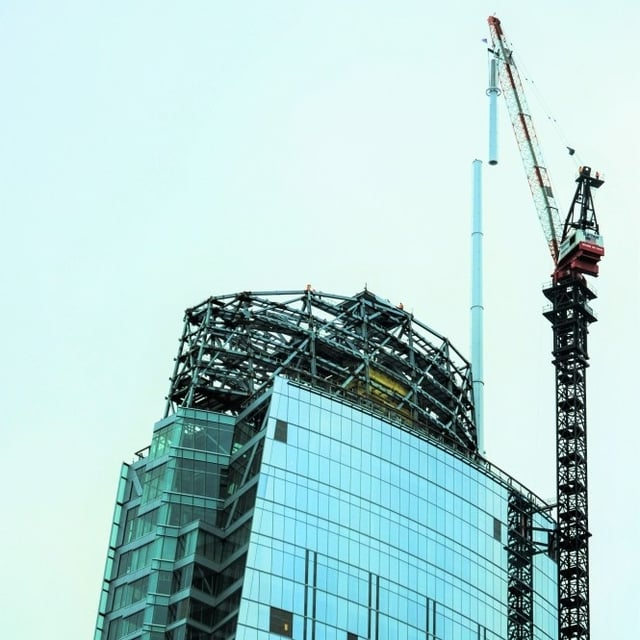

The crowning touch to Los Angeles’ Wilshire Grand Center, its novel steel spire, was recently placed on the skyscraper. Los Angeles’ newest icon, scheduled to open in the spring of 2017, is located in the city’s financial district. With the addition of the spire, the Wilshire Grand becomes the tallest building in Los Angeles as well as the western United States. The 273-foot spire contains LED lighting that will shine varied colors from the tower. We want to highlight the addition of this feature to the Wilshire Grand, a Burnham project.

The spire on the Wilshire Grand opens the door to a new era of design in Los Angeles and will ultimately alter the city’s skyline.The [Wilshire Grand’s spire](http://www.latimes.com/local/california/la-me-wilshiregrand-20160901-snap-story.html) was the focus of a Los Angeles Times article which highlighted the beacon’s unique composition and importance. According to the article, the Wilshire Grand’s design departs from years of flat roofs abruptly capping downtown Los Angeles skyscrapers.

The flat roofs were designed to comply with the building code requirement that Los Angeles high-rises accommodate a helicopter landing pad. It was thought that helicopters would be used in the event of a fire rescue. However, the Wilshire Grand’s designers were able to demonstrate that there are far better options for safe rescue and fire prevention than investing in the creation of a helicopter pad. The skyscraper, with new features such as a landing platform and elevator dedicated to firefighters, led the way for changes to the building code that allow for newer and better methods to avoid and fight fires.

Designing and building the spire also had several other unique challenges according to the Los Angeles Times. Without proper engineering of the spire, area windstorms could cause the tall, hollow cylinder to vibrate which would potentially lead to its collapse. The Federal Aviation Administration (FAA) requirements also were a possible obstacle for the Wilshire Grand’s towering structure. The FAA initially wanted a reduction in the Wilshire Grand’s height but eventually agreed that the building would not pose a hazard at its planned 1,100 feet.

The spire’s successful design and construction are only one set of many key accomplishments contributing to the tower being fully realized. As we noted in a recent post, the Wilshire Grand is the [first time phased permitting was used in Los Angeles](/final-review-blog/burnham-expedites-construction-of-los-angeles-newest-iconic-building-the-wilshire-grand-center/), enabling construction to begin while plans are being finalized for the remainder of the building. This approach allows for a more cost-effective way to permit large construction projects.

Also, the Wilshire Grand’s foundation required the pouring of 21,200 cubic yards of concrete over 20 straight hours, recognized by Guinness World Records as the largest continuous concrete pour in the world. We facilitated street closures in downtown Los Angeles to make the continuous pouring of concrete possible and support the most cost-effective way to build the Wilshire Grand’s foundation.

We continue to assist with a variety of different permits and approvals necessary for the Wilshire Grand’s completion and are proud to be part of this innovative and exciting project.
