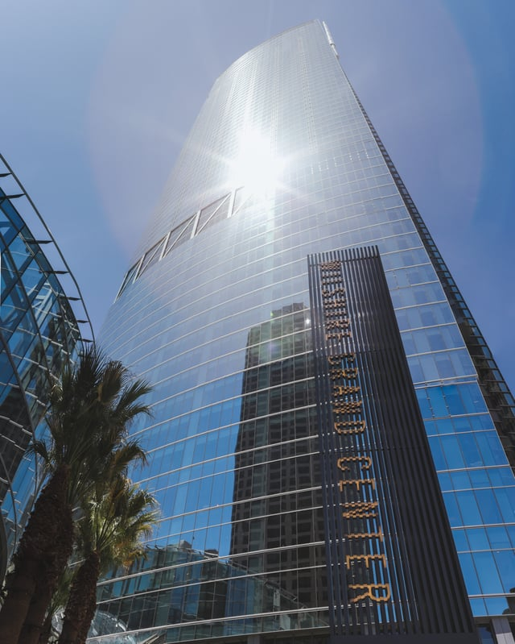
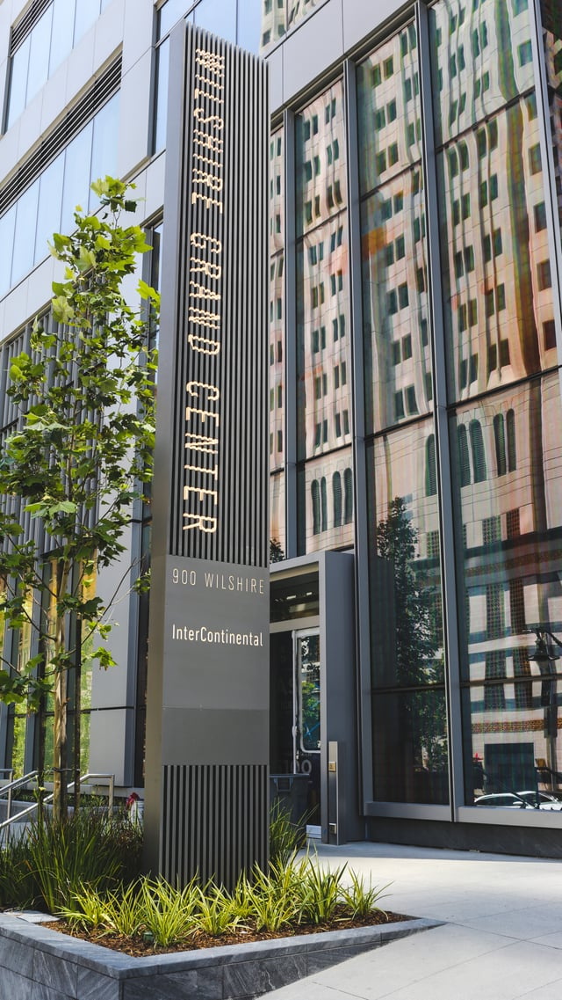

Now the tallest building west of the Mississippi River, Downtown Los Angeles’s Wilshire Grand Center obtained its temporary certificate of occupancy last week and the project is nearing completion after four years of construction. Burnham Nationwide’s Los Angeles office worked closely with the City of Los Angeles throughout the construction process and we are thrilled to have been a part of the team bringing the impressive new skyscraper to LA’s skyline.

Designed by AC Martin, owned by Korean Air, and built on the site of the demolished Wilshire Grand hotel, the finished tower will house 892 hotel rooms operated by InterContinental Hotels [opening](https://la.curbed.com/2017/6/20/15839770/wilshire-grand-intercontinental-hotel-opening) July 2nd, over 350,000 square feet of new office space in LA’s Financial District, and open-air rooftop bar on the [73rd floor](http://www.ladowntownnews.com/development/wilshire-grand-week-the--room-hotel-is-a-game/article_089e10be-5515-11e7-80e2-cb06e17b91a4.html) among other tenant amenities. Wilshire Grand will also a feature a [sky lobby](http://www.wilshiregrandcenter.com/design) on its 70th floor offering unparalleled views of Los Angeles for hotel guests along with a rooftop pool and fitness center. Adding the most [office space](http://www.ladowntownnews.com/news/as-the-wilshire-grand-opening-approaches-its-office-space-comes/article_e4ea5522-4260-11e7-8b27-abaa136dc367.html) to downtown Los Angeles than any development in the last two decades, the tower is a groundbreaking building for Los Angeles and the downtown market.

## Wilshire Grand Debuts a Host of Building Firsts

The Wilshire Grand’s construction features an 273-foot LED [spire](/final-review-blog/wilshire-grand-sets-the-standard-for-architectural-design-in-los-angeles/) in a significant departure from the architectural details defining the LA skyline. Downtown Los Angeles is home to mostly boxy, flat-topped towers due to a code requirement that all skyscrapers have a helipad for evacuation in case of emergency, however the Wilshire Grand’s design demonstrates sufficient fire safety requirements using different methods and received permission to proceed without this requirement.

Also featured is new large-scale, architecturally-integrated [lighting](http://www.ladowntownnews.com/development/wilshire-grand-week-the-man-who-built-the-billion-tower/article_5d213874-52d0-11e7-9b7e-8be31647ee47.html) that scales along the spines of the building, allowing the entire building to be illuminated or animated, which will be demonstrated during the tower's grand opening. By modernizing the tower’s design and aesthetics, construction of the Wilshire Grand ushers in a new era for Los Angeles architecture.

Also among its many firsts, the Wilshire Grand Tower is the first project to utilize [phased permitting](/final-review-blog/wilshire-grand-sets-the-standard-for-architectural-design-in-los-angeles/), known as the Parallel Design-Permitting Program, in the City of Los Angeles. Burnham facilitated and expedited permit submittals at the Los Angeles Department of Building Safety (LADBS) using their new phased program that reduces approval times by breaking down the review process into multiple permits issued for smaller scopes of work. Though each permit must receive full approval by the LADBS’s various departments, construction runs continuously once the first permit is pulled, and Burnham was able to use our experience with similar processes throughout the country to assist with piloting the program.

The Wilshire Grand Center [hosted](https://la.curbed.com/2017/6/23/15860186/wilshire-grand-tower-los-angeles-opening) its grand opening on June 23rd, 2017 and after watching the tower ascend to 1,100 feet, Burnham Nationwide is proud of have lent our expertise to this project and to have been a part of the hard work by the development, design, and construction teams that have brought Los Angeles its newest supertall.

<em>This post was last updated on July 6th, 2017.</em>
